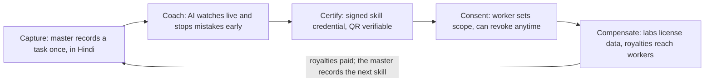
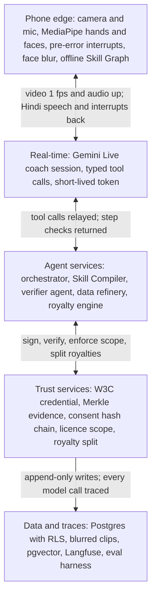

# BUILD 2036: The Winning Idea Blueprint

Nov 25, 2026 · @DHAANISH AHAMED B

## The verdict: build Parampara

**Parampara** (परम्परा, the master-to-apprentice lineage) is the idea to enter. One master's demonstration becomes three things: an AI coach that trains new workers live in Hindi, a verifiable skill credential, and robot-training data that the workers own and earn royalties on. File it under **Frontier 04, Manufacturing Renaissance**. It also covers skilling (Frontier 06) and verifiable trust layers (Frontier 03).

**One-liner for the jury:** "India's workers are already teaching the world's robots, for ₹250 an hour or a carton of Frooti. Parampara makes them the owners."

**The loop, five Cs:**

1. **Capture.** A master records a task once on a phone and narrates it in Hindi. Agents compile it into a structured Skill Graph and interview the master for the tacit "why" behind each step.
2. **Coach.** A trainee does the task under a live AI coach that watches through the phone camera, speaks Hindi and stops a mistake before it becomes a defect.
3. **Certify.** After enough unassisted correct runs, Parampara issues a signed, QR-verifiable Proof-of-Skill credential built from observed performance, not a written test.
4. **Consent.** Every clip carries a revocable, purpose-bound consent record. Faces are blurred on the phone. A no-surveillance clause bars using the data to rate individual workers.
5. **Compensate.** Consented sessions are refined into robot-learning datasets. Each time a lab licenses one, royalties flow back to the master and the trainees.

**Why it beats every other idea in this doc:**

- **It lands on the year's most-discussed labour story in India.** In 2026 India became a hub for "egocentric" robot-training video. Delhi garment workers who wore the cameras were [paid with a carton of Mango Frooti](https://m.thewire.in/article/labour/told-to-train-ai-models-indian-workers-fought-back). MeitY [convened platforms on consent](https://inc42.com/buzz/meity-reviews-house-help-platforms-data-collection-process-for-physical-ai-training/) on 12 November 2026. Judges have read these headlines. Nobody else in the room will turn them into a product.
- **It fixes two broken markets with one loop.** [82% of Indian employers](https://manpowergroup.co.in/global-talent-shortage-survey-india-report-2026.html) can't find skilled talent, and [only 4.2% of the workforce](https://www.mospi.gov.in/uploads/latestReleases/latest_release_1774607827733_3e8964a9-268b-4cc9-ad65-cfc8a9e32f08_Press_note_AR_PLFS_2025_23032025_V2.1_26032026_final.pdf) has formal vocational training. The same footage that trains a new worker is the most valuable kind of robot data: annotated, step-segmented and full of corrections.
- **The demo is physical, live and in Hindi.** A judge wires a terminal block on stage and the AI catches the live-neutral swap before they tighten it. Then the room scans the credential QR, and a royalty lands in the master's ledger. Every other finalist will demo a screen.
- **It is plainly a 2036 company.** Robot investors are in a frenzy: [Mecka raised $60M led by Sequoia](https://www.unite.ai/?p=481819) for human-motion data and [passed $100M run-rate](https://theaiinsider.tech/2026/10/08/mecka-raises-60m-in-series-b-funding-to-build-data-and-deployment-infrastructure-for-robots/). Parampara is India's answer to who owns that data.
- **It hits Madhya Pradesh where it hurts.** MP's flagship Seekho Kamao on-the-job training scheme was found full of [fake trainees and unverifiable training](https://theprint.in/india/governance/reality-check-for-mp-govts-mega-youth-skilling-dream-missing-companies-fake-trainees-missed-targets/2711328). Proof-of-Skill is the missing verification layer, and the summit's own sponsors (MP MSME Department, MPSEDC) own that problem.

**Blunt odds (judgement, not data):** if the full loop works live by 30 November, about **45% to make the top 10** and about **20% to win**. If the live coach is flaky on stage, the win odds fall below 10%, so everything in this plan protects that one moment. The earlier picks sat nearer 10 to 15% to win, because judges file them as "another collections app" or "a dashboard of Kaggle models".

## How BUILD 2036 is actually judged

You face three gates with different judges. Each one rewards something different, and the HackerRank loss shows what happens when you build for the wrong one.

| Gate | Dates | Who judges | What they reward |
| --- | --- | --- | --- |
| 1. Technical and product screening | 1 to 2 Dec | Hack2skill reviewers, very likely helped by AI triage | A working link with no login wall, real AI rather than mocked JSON, a clean repo, a readable architecture and an impact case |
| 2. Top-10 selection | 3 to 4 Dec | TiE jury and steering committee | A meaningful problem, real-world viability and a founder who could pitch to investors |
| 3. Grand finale | 14 Dec (awards 15 Dec) | Grand jury in Indore | Live demo, a story that sticks, a business, and the 2036 vision |

The [TiE hackathon page](https://tieglobalsummit.org/hackathon/) publishes no scoring weights. It asks for architecture, a code repo, a working demo link and an impact case, and for "a working AI prototype" with "real-world viability". Your uploaded snapshot of the initiative terms lists four unweighted criteria: **Impact, Creativity, Design and Execution**.

**Is an AI going to score you?** Nothing published says so for BUILD 2036. Hack2skill's sister events say yes, in part. Its Build with Gemini event runs "AI-assisted and manual idea screening", then a technical pre-screen and rubric scoring. Its AI for Bharat rules demand "meaningful use of AI, not rule-based logic alone" and work that is "substantially new". Its Solution Challenge asks whether "a simpler approach" could have worked ([Build with Gemini](http://hack2skill.com/event/buildwithgemini/), [AI for Bharat](https://hack2skill.com/event/ai-for-bharat), [Solution Challenge](https://hack2skill.com/event/solution-challenge-2026)). Assume an LLM reads your form text and README first and a human then clicks your link.

**What such a screener checks, and how Parampara answers it:**

- **Is it an agent or a script with an API call?** Parampara has a live tool-calling coach, a multi-agent Skill Compiler and a verifier agent, all visible in an on-screen agent trace.
- **Could a simpler approach work?** No. Watching hands in real time, understanding a Hindi narration and judging whether a wire is seated all need multimodal AI. Rules alone can't do any of them.
- **Is the AI real?** Every model call is traced in Langfuse, and a usage report with real call counts and costs ships in the repo.
- **Is it new work?** A fresh repo with steady commits inside the hackathon window, and a "Prior work" note.

### What the HackerRank Orchestrate loss teaches

You scored 28.2 of 30 on the output and 8.7 of 10 on the transcript, near the top of the field. You lost the win on two rubric slots you didn't build for: code architecture (9.6 of 30) and the AI interview (19.2 of 30). The lesson is to read the evaluator's rubric before writing code, then make every point it rewards visible.

| What cost you points in October | What you do differently here |
| --- | --- |
| A deterministic pipeline with zero LLM calls was read as "no agent" | The agent loop, tool schemas and handoffs are the product's spine and are shown live in the trace panel |
| One three-line prompt, no tool declarations | One prompt file per agent: role, constraints, refusal conditions and a JSON output schema; typed tool declarations |
| A usage report showing 0 calls and $0.00 | Real calls in every run, logged with tokens, latency and cost per session |
| Pre-baked answers in a static dictionary | Everything computed live from the judge's own camera, video or upload |
| A 1,900-line module with dataset IDs in core logic | Files under 300 lines, functions under 40, no demo constants in core code |
| Struggling to explain complex branches under live questioning | A DECISIONS.md log of every fork, the rejected alternative and the reason, rehearsed before 14 Dec |
| Your strengths: deterministic accuracy, strict TDD | Kept: deterministic checks become the verifier tools that stop the AI from saying "done" when it isn't |

The design rule from that post-mortem still holds: **agents perceive, reason and talk; deterministic tools measure and verify; a verifier signs off.** This time the agents sit on top, where the screener can see them.

## Why the three earlier ideas lose from the judge's chair

You were right about the first two. A judge sorts each pitch into a familiar category within about ten seconds. If that category is crowded, no feature list rescues it.

| Idea | What the judge files it as | The fatal problem | What to keep |
| --- | --- | --- | --- |
| **PRAAPTI** (MSME 45-day payment enforcement) | "A collections app", next to CredFlow, Khatabook and Vyapar | The hard part, the legal clock and interest maths, is deterministic, so the AI looks bolted on. No visual wow. Jury members who are buyers may feel the pitch is aimed at them. The 2036 story is just enforcing a 2006 law. | Deterministic maths under AI agents; human approval before any outbound action |
| **MSME Business Digital Twin** | "A cash-flow forecasting dashboard" | Tally, Zoho and bank apps already forecast. It runs on synthetic data, gives generic LLM advice and has no moat. The 2036 framing is decoration. | Nothing specific |
| **PramanOS** (CV defects, maintenance, CBAM, product passports) | "Six demos stapled together" | Breadth without depth. NEU-DET and AI4I are classic Kaggle datasets, and a technical reviewer spots them instantly. CBAM is real, but steel exports to the EU are a thin slice of Indore's economy. Its stack cites model names I could not verify. | W3C Verifiable Credentials with a QR tamper test (reused here for skills); the "zero-capex, phone-only" angle |

All three share one deeper flaw. They automate something a business already does. A winning BUILD 2036 entry creates something that **can't exist without 2026-era AI**, solves a problem the judges have **personally felt**, and gives them something to **do** on stage.

Parampara clears all three bars. Live multimodal agents that watch hands and speak Hindi only became practical this year: [Gemini 3.8 Live](https://docs.cloud.google.com/gemini-enterprise-agent-platform/models/gemini/3-8-live) went GA on 24 September 2026. Every TiE member who runs a factory or an IT services firm has trained new hires who then left. And the judge gets to wire a terminal block on stage.

## Every idea explored, scored

Parampara scores 54 of 60. The next best, a trust layer for AI agents, scores 46 and is the backup if you'd rather pitch infrastructure. Each idea is scored out of 10 on the four published criteria, plus jury fit and 2036 vision. Execution means how well a solo builder can ship it working, not how easy it is.

| Idea | Frontier | Impact | Creativity | Design and demo | Execution | Jury fit | 2036 | Total /60 | Why it isn't the pick |
| --- | --- | --- | --- | --- | --- | --- | --- | --- | --- |
| **Parampara**: capture, coach, certify, consent, compensate | 04 + 06 + 03 | 9 | 10 | 9 | 7 | 9 | 10 | **54** | The pick |
| Trust layer for AI agents: mandates, firewall and audit for agents that pay and act | 03 + 01 | 8 | 9 | 6 | 7 | 6 | 10 | 46 | Abstract on stage. NPCI, Google, Visa and Mastercard already build agent payment rails. Weak Indore link |
| Rules-as-code for India's business compliances | 03 + 06 | 8 | 8 | 5 | 6 | 7 | 8 | 42 | Hard to make visual. RegTech incumbents exist |
| Narmada pumping energy optimiser for Indore's water supply | 02 + 06 | 8 | 6 | 7 | 6 | 8 | 6 | 41 | Needs utility SCADA data you can't get. The demo is a simulation, and government sales are slow |
| PRAAPTI, MSME payment enforcement | 06 | 8 | 6 | 6 | 8 | 8 | 4 | 40 | "Collections app" (section above) |
| Scam and deepfake call shield (KAAVAL extended) | 03 | 8 | 6 | 7 | 8 | 5 | 6 | 40 | A crowded hackathon category. No sponsor fit |
| Voice agent that completes government forms for non-literate users | 01 + 06 | 8 | 5 | 7 | 8 | 6 | 6 | 40 | Already appearing among BUILD 2036 demos on YouTube |
| PramanOS factory OS | 04 | 7 | 6 | 8 | 5 | 6 | 7 | 39 | Too broad. Built on Kaggle datasets |
| EV battery second-life grading and battery passport | 02 | 7 | 7 | 5 | 6 | 5 | 8 | 38 | Lohum, Nunam and BatX exist. Needs real cell data |
| "Mock inspector" agent for pharma GMP compliance | 05 + 04 | 7 | 7 | 5 | 6 | 7 | 5 | 37 | Compliance software is dull on stage. Deep domain risk |
| MSME Business Digital Twin | 06 | 6 | 4 | 6 | 8 | 6 | 4 | 34 | "Dashboard" (section above) |

**How the winner was picked.** Each idea had to pass six tests a TiE judge applies without saying so:

1. Does it escape a crowded category in the first ten seconds?
2. Could it exist before 2026-era AI? It must not.
3. Have the judges felt this pain themselves?
4. Can a judge do something with it on stage?
5. Is there a company here that a VC would fund?
6. Does it tie to Indore and Madhya Pradesh without feeling forced?

Only Parampara passes all six. The scores are judgement calls; the tests behind them are what matter.

## The problem: India's hand skills are undertrained, unverified and being given away

Three failures meet in one place: the skilled hands of India's workers.

### 1. Factories can't train people fast enough

- Only 4.2% of Indians aged 15 to 59 have formal vocational or technical training ([PLFS 2025](https://www.mospi.gov.in/uploads/latestReleases/latest_release_1774607827733_3e8964a9-268b-4cc9-ad65-cfc8a9e32f08_Press_note_AR_PLFS_2025_23032025_V2.1_26032026_final.pdf)).
- 82% of Indian employers report difficulty finding skilled talent, well above the 72% global average ([ManpowerGroup 2026](https://cxotoday.com/media-coverage/talent-shortages-rise-to-82-in-india-in-2026-as-ai-skills-claim-top-spot/)).
- Garment operators need [30 to 60 days of training](https://www.fibre2fashion.com/industry-article/8607/submitArticleLink?amp=true), with high training cost and high attrition. In one Bengaluru garment factory, [36% of first-time workers quit within three months](https://kingcenter.stanford.edu/news/socialization-training-key-factor-retaining-first-time-women-workers). Every lost trainee is a training bill paid twice.
- Knowledge walks out with retiring masters. What a 30-year electrician knows about why a ferrule matters is rarely written down.

### 2. Skill credentials can't be trusted

Madhya Pradesh's Mukhyamantri Seekho Kamao Yojana pays youth ₹8,000 to ₹10,000 a month to learn on the job. In two years it trained 25,203 youths, about 12% of its target. It had "no online mechanism for districts to monitor training". In Damoh, half of the first 121 establishments checked broke the rules, often by enrolling family members as trainees ([ThePrint, Aug 2025](https://theprint.in/india/governance/reality-check-for-mp-govts-mega-youth-skilling-dream-missing-companies-fake-trainees-missed-targets/2711328)). The state's fix was geo-tagged attendance and an MPSEDC verification app. Attendance proves someone was there. It doesn't prove they learned anything.

### 3. Workers' skills are being harvested for robots, for almost nothing

- Robotics labs may need 100 million to 1 billion hours of first-person footage over two to three years, a spend estimated at $1.5 billion to $50 billion ([Scroll](https://scroll.in/article/1092960/how-big-tech-is-harnessing-the-data-of-indian-factory-workers-to-train-robots)).
- Packaged, annotated data sells for $15 to $50 an hour; raw footage fetches $1 to $10 ([Inc42](https://inc42.com/features/india-trains-the-worlds-robots-but-at-what-cost/)). Workers get $1 to $4 an hour ([TechCrunch](https://techcrunch.com/2026/05/26/human-archive-taps-into-indias-services-startups-to-collect-data-for-physical-ai/)), or nothing at all.
- At two Delhi garment factories, workers weren't told the purpose, consent was claimed but not taken, and pay was a carton of Mango Frooti. Workers pulled the cameras off and the trial was shelved ([The Wire](https://m.thewire.in/article/labour/told-to-train-ai-models-indian-workers-fought-back)).
- Indian players own almost none of the resulting models or IP. One Gurugram factory used the footage to benchmark worker productivity ([Inc42](https://inc42.com/features/india-trains-the-worlds-robots-but-at-what-cost/)).
- Workers are paid once. The data trains models for years ([Policy Circle](https://www.policycircle.org/opinion/ai-training-data-worker-ownership/)).

### Why now

| Shift | Date | Why it matters |
| --- | --- | --- |
| Gemini 3.8 Live goes GA: real-time video, audio and function calling in one session | 24 Sep 2026 | A phone can now coach a worker live. Not practical a year earlier ([Google Cloud](https://docs.cloud.google.com/gemini-enterprise-agent-platform/models/gemini/3-8-live)) |
| MeitY convenes platforms on worker consent for physical-AI data | 12 Nov 2026 | Government is looking for a responsible model ([Inc42](https://inc42.com/buzz/meity-reviews-house-help-platforms-data-collection-process-for-physical-ai-training/), [Lapaas](https://lapaasvoice.com/meity-examines-home-services-platforms-data-collection-for-physical-ai-training/)) |
| DPDP consent-manager framework takes effect | 13 Nov 2026 | Consent becomes a regulated artefact. Full DPDP duties follow on 13 May 2027 ([PIB](https://www.pib.gov.in/PressReleasePage.aspx?PRID=2336151)) |
| Robot-data investment boom | Oct 2026 | Mecka's $60M Series B shows the price of human-motion data ([Unite.AI](https://www.unite.ai/?p=481819)) |

### Why it matters in 2036

Morgan Stanley projects that over a billion humanoid robots could be in use by 2050 ([AFP via Khaleej Times](https://www.khaleejtimes.com/world/asia/india-workers-training-ai-robots-to-take-their-jobs)). The skills those robots learn are being recorded in Indian factories now. If nothing changes, India repeats the 1990s transcription story: cheapest labour, no ownership. NITI Aayog's roadmap for India's [490 million informal workers](https://niti.gov.in/sites/default/files/2025-10/Roadmap_On_AI_for_Inclusive_Societal_Development.pdf) already calls for AI that serves workers, through a proposed Mission Digital ShramSetu. Parampara is a working version of that idea.

### Who is affected, and the Indore angle

| Stakeholder | Their pain today | What Parampara gives them |
| --- | --- | --- |
| Masters (senior operators, electricians, tailors) | Their know-how leaves with them; no credit for teaching | Royalties every time their demonstration is licensed; recognition as the skill's author |
| Trainees and Seekho Kamao youth | Slow, uneven training; certificates employers don't trust | Live coaching in Hindi; a credential built from observed performance |
| MSME factory owners (Indore garments, Pithampur auto and engineering, pharma) | Training costs, attrition, defects from new hires | Faster time to competency, fewer errors, a verified skill matrix |
| MP MSME Department, MPSEDC, Skill Development Directorate | Can't verify on-the-job training; fraud | Machine-verifiable proof of skill for every stipend rupee |
| Robotics and AI labs | Need consented, annotated, high-quality data | Step-segmented, consent-cleared, provenance-proven datasets |

Indore's readymade garment cluster alone had about 1,475 functional units in a Ministry of MSME district profile ([DCMSME](https://dcmsme.gov.in/dips/2016-17/Indore.pdf); an older document, so treat it as scale, not a current count). MP Power Generating Company is offering 559 Seekho Kamao positions this year ([Indian Masterminds](https://indianmasterminds.com/news/mp-seekho-kamao-yojana-559-training-positions-237046/)). That is why the demo skill is electrical terminal wiring.

## The solution: one loop, six modules, eight innovations

Parampara is a phone-first platform. A factory installs nothing but a web app and a ₹300 phone mount. Every module below ships working, and each carries at least one idea the judges won't have seen.



Each stage feeds the next, and royalties close the loop back to the master who recorded the skill.

### Module 1: Skill Compiler (Capture)

The master records the task once, one to three minutes on a phone, talking through it in Hindi or Hinglish. A team of agents turns that into an executable **Skill Graph**:

- **Segmenter agent** reads the video and narration and splits it into timestamped steps.
- **Predicate writer agent** turns each step into checkable success conditions: what must be visible, where, in what order. It also lists reference keyframes, common errors and hazards.
- **Tacit interviewer agent** asks the master three to five voice questions: "Why the ferrule?", "How do you know it's tight enough?", "What do beginners get wrong here?" The answers become coaching tips. This captures the knowledge that never makes it into an SOP.
- **SOP writer agent** produces a bilingual skill card (Hindi and English).
- **Critic agent** rejects the graph if any step lacks a checkable condition, and sends the gaps back for a fix.

A supervisor reviews and approves. The master signs the Skill Graph as its author, and it is versioned. **Innovation 1:** one narrated demonstration becomes a full coaching programme, with no instructional designer involved.

### Module 2: Live Ustaad Coach (Coach)

The trainee props the phone on a stand and starts. A Gemini Live session watches the camera at about one frame a second and talks in Hindi. It works through typed tools: `get_current_step`, `request_step_check`, `raise_risk`, `give_hint`, `log_question`. On the phone itself, MediaPipe tracks both hands and detects coloured objects many times a second, so dangerous moves are caught between the AI's frames.

- **Innovation 2: pre-error interrupts.** On-device detectors spot a mistake forming, such as the red wire moving towards the neutral terminal. The coach says "Ruko" before the screw is tightened. Catching the error before it happens is the moment judges remember.
- **Innovation 3: two-key verification.** The coach can't mark a step done on its own. A step completes only when (a) the on-device signals agree and (b) a separate verifier model, given a high-resolution frame, the reference keyframe and the step's predicates, agrees too. If they disagree, the coach asks the trainee to hold the part up to the camera. This is your HackerRank lesson turned into product: the agent reasons, deterministic tools measure, a verifier signs.
- **Innovation 4: fading scaffolds.** A Bayesian Knowledge Tracing model estimates mastery of each step. Guidance fades from full instructions to hints to silent watching to exam mode, the way a good ustaad backs off.

### Module 3: Proof-of-Skill (Certify)

After a set number of unassisted, error-free runs and a supervisor co-sign, Parampara issues a **W3C Verifiable Credential**. It records the skill and version, the master lineage, run statistics and a Merkle root of the evidence clip hashes. The clips stay private; the hashes prove them. Anyone can scan the QR code to verify it, and a tamper test shows verification failing if one byte changes. **Innovation 5:** a credential built from observed performance at step level, not from attendance or a written test. For Seekho Kamao, stipend milestones can be tied to verified skills rather than geo-tagged attendance.

### Module 4: Consent Wallet (Consent)

Before any recording is shared, the worker hears a Hindi explanation and answers one comprehension question. Then they choose a scope: my factory's training only; other Indian employers' training; non-commercial robotics research; or commercial robotics licensing. They also choose a duration, and they can revoke at any time. Revocation stops future use; Parampara says plainly that a model already trained can't unlearn.

- Faces and bystanders are blurred on the phone before upload.
- Every consent record is written to a hash-chained, append-only ledger, with fields shaped for the DPDP consent-manager model.
- **Innovation 6: purpose-bound licences.** Every licence carries a no-surveillance clause: the data can't be used to score individual workers' productivity. That is exactly the misuse reported in Gurugram. Buyers get only the scopes their licence allows, with a per-buyer watermark.

### Module 5: Data Refinery and Royalty Engine (Compensate)

- **Refinery.** Consented sessions become LeRobotDataset v3.0 episodes, the open format robot labs use ([Hugging Face docs](https://huggingface.co/docs/lerobot/lerobot-dataset-v3)). Each episode holds the video, per-frame hand keypoints, a task string, step segments, a success flag and quality scores. **Innovation 7: correction data for free.** Every coaching session produces labelled mistakes and labelled recoveries, the failure-and-correction data robot learning needs and raw footage lacks. It moves the data from the $1 to $10 raw tier towards the $15 to $50 annotated tier.
- **Royalty engine.** When a lab licenses a dataset, the event is logged and revenue is split by contribution: the master's demonstration, trainees' runs and the reviewer's checks. Payouts go out over UPI (Razorpay payouts, test mode in the demo). **Innovation 8: lineage royalties.** If a trainee becomes a master and records a variant, the original master keeps a share, as a guru does in a real parampara.

### Module 6: Factory Command Centre

The owner sees a live skill matrix, time to competency for each skill, and **mistake hotspots**: the steps where trainees fail most, which point to a bad SOP or a missing fixture. The dashboard also verifies credentials and shows the workforce's data earnings.

### Innovations against the closest existing products

| Innovation | Closest existing | What Parampara does differently |
| --- | --- | --- |
| Skill Compiler with tacit interview | [Retrocausal](https://www.newequipment.com/industry-trends/article/21278622/increased-demand-for-generative-ai-manufacturing-assembly-platform-raises-53m) (US assembly copilots), manual SOP authoring | One narrated video becomes the whole programme, including the "why" |
| Live Hindi coach, pre-error interrupts, two-key verification | Retrocausal Pathfinder (fixed cameras on US lines); [Skyljo](https://www.tribuneindia.com/news/business/skyljo-unveils-indias-first-camera-based-ai-platform-for-blue-collar-skill-assessment-at-ai-impact-summit-2026/) (camera assessment, India) | Phone-only, speaks Hindi, coaches rather than only scoring; the LLM can't mark a step done alone |
| Proof-of-Skill credential | [Skill India Digital Hub](https://en.vikaspedia.in/education/professional-courses/skill-india-digital) certificates (proof of course completion) | Step-level performance evidence, cryptographically verifiable |
| Purpose-bound consent ledger | Egolab, Human Archive (consent taken from factory management) | Per worker, per clip, revocable, with a no-surveillance clause |
| Correction-rich robot data | [Mecka](https://www.unite.ai/?p=481819), Objectways, [FirstlyLabs](https://huggingface.co/datasets/FirstlyLabs/Firstly-household-v01) | Mistakes and recoveries labelled as a by-product of coaching; workers own the data |
| Lineage royalties | [Karya](https://www.policycircle.org/opinion/ai-training-data-worker-ownership/) (royalties on resold speech data) | Royalties follow the master-to-apprentice lineage |

I found no product that joins capture, coaching, certification, consent and compensation in one loop. That gap is the pitch.

## The live demo: five moments judges will remember

The demo skill is **wiring a three-way terminal block on a DIN rail**. It is short, visual, has a dangerous classic mistake, and matches real MP training demand. The colours are whatever the master uses in his recording, for example red phase, black neutral, green earth. The bench is never powered.

**Props (under ₹2,000):** a DIN rail with three screw terminals, three pre-stripped coloured wires, ferrules, a screwdriver, two phones (trainee and "master") and a phone stand. Bring a spare set.

1. **"Compiled in under a minute."** Play the 60-second recording of Rameshji, a senior electrician, narrating in Hindi. Press Compile. On the big screen the agent trace streams: steps appear, then their success checks, then a hazard flag on the phase terminal. The tacit interviewer's question pops up ("Ferrule kyon lagaate hain?") with his recorded answer.
2. **"Ruko!"** Invite a judge to wire the block with the coach. Have them deliberately put the phase wire into the neutral terminal. The coach interrupts in Hindi before they tighten the screw and explains why. They fix it. The two-key panel shows both checks turning green, step by step.
3. **"Scan it yourself."** The run completes and a Proof-of-Skill credential appears with a large QR code. Judges scan it from their seats and see a green verified badge. Press "Tamper test" and it turns red.
4. **"Your hands, your data."** On the master's phone, show the Hindi consent card, the blurred-face preview and the licence choices. Open the robot-data viewer: the episode with hand skeletons drawn over the video, and the mistake-and-recovery segment from the judge's run highlighted.
5. **"Teach once, earn forever."** A test robotics-lab account licenses the dataset. The royalty ledger splits it between Rameshji, the trainees and the reviewer, and a UPI test payout shows on his phone. Close on the factory dashboard: time to competency and the mistake hotspot on step 3.

**What can go wrong, and the backup for each:**

- **Venue Wi-Fi fails.** Run on your own phone hotspot. Keep an offline mode where on-device detectors and a cached Skill Graph give scripted Hindi warnings without the cloud.
- **Live model latency spikes.** The pre-error interrupt is on-device, so the "Ruko" moment never waits for the cloud.
- **The volunteer gets everything right.** Ask for the deliberate mistake up front. If they refuse, do the swap yourself.
- **Everything fails.** A recorded 2-minute run of the same flow, on a USB stick and in the cloud.

Rehearse it ten times on a hotspot, including twice with a stranger as the trainee.

## System architecture

The architecture has five layers. Agents perceive and reason. Deterministic tools measure and enforce. A verifier signs off before anything counts. Every model call is traced.



The phone catches dangerous moves locally, the Live coach reasons in the cloud, and every step, credential and payout passes through deterministic trust services before it is stored.

### The five layers

1. **Edge, on the phone (Next.js PWA).** Camera and mic capture; MediaPipe hand, face and object detection running on the device; pre-error detectors; face and bystander blur; a cached Skill Graph for offline mode.
2. **Real-time session.** A Gemini Live WebSocket session, opened with a short-lived token from the backend so no API key reaches the phone. It streams video at about 1 frame per second plus audio, and makes tool calls the client relays to the backend.
3. **Agent services (Python FastAPI).** The Skill Compiler graph, the verifier agent, the data refinery and the royalty engine, run by an orchestrator with handoffs, iteration caps, retries with backoff and model routing.
4. **Trust services (deterministic).** Credential signing and verification, Merkle evidence roots, a hash-chained consent ledger, licence-scope enforcement and royalty-split maths.
5. **Data and observability.** Postgres with row-level security, object storage for blurred clips, pgvector for the skill library, and Langfuse for traces, cost and evals.

### Agent roster

| Agent | Model (verify IDs on the day) | Tools it calls | Output | Guardrail |
| --- | --- | --- | --- | --- |
| Segmenter | `gemini-3.5-flash` | none (structured output) | Timestamped steps | JSON schema validation |
| Predicate writer | `gemini-3.5-flash` | `extract_keyframe`, `colour_profile` | Success checks, errors and hazards per step | Critic review loop |
| Tacit interviewer | `gemini-3.8-live` | `save_tip` | Coaching tips in the master's words | At most 5 questions |
| SOP writer | `gemini-3.5-flash-lite` | `translate` | Bilingual skill card | Glossary of fixed terms |
| Critic | `gemini-3.5-flash` | `schema_check`, `predicate_lint` | Pass, or a list of fixes | At most 3 revision rounds |
| Live coach | `gemini-3.8-live` | `get_current_step`, `request_step_check`, `raise_risk`, `give_hint`, `log_question` | Hindi speech and step events | Can't mark a step done; stays on the skill; refuses live-electrical advice |
| Verifier | `gemini-3.5-flash` | `compare_keyframes`, `read_edge_signals` | Pass or fail, with the evidence frame | Edge signals must agree |
| Refinery | `gemini-3.5-flash-lite` | `align_segments`, `score_quality` | LeRobot episodes and a data card | Consent scope checked before every export |

Model facts: [Gemini 3.8 Live](https://docs.cloud.google.com/gemini-enterprise-agent-platform/models/gemini/3-8-live) is GA with video input and function calling. [Gemini 3.5 Flash](https://docs.cloud.google.com/gemini-enterprise-agent-platform/models/gemini/3-5-flash) is GA and takes video input; Roboflow lists it at [$1.50 per million input tokens and $9.00 per million output](https://playground.roboflow.com/models/google/gemini-3-5-flash). Keep a provider interface so Sarvam's Indic speech models can be swapped in as the sovereign option.

### Deterministic tools (no LLM inside)

Hand-in-zone and colour-at-terminal tests, dwell timers, the Bayesian Knowledge Tracing update, Ed25519 credential signing (W3C Data Integrity, `eddsa-jcs-2022`), Merkle roots, the consent hash chain, scope enforcement, royalty splits and the LeRobot writer. Each one has unit tests. These are what stop the agents from hallucinating progress or leaking data.

### Core data model

`orgs`, `workers`, `skills` (version, author, lineage parent), `skill_steps`, `sessions`, `step_events`, `evidence_clips` (hash, blur status, consent id), `consent_records` (scope, purpose, expiry, revoked\_at, prev\_hash, hash), `credentials`, `datasets`, `licences` (buyer, scope, terms), `royalty_events`, `payouts`.

### The happy path

1. The master records a clip and the Skill Compiler builds and checks the graph. A supervisor approves it.
2. The trainee starts a session and the coach loads that graph.
3. Edge signals and coach tool calls produce step events. The verifier confirms each step.
4. The knowledge-tracing model updates mastery. At the threshold, the credential service issues a VC.
5. The worker sets consent and the blurred clips are sealed into the ledger.
6. The refinery exports LeRobot episodes for consented scopes only.
7. A licence event triggers royalty splits and UPI payouts.

### Security basics

Short-lived tokens for the Live session. Secrets only on the server. Row-level security for each org. Signed, expiring URLs for clips. Credentials hold hashes, never video.

## Tech stack

Every choice favours your existing strengths (Next.js, FastAPI, LangGraph, Supabase, Langfuse), plus the few new pieces this idea needs.

| Layer | Choice | Why |
| --- | --- | --- |
| Phone and web app | Next.js, TypeScript, Tailwind, Framer Motion, installable PWA | One codebase for the trainee phone, master capture and factory dashboard. Judges open a link, nothing to install |
| On-device vision | MediaPipe Tasks for Web: Hand Landmarker, Face Detector, Object Detector (WASM or WebGPU) | Many frames a second, free, private. Faces are blurred before any upload. Powers the pre-error interrupts |
| Real-time coach | Gemini Live API, `gemini-3.8-live`, over WebSocket with short-lived tokens | Video, audio and function calling in one session, with multilingual speech ([docs](https://ai.google.dev/gemini-api/docs/models/gemini-3.8-live)) |
| Reasoning and vision agents | `gemini-3.5-flash` for video understanding and verification; `gemini-3.5-flash-lite` for cheap sub-tasks | Model routing by cost and difficulty, a point AI screeners look for |
| Indic speech option | Sarvam STT and TTS behind a provider interface | Sovereign-AI talking point; fallback if Live audio struggles with Malwi or code-mixed Hindi |
| Agent orchestration | LangGraph on FastAPI (Python 3.12), Postgres checkpointer, interrupt nodes for supervisor approval | Visible graph of agents and handoffs, with durable state and human-in-the-loop steps |
| Data | Supabase: Postgres with row-level security, storage, pgvector | One managed service you already know |
| Credentials | W3C VC Data Model 2.0, Data Integrity `eddsa-jcs-2022`, Ed25519 (PyNaCl), `did:web` issuers, QR via `qrcode.react` | Standards-based, verifiable in any browser, no blockchain fees |
| Ledger | Append-only Postgres table, SHA-256 hash chain, Merkle roots per session | Tamper-evident without a chain. Easy to explain to a judge |
| Robot data | Hugging Face `lerobot` library, LeRobotDataset v3.0 | The format robot labs already train on ([docs](https://huggingface.co/docs/lerobot/lerobot-dataset-v3)) |
| Payouts | Razorpay Payouts in test mode (UPI) | Real API, real ledger entries, no real money moves during judging |
| Observability and evals | Langfuse traces, cost, latency and scores; an eval harness over recorded runs | Proof the AI is real and measured. Fixes the October "0 calls" mistake |
| Testing | pytest (tools, ledger, credentials, royalties), Playwright (one end-to-end coached run) | Engineering rigour a reviewer can see |
| Hosting | Vercel (web), Cloud Run in `asia-south1` (API), Supabase in Mumbai | Stable links through 1 to 15 December. Data residency in India |

**Hardware you need:** your Mac, one mid-range Android phone and one iPhone or second Android for the two-phone demo, a phone stand and the terminal-block kit. Nothing else.

## Feature scope

The submission must carry the whole loop working end to end. Screeners on 1 to 2 December judge what they can click, so a working thin loop beats a beautiful half. The finale list deepens and polishes. The last list is honestly later, and the demo never depends on it.

### Must ship by 30 November (submission)

- [ ] Master capture: record or upload a clip; the Skill Compiler builds steps, checks, hazards and a bilingual card; a supervisor edits and approves
- [ ] Tacit interviewer: at least three voice questions, with the answers attached as tips
- [ ] Live coach on a phone browser: Gemini Live session, Hindi speech, typed tools, step tracking
- [ ] On-device MediaPipe hand and colour detection, with a pre-error interrupt for the wrong-terminal mistake
- [ ] Two-key verifier, with an evidence panel in the UI
- [ ] Knowledge-tracing mastery with fading guidance, at least full mode and hint mode
- [ ] Proof-of-Skill credential: issue, QR, public `/verify` page, tamper test
- [ ] Consent wallet: Hindi consent card, four scopes, revoke, on-device face blur, hash-chained ledger
- [ ] Refinery: export one consented session as a valid LeRobotDataset v3.0 episode, with a viewer showing hand keypoints
- [ ] Royalty engine: test lab account, licence event, split, Razorpay test payout, worker earnings screen
- [ ] Factory dashboard: skill matrix, time to competency, mistake hotspots
- [ ] Agent trace panel in the UI; Langfuse wired up; `USAGE.md` with real call counts and costs
- [ ] Eval report: at least 30 recorded runs (correct runs plus five mistake types), with mistake-detection recall, false alarms and latency
- [ ] Seeded demo org and "Try as judge" login on the landing page; README, architecture diagram, impact case, 2 to 3 minute video

### Must ship by 14 December (finale)

- [ ] Two more skills to prove it generalises: a shirt fold-and-pack to export spec (garment cluster, and a classic robot benchmark task) and one packaging or gowning step for pharma
- [ ] Lineage royalties across skill versions
- [ ] Full offline coaching mode for poor connectivity
- [ ] Credential share on WhatsApp, plus an export shaped for Skill India Digital Hub and DigiLocker
- [ ] Buyer data room with purpose-bound licence terms and per-buyer watermarks
- [ ] A real pilot: one Indore or Pithampur unit, five or more workers, before-and-after numbers, a letter of intent
- [ ] Rehearsed DECISIONS.md and a Q&A sheet

### Honestly later (say "roadmap" on stage)

- Smart-glasses capture, depth and IMU sensors
- Signed data deals with robotics labs
- Registering as a DPDP consent manager, which needs a ₹2 crore net worth ([PIB](https://www.pib.gov.in/PressReleasePage.aspx?PRID=2336151)), or partnering with a registered one
- Official SIDH and DigiLocker issuer integration
- Multi-camera views, force and tactile gloves

**Cut order if the 30 November deadline bites:** cut the SOP translation polish first, then the dashboard styling, then lineage maths. Never cut the live coach, the pre-error interrupt, the two-key verifier, the credential QR or the consent ledger. Those five are the demo.

## Impact case, business model and moat

Parampara earns from training first and data second. That order matters: robot-data prices are volatile, and training value is not.

### Impact case (every number here is an assumption until the pilot measures it)

| Outcome | How it's measured | Illustrative estimate |
| --- | --- | --- |
| Faster time to competency | Days from first session to credential, against the factory's current baseline | Garment operators take 30 to 60 days today. A 30% cut on a 45-day average saves about 13 days per trainee. A factory training 100 people a year saves about 1,350 trainee-days |
| Fewer new-hire defects | First-pass yield of credentialed against non-credentialed workers | Measure in the pilot. Retrocausal's vendor claim of [25% higher first-time yield](https://www.newequipment.com/industry-trends/article/21278622/increased-demand-for-generative-ai-manufacturing-assembly-platform-raises-53m) is a ceiling, not a promise |
| Trustworthy skilling spend | Share of stipend milestones backed by a verified credential | Seekho Kamao has a ₹1,000 crore budget, and half of the first establishments checked in Damoh broke the rules ([ThePrint](https://theprint.in/india/governance/reality-check-for-mp-govts-mega-youth-skilling-dream-missing-companies-fake-trainees-missed-targets/2711328)) |
| Worker income from data | Royalties paid per recorded hour, against the ₹250 to ₹400 one-off rate | If an annotated hour licenses at $20 to three buyers in a year, with 60% to workers, that is about $36 (roughly ₹3,000) per hour of footage, repeatable. Prices fell 30% in early 2026 ([Inc42](https://inc42.com/features/india-trains-the-worlds-robots-but-at-what-cost/)), so model the downside too |

At national scale the story is simple. Every one of India's 490 million informal workers carries skills that are untrained, uncredentialed and unpriced. Parampara gives each skill an author, a verified learner and a price.

### Business model

1. **Factory SaaS.** Priced per active trainee per month, with a credential fee per certified worker. A starting point to test is ₹499 per trainee-month, sized well below the cost of one wasted training day.
2. **Government outcome contracts.** States and schemes pay per verified skill credential: Seekho Kamao in MP, then PMKVY-style programmes elsewhere.
3. **Data licensing.** Parampara takes a minority share of licence revenue, and the majority goes to workers. A starting split to test is 65% to workers, 10% to the factory and 25% to Parampara.
4. **Verification API.** Employers and staffing firms pay a small fee per credential check.

**AI cost discipline:** Langfuse logs the cost of every coached session. Target AI cost under 10% of the price of a trainee-month, and publish the measured figure in `USAGE.md`.

### Market signals investors will recognise

- Robot-data spend estimated at $1.5 billion to $50 billion over two to three years ([Scroll](https://scroll.in/article/1092960/how-big-tech-is-harnessing-the-data-of-indian-factory-workers-to-train-robots)).
- Mecka passed $100M run-rate in June 2026 and raised $60M led by Sequoia ([The AI Insider](https://theaiinsider.tech/2026/10/08/mecka-raises-60m-in-series-b-funding-to-build-data-and-deployment-infrastructure-for-robots/)). XDOF was reported near a $1.2B valuation ([TechJuice](https://www.techjuice.pk/?p=257010)).
- Worker copilots are being funded too: NavigateAI launched with a [$25M seed](https://dealroom.co/news/133440-navigateai-launches-with-25m-seed-to-build-an-ai-copilot-for-constructio/) for a construction-worker copilot.

### Why it stays defensible

- **A data flywheel.** Every coached session adds labelled mistakes and recoveries that no camera-only collector has.
- **Trust as the moat.** Workers will choose the platform that pays royalties and respects consent. Regulators examining this market will prefer it too.
- **The lineage graph.** The more masters and versions, the more valuable the library, and the harder it is to copy.
- **MSME-grade cost.** Phone-only, Hindi-first, no fixed cameras. Retrocausal-style systems are built for large OEM lines.

### Go-to-market, starting in Indore

1. **December to February:** pilots at two units via TiE Indore introductions, one garment and one Pithampur engineering or electrical unit.
2. **February to April:** an ITI and Seekho Kamao establishment pilot, then a verification proposal to the MP Skill Development Directorate and MPSEDC.
3. **From April:** the first non-exclusive data licence with a robotics lab, under purpose-bound terms.

## Risks, responsible AI and worker privacy

The hardest question you will get is "aren't you helping robots take these jobs?" Answer it head-on: the recording is already happening, for ₹250 an hour or a Frooti. Parampara makes the worker the owner, pays them every time, and uses the same footage to move them up to better-paid work now.

| Risk | Mitigation |
| --- | --- |
| The coach makes a wrong call, or misses an unsafe step | Two-key verification. On-device interrupts for known hazards. A supervisor co-signs every credential. Unpowered benches only during training |
| Recording becomes worker surveillance | The no-surveillance clause in every licence. No individual productivity scores anywhere in the product. Workers see and control every clip |
| Consent that isn't really understood | Hindi voice explanation, one comprehension question, scopes in plain words, revocation one tap away |
| Bystanders and faces in the footage | On-device blur before upload; recording only inside the work zone; audio name-scrubbing as an option |
| Revocation can't undo training | Said plainly on the consent card: revocation stops future licences and exports; models already trained keep what they learned |
| Robot-data prices collapse (down 30% in early 2026) or synthetic data replaces it | Training SaaS is the core revenue; data is upside. Correction-rich data holds value better than raw footage |
| Live API latency or outages on stage | On-device interrupts, offline mode, hotspot, recorded backup |
| Bias against accents, left-handed workers or women's PPE | Eval set recorded across speakers and hands; results by group in the eval report |
| Misread as a deepfake or identity tool | No face recognition; workers are identified by account, not biometrics |

### DPDP and the law

- The consent-manager framework took effect on 13 November 2026, and most DPDP duties start on 13 May 2027 ([PIB](https://www.pib.gov.in/PressReleasePage.aspx?PRID=2336151), [Swarajya](https://swarajyamag.com/tech/india-launches-registration-for-consent-managers-under-new-data-protection-rules)). Build to the May 2027 standard now: notice, purpose limits, security, breach handling, retention and erasure.
- DPDP lets employers process worker data for employment purposes without consent, but legal experts argue that cross-factory benchmarking goes beyond that ([Inc42](https://inc42.com/features/india-trains-the-worlds-robots-but-at-what-cost/)). Parampara asks for explicit consent anyway, and that is the selling point.
- Credentials carry hashes and statistics, never video. Data minimisation by design.
- This is not legal advice. Get a lawyer's read before the first commercial data licence.

### The hackathon's own terms

Your uploaded snapshot of the initiative terms gives the organiser a six-month right of first refusal on any exclusive licence or acquisition of what you submit. If Parampara becomes a company, that clause matters. Keep the hackathon repo clean and original, and email support before you sign anything with an investor.

## Submission package, tuned for AI and human screeners

Use the same name, frontier, one-liner and three headline numbers in the form, README, deck and video. An AI screener checks consistency, and a human remembers it.

| Asked for | What you submit |
| --- | --- |
| Working prototype and demo link | A public URL that opens on a landing page with "Try as judge" (no sign-up), a seeded Indore factory, and a 60-second "how to test" with the props-free mode (upload the sample trainee video if there's no terminal block to hand) |
| Architecture | `docs/architecture.png` plus `docs/ARCHITECTURE.md`, also embedded in the README |
| Code repository | Public GitHub repo, steady commits from 25 November, tests, `.env.example`, MIT or Apache licence, a "Prior work" note |
| Impact case | `docs/IMPACT.md` and a PDF: problem data with sources, assumptions, pilot metrics, business model |
| Likely extras | A 2 to 3 minute video, a 10-slide deck PDF, and a LinkedIn build post tagging TiE Global Summit and Hack2skill |

### Repository layout

```text
parampara/
  apps/web/            Next.js PWA: capture, coach, wallet, verify, dashboard
  apps/web/edge/       MediaPipe detectors, pre-error rules, face blur
  services/api/        FastAPI routes, auth, Live token minting
  agents/              one folder per agent: prompt.md, tools.py, graph.py
  agents/orchestrator/ LangGraph graph, routing, retries, iteration caps
  tools/               deterministic tools: zones, BKT, VC, Merkle, ledger, royalties
  refinery/            LeRobotDataset v3.0 writer and data card
  evals/               recorded runs, labels, eval harness, EVAL_REPORT.md
  tests/               pytest and Playwright
  docs/                ARCHITECTURE.md, IMPACT.md, DECISIONS.md, USAGE.md, PRIVACY.md
```

### README, in this order

1. One line, a GIF of the "Ruko" moment, and the live link with judge login.
2. The problem in three numbers, with sources.
3. What it does: the five Cs, one sentence each.
4. **Why AI, and why not rules alone:** what each agent does and what the deterministic tools do.
5. The architecture diagram and agent roster.
6. Measured results: eval recall, false alarms, latency, cost per session.
7. Responsible AI and consent design.
8. How to run it locally, and how to test it in 60 seconds.
9. Frontier, 2036 vision, roadmap, prior work.

### Code-judge hygiene, from October

- Every agent has a prompt file with a role, constraints, refusal conditions and a JSON output schema.
- Every tool has a typed declaration and returns structured errors.
- Real model calls in every run, with the numbers in `USAGE.md`.
- Files under 300 lines, functions under 40, type hints, secrets only in env.
- No demo-specific IDs in core code; seed data lives in `seed/`.

## Build plan, finale preparation and the pitch

To be blunt: this is about three weeks of normal work squeezed into five days. It is only possible with Claude Code doing most of the typing while you integrate and test ruthlessly. You also have another submission due on 30 November. Decide tonight which one gets 26 to 29 November, because splitting the days will sink both.

### Solo build sprint, day by day

1. **25 Nov (tonight).** Register solo and email support (questions at the end of this doc). Scaffold the repo and the Supabase schema, set up the Gemini keys, and get MediaPipe hands running on your phone. Buy the terminal-block kit. Record the master clip and ten trainee clips.
2. **26 Nov.** The live coach end to end: token minting, Live session, typed tools, a hand-written Skill Graph, and the wrong-terminal pre-error interrupt. If this works by midnight, the project works.
3. **27 Nov.** Skill Compiler agents (segmenter, predicate writer, critic, SOP writer), supervisor approval and a basic tacit interviewer. Add the two-key verifier.
4. **28 Nov.** Knowledge tracing with fading guidance; credential issue, verify and tamper test; consent wallet, face blur and ledger.
5. **29 Nov.** LeRobot export and viewer; royalty engine and test payout; dashboard; agent trace panel; Langfuse. Record the 30 eval runs.
6. **30 Nov.** Eval report, README, architecture, impact case and video. Deploy, test on mobile data from a second phone, and **submit by 12:00 IST**. Freeze the main branch.

### From screening to the stage

- **1 to 4 Dec:** keep the link stable. Fix bugs only on a branch, and deploy only if a fix is safe.
- **5 Dec:** the top 10 are announced. **7 Dec:** at the virtual induction, ask about pitch length, demo setup, screen and Wi-Fi, and whether 13 December attendance is required.
- **5 to 12 Dec:** build the finale list. Run a real pilot where you can reach one: a Chennai ITI or electrical training centre this week, plus a TiE-introduced Indore unit lined up for January. Say exactly that on stage.
- **12 to 13 Dec:** travel to Indore. Rehearse ten times, twice with a stranger as the trainee.
- **14 Dec:** demo day. **15 Dec:** main stage and the 2036 Capsule.

### The 5-minute pitch

1. **0:00 to 0:40, the hook.** "In April, garment workers near Delhi wore cameras on their heads for two weeks. Their hand movements were sent abroad to train robots. Their pay was a carton of Mango Frooti. Meanwhile 82% of Indian employers can't find skilled workers. Parampara fixes both with one loop."
2. **0:40 to 1:20, Capture.** Compile Rameshji's clip live and show the agent trace.
3. **1:20 to 2:40, Coach.** The judge wires the block. "Ruko!" The fix. The two-key panel.
4. **2:40 to 3:10, Certify.** The room scans the QR, then the tamper test.
5. **3:10 to 3:50, Consent and Compensate.** The consent card, the robot-data viewer, and the royalty landing on Rameshji's phone.
6. **3:50 to 4:30, the business.** Factory SaaS, government outcome contracts, data licensing; the pilot; Seekho Kamao verification for MP.
7. **4:30 to 5:00, 2036.** "By 2036, robots will have learned from Indian hands. Parampara makes sure Indian hands own that knowledge, and get paid for it."

Keep 3-minute and 8-minute cuts ready, since the format isn't published.

### Questions the jury will ask, and your answers

- **"Aren't you helping robots take these jobs?"** The recording already happens, for a Frooti. We make workers owners, pay them every time, and use the same footage to upskill them into better roles now.
- **"Why won't Retrocausal or Mecka do this?"** Retrocausal sells fixed-camera copilots to large OEM lines; Mecka buys data. Neither starts from the worker, speaks Hindi on a ₹10,000 phone, or pays royalties. Trust is the wedge.
- **"How accurate is the coach?"** Quote your eval: recall on the five mistake types, false alarms per run and latency. Then explain the two-key rule.
- **"What if a worker revokes consent?"** Future licences stop and exports are blocked. Trained models keep what they learned, and the consent card says so.
- **"Who pays first?"** Factories, for faster onboarding. Data is upside.
- **"Why you?"** You've shipped multi-agent systems, an on-device Android scam detector and a Play Store app, and built this end to end in five days.

**Your 2036 Capsule message:** "In 2036, I hope no Indian worker teaches a machine for free."

## Questions to send the organisers tonight

Send these to <support+build2036@hack2skill.com>. As of 25 November, the Hack2skill page renders only through JavaScript and the FAQ still says the deadline is to be announced.

- [ ] What is the exact submission cutoff: date, time and time zone?
- [ ] Is solo participation confirmed, and is there a team maximum?
- [ ] What does the form require: a video (how long), a deck template, a public repo, a login-free demo link?
- [ ] Is reusing your own earlier code allowed, and is there an AI coding-assistant policy?
- [ ] Is screening AI-assisted, and are rubric weights published?
- [ ] How long are the finale pitch and demo, and is a stage table, screen, power and Wi-Fi provided?
- [ ] Is attendance required on 13 December? Is travel or accommodation covered for finalists?
- [ ] How does the right-of-first-refusal clause apply to a participant who later starts a company?

## Sources

- BUILD 2036: [TiE hackathon page](https://tieglobalsummit.org/hackathon/), [Hack2skill event](https://hack2skill.com/event/build2036/) and your uploaded guide snapshot of 25 Nov 2026
- Hack2skill screening patterns: [Build with Gemini](http://hack2skill.com/event/buildwithgemini/), [AI for Bharat](https://hack2skill.com/event/ai-for-bharat), [Solution Challenge 2026](https://hack2skill.com/event/solution-challenge-2026)
- Skills: [PLFS 2025 press note](https://www.mospi.gov.in/uploads/latestReleases/latest_release_1774607827733_3e8964a9-268b-4cc9-ad65-cfc8a9e32f08_Press_note_AR_PLFS_2025_23032025_V2.1_26032026_final.pdf), [ManpowerGroup India 2026](https://manpowergroup.co.in/global-talent-shortage-survey-india-report-2026.html), [Fibre2Fashion](https://www.fibre2fashion.com/industry-article/8607/submitArticleLink?amp=true), [Stanford King Center](https://kingcenter.stanford.edu/news/socialization-training-key-factor-retaining-first-time-women-workers), [NITI Aayog roadmap](https://niti.gov.in/sites/default/files/2025-10/Roadmap_On_AI_for_Inclusive_Societal_Development.pdf)
- Madhya Pradesh: [ThePrint on Seekho Kamao](https://theprint.in/india/governance/reality-check-for-mp-govts-mega-youth-skilling-dream-missing-companies-fake-trainees-missed-targets/2711328), [MPPGCL positions](https://indianmasterminds.com/news/mp-seekho-kamao-yojana-559-training-positions-237046/), [DCMSME Indore profile](https://dcmsme.gov.in/dips/2016-17/Indore.pdf)
- Robot data and workers: [The Wire](https://m.thewire.in/article/labour/told-to-train-ai-models-indian-workers-fought-back), [Inc42](https://inc42.com/features/india-trains-the-worlds-robots-but-at-what-cost/), [Scroll](https://scroll.in/article/1092960/how-big-tech-is-harnessing-the-data-of-indian-factory-workers-to-train-robots), [TechCrunch on Human Archive](https://techcrunch.com/2026/05/26/human-archive-taps-into-indias-services-startups-to-collect-data-for-physical-ai/), [Inc42 on MeitY review](https://inc42.com/buzz/meity-reviews-house-help-platforms-data-collection-process-for-physical-ai-training/), [Policy Circle on royalties](https://www.policycircle.org/opinion/ai-training-data-worker-ownership/), [AFP via Khaleej Times](https://www.khaleejtimes.com/world/asia/india-workers-training-ai-robots-to-take-their-jobs)
- Market: [Mecka Series B](https://www.unite.ai/?p=481819), [Mecka run-rate](https://theaiinsider.tech/2026/10/08/mecka-raises-60m-in-series-b-funding-to-build-data-and-deployment-infrastructure-for-robots/), [Retrocausal](https://www.newequipment.com/industry-trends/article/21278622/increased-demand-for-generative-ai-manufacturing-assembly-platform-raises-53m), [Skyljo](https://www.tribuneindia.com/news/business/skyljo-unveils-indias-first-camera-based-ai-platform-for-blue-collar-skill-assessment-at-ai-impact-summit-2026/), [NavigateAI](https://dealroom.co/news/133440-navigateai-launches-with-25m-seed-to-build-an-ai-copilot-for-constructio/)
- Law: [PIB on consent managers](https://www.pib.gov.in/PressReleasePage.aspx?PRID=2336151), [Swarajya on the DPDP timeline](https://swarajyamag.com/tech/india-launches-registration-for-consent-managers-under-new-data-protection-rules)
- Tech: [Gemini 3.8 Live](https://docs.cloud.google.com/gemini-enterprise-agent-platform/models/gemini/3-8-live), [Gemini 3.5 Flash](https://docs.cloud.google.com/gemini-enterprise-agent-platform/models/gemini/3-5-flash), [LeRobotDataset v3.0](https://huggingface.co/docs/lerobot/lerobot-dataset-v3), [egocentric data in LeRobot format](https://www.cloudpano.com/blog/how-to-deliver-egocentric-data-in-lerobotdataset-format)

The name check: "Ustaad AI" is already taken by a construction chatbot ([Lokmat](https://www.lokmattimes.com/business/construction-tech-startup-projecthero-launches-ustaad-ai-to-revolutionize-construction-training/amp/)), so "Parampara" is the brand. Inside the app, the coach's voice can still be called Ustaad.
