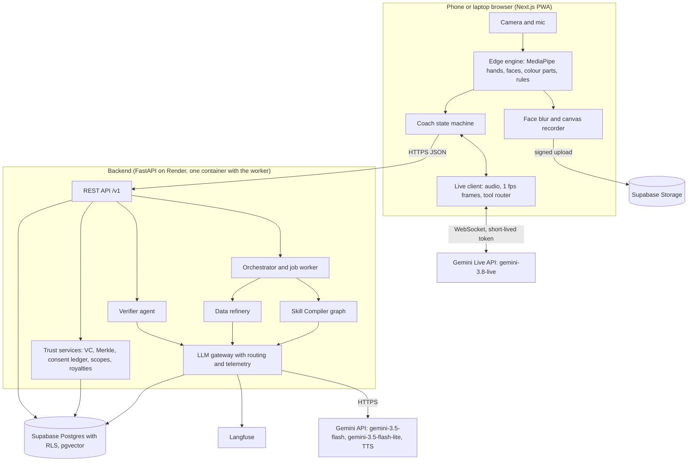
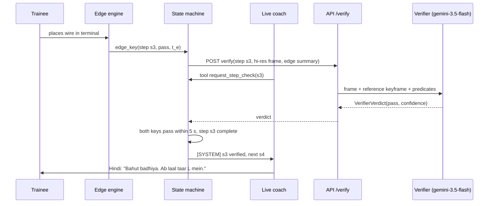
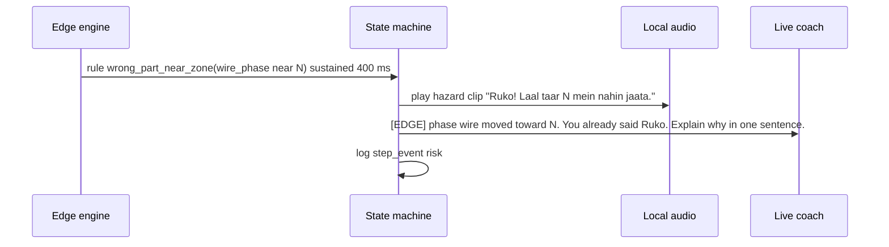
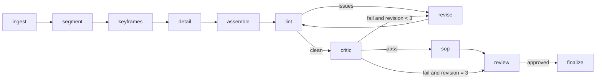
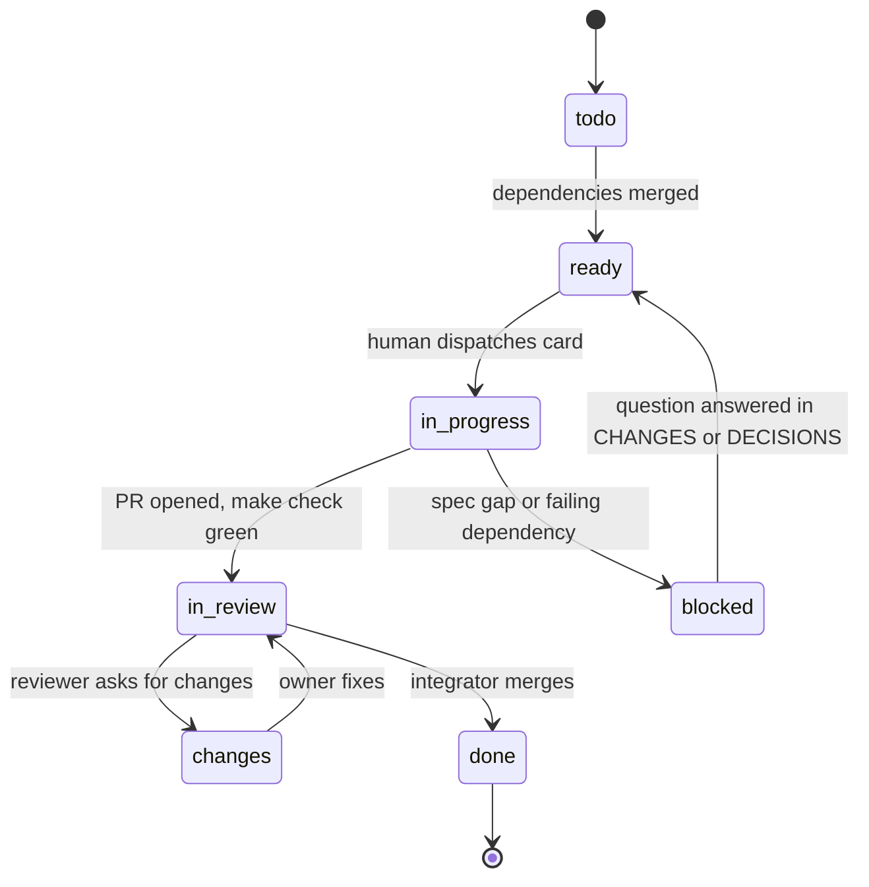

# Parampara: Build Plan and Source of Truth

**Version:** 1.1 (26 November 2026, 14:00 IST). Change log in section 37.
**Status:** Approved for build. Changes only through a Change Request (section 31.9).
**Product:** Parampara, entry for BUILD 2036, Frontier 04 Manufacturing Renaissance.
**Submission deadline (working assumption):** 30 November 2026, 12:00 IST. Confirm with the organisers.
**Companion document:** `docs/BLUEPRINT.md` (the why). This document is the what and the how.


## Contents

- [0. How to use this document](#0-how-to-use-this-document)
- [1. Product in one page](#1-product-in-one-page)
- [2. Scope](#2-scope)
- [3. Glossary](#3-glossary)
- [4. Users, roles and journeys](#4-users-roles-and-journeys)
- [5. The demo skill: 3-way terminal block wiring](#5-the-demo-skill-3-way-terminal-block-wiring)
- [6. System architecture](#6-system-architecture)
- [7. Repository layout](#7-repository-layout)
- [8. Tech stack and versions](#8-tech-stack-and-versions)
- [9. Accounts, environments and configuration](#9-accounts-environments-and-configuration)
- [10. Contracts (canonical data shapes)](#10-contracts-canonical-data-shapes)
- [11. Database](#11-database)
- [12. Backend API](#12-backend-api)
- [13. AI layer: models, routing and telemetry](#13-ai-layer-models-routing-and-telemetry)
- [14. Skill Compiler (Capture)](#14-skill-compiler-capture)
- [15. Tacit Interviewer (Capture, part 2)](#15-tacit-interviewer-capture-part-2)
- [16. Live Coach (Coach)](#16-live-coach-coach)
- [17. Edge vision engine](#17-edge-vision-engine)
- [18. Verifier and the two-key rule](#18-verifier-and-the-two-key-rule)
- [19. Mastery engine and coaching modes](#19-mastery-engine-and-coaching-modes)
- [20. Proof-of-Skill credentials (Certify)](#20-proof-of-skill-credentials-certify)
- [21. Consent wallet and ledger (Consent)](#21-consent-wallet-and-ledger-consent)
- [22. Data refinery (Compensate, part 1)](#22-data-refinery-compensate-part-1)
- [23. Licensing, royalties and payouts (Compensate, part 2)](#23-licensing-royalties-and-payouts-compensate-part-2)
- [24. Factory Command Centre (`/dashboard`)](#24-factory-command-centre-dashboard)
- [25. Frontend: screens and UX](#25-frontend-screens-and-ux)
- [26. Observability, trace panel and usage report](#26-observability-trace-panel-and-usage-report)
- [27. Security and privacy](#27-security-and-privacy)
- [28. Testing strategy](#28-testing-strategy)
- [29. Evaluation protocol](#29-evaluation-protocol)
- [30. Deployment and operations](#30-deployment-and-operations)
- [31. Multi-agent build protocol: one agent, three hands](#31-multi-agent-build-protocol-one-agent-three-hands)
- [32. Task cards](#32-task-cards)
- [33. Schedule and milestones](#33-schedule-and-milestones)
- [34. Definition of done, smoke test and submission checklist](#34-definition-of-done-smoke-test-and-submission-checklist)
- [35. Finale backlog (5 to 13 December)](#35-finale-backlog-5-to-13-december)
- [36. Risk register and fallbacks](#36-risk-register-and-fallbacks)
- [37. Change log](#37-change-log)

---

## 0. How to use this document

This is the single source of truth for building Parampara. A competent engineer, or a coding agent, holding only this file and the repository should be able to build the product without asking anyone.

**Precedence when documents disagree**

1. `contracts/` schemas (once generated from section 10) win on data shapes.
2. This file wins on behaviour, scope and architecture.
3. `AGENTS.md` wins on working rules for coding agents.
4. `docs/DECISIONS.md` records why. It never overrides this file. If a decision changes behaviour, raise a Change Request and update this file.
5. Code comments never override anything.

**How agents should read it.** Never load the whole file into a task unless the task card says so. Each task card in section 32 lists the sections it needs. Read those, plus section 31 (how we work), plus `AGENTS.md`.

**Words used with a fixed meaning.** MUST means the build fails review without it. SHOULD means do it unless a task card says otherwise. MAY means optional.

**Placeholders.** Values in `<angle brackets>` are filled at setup time and stored in environment variables, never committed.

---

## 1. Product in one page

Parampara turns one master worker's demonstration into three things:

1. **An AI coach** that watches a trainee through a phone camera, speaks Hindi, and stops a mistake before it becomes a defect.
2. **A Proof-of-Skill credential**, signed and QR-verifiable, built from observed performance.
3. **Robot-training data the workers own**, licensed to robotics labs under purpose-bound terms, with royalties paid back to the master and the trainees.

The loop has five stages, always written in this order:

| Stage | What happens | Main module |
| --- | --- | --- |
| Capture | Master records a task once and narrates it. Agents compile a Skill Graph and interview the master for tacit knowledge. | Skill Compiler (14), Tacit Interviewer (15) |
| Coach | Trainee performs the task under a live Hindi coach with on-device pre-error interrupts and two-key step verification. | Live Coach (16), Edge engine (17), Verifier (18), Mastery (19) |
| Certify | After enough clean runs and a supervisor co-sign, a W3C Verifiable Credential is issued. | Credentials (20) |
| Consent | Each worker controls every clip with revocable, purpose-bound consent recorded in a hash-chained ledger. | Consent (21) |
| Compensate | Consented sessions become LeRobot datasets. Licences trigger royalty splits and UPI payouts. | Refinery (22), Royalties (23) |

A factory dashboard (24) shows skill matrix, time to competency and mistake hotspots.

**The one design rule.** Agents perceive, reason and talk. Deterministic tools measure, sign and enforce. A verifier signs off before anything counts. No LLM output is ever trusted alone for a step completion, a credential, a consent record or a payment.

---

## 2. Scope

### 2.1 Submission scope (must work end to end by 30 November)

Everything in section 34.1 (Definition of Done). In short: one real skill (terminal wiring) runs through all five stages on a deployed public URL, with a judge login, an agent trace panel, real model telemetry, tests and an eval report.

### 2.2 Finale scope (by 14 December)

Section 35. Two more skills, full offline coaching, WhatsApp credential sharing, Skill India Digital Hub export format, a buyer data room with watermarks, lineage royalties across versions, and a real pilot.

### 2.3 Non-goals (do not build, even if easy)

- Face recognition or any biometric identification of workers.
- Individual productivity scoring or ranking of workers. This is forbidden by product policy, not just deferred.
- Real money movement. Payouts run in test mode only.
- Smart glasses, depth sensors, IMUs, force gloves.
- Native mobile apps. The product is a PWA.
- Registering as a DPDP Consent Manager (needs a Rs 2 crore net worth). The ledger is designed to plug into a registered one later.
- Live electrical work. Training benches are never powered.

---

## 3. Glossary

| Term | Meaning |
| --- | --- |
| Skill | A named procedural task, for example "3-way terminal block wiring". Has versions. |
| Skill version | One immutable, approved Skill Graph for a skill, authored by one master. |
| Skill Graph | The machine-readable programme for a skill: steps, parts, zones, predicates, edge checks, hazards, tips. Schema in 10.2. |
| Step | One observable unit of work with a success condition. |
| Part | A physical item the edge engine can recognise by colour, for example the red phase wire. |
| Zone | A location on the bench, calibrated per session by tapping, for example terminal L. |
| Predicate | A natural-language, VLM-checkable success condition for a step. |
| Edge check | A deterministic on-device check for a step, for example "red part inside zone L for 1 s with no hand inside". |
| Edge rule | A deterministic on-device hazard detector that fires a pre-error interrupt. |
| Two-key rule | A step completes only if the edge key and the VLM key both pass within 5 seconds (section 18). |
| Session | One trainee attempt at one skill version, from calibration to completion or abort. |
| Run | A completed session. |
| Clean run | A run with every step two-key verified, no major or critical errors, and hint level at most 1 on every step. |
| Mode | Coaching intensity for a session: `full`, `hint`, `watch`, `exam` (section 19). |
| Evidence clip | A blurred video or frame stored with its SHA-256 hash. |
| Consent record | One append-only ledger entry granting or revoking scopes for a clip or session. |
| Scope | One of `train_own_org`, `train_other_employers`, `robotics_research`, `robotics_commercial`. |
| Episode | One session exported in LeRobotDataset v3.0 format. |
| Dataset | A set of episodes for one skill version and one scope. |
| Licence | A buyer's right to use a dataset under a scope and fixed terms. |
| Royalty event | One beneficiary's share of one licence, in paise. |
| Lineage | The parent link between skill versions authored by different masters. |
| Master | A senior worker who records and owns a skill. |
| Supervisor | A person at the org who approves Skill Graphs and co-signs credentials. |
| Lab buyer | A robotics lab user who licenses datasets. |
| Judge mode | An anonymous login that joins the demo org with every role. |

---

## 4. Users, roles and journeys

### 4.1 Roles

| Role | Can do |
| --- | --- |
| `owner` | Everything in their org; sees dashboard and earnings totals. |
| `supervisor` | Approve Skill Graphs, edit them, co-sign credentials, see sessions. |
| `master` | Record demonstrations, answer the interview, see own skills, consent wallet, earnings. |
| `trainee` | Run coached sessions, see own progress and credentials, consent wallet, earnings. |
| `lab_buyer` | Browse datasets allowed to their org, create licences, download licensed data. |
| public | Open `/verify/<id>` and verify a credential. No login. |

A user can hold several roles. Judge mode grants all five roles in the demo org.

### 4.2 Journeys (each one MUST work in judge mode)

**J1 Capture (master, then supervisor)**
1. Master opens Capture, mounts the phone, records 60 to 180 seconds while narrating in Hindi. Faces are blurred on the device.
2. Master taps Compile. The trace panel streams agent progress. A draft Skill Graph appears in about 60 to 120 seconds.
3. Master taps Interview. A voice interview of up to 5 questions runs. Tips are attached to steps.
4. Supervisor opens Review, edits any step, then approves. Version 1 is published with the master as author.

**J2 Coach (trainee)**
1. Trainee opens the skill and taps Start.
2. Calibration: tap each zone on the camera preview, then show each part to the centre box.
3. The Live coach greets in Hindi and guides step by step.
4. A wrong move near a forbidden zone triggers a local "Ruko" within 300 ms, then the coach explains.
5. Each step completes only when both keys pass. The evidence panel shows both.
6. At the end, a summary shows steps, errors, hints, time and updated mastery.

**J3 Certify (supervisor, public)**
1. If the policy is met, the supervisor sees "Ready to certify" and co-signs.
2. A credential with a QR code appears. Anyone scans it to verify. A tamper toggle shows failure.

**J4 Consent (master or trainee)**
1. After a session, the wallet shows the new clip as "Private".
2. The worker listens to the Hindi notice, answers one question, picks scopes, confirms.
3. The ledger entry appears with its hash. The worker can revoke at any time.

**J5 Compensate (lab buyer, then worker)**
1. Lab buyer opens the data room, sees datasets whose episodes carry the needed scope, opens the episode viewer.
2. Buyer licenses a dataset. Royalty events and test payouts are created.
3. Worker's earnings screen shows the new entries with the licence reference.

**J6 Owner**
1. Owner opens the dashboard: skill matrix, time to competency, mistake hotspots, credentials, data earnings.

---

## 5. The demo skill: 3-way terminal block wiring

This skill drives every acceptance test. It is short, visual and has a classic dangerous mistake.

**Bench kit (buy on day 0):** one 35 mm DIN rail about 20 cm long, three screw terminal blocks mounted side by side (labelled L, N, PE with stickers), three 30 cm insulated wires in three clearly different colours (red, black, green; or brown, blue, green-yellow), bootlace ferrules for those wires, a small screwdriver, a phone stand with a top-down view, good white light. Two complete kits. The bench is never connected to power.

**Reference procedure (the master narrates this in his own words; this list is for testing only):**

| # | Step | Success condition | Common errors |
| --- | --- | --- | --- |
| 1 | Check wires and ferrules | All three wires stripped about 8 mm with a ferrule crimped on each | Missing ferrule (M3) |
| 2 | Earth first: green wire into PE | Green wire fully inside PE terminal | Earth skipped (M2) |
| 3 | Neutral: black wire into N | Black wire fully inside N terminal | Phase into N (M1, critical) |
| 4 | Phase: red wire into L | Red wire fully inside L terminal | Wrong terminal (M1) |
| 5 | Tighten all three screws | Each wire firmly clamped | Insulation under clamp (M4) |
| 6 | Pull test each wire | Each wire tugged, none moves | Order skipped (M5) |

**Mistake types used in evals (section 29):** M1 phase and neutral swapped, M2 earth step skipped, M3 ferrule missing, M4 wire not fully inserted or insulation under the clamp, M5 steps out of order.

**Colours.** The edge engine never hard-codes colours. Parts are calibrated per session (section 17.3). The Skill Graph names parts by role (`wire_phase`, `wire_neutral`, `wire_earth`) and by the colour the master used.


---

## 6. System architecture

### 6.1 Layers



### 6.2 Responsibilities and boundaries

| Component | Owns | Never does |
| --- | --- | --- |
| Edge engine (browser) | Hand and face detection, part colour detection, zone geometry, pre-error rules, edge keys, face blur, recording | Talks to Gemini directly for verification; stores data without consent |
| Live client (browser) | The real-time conversation, tool calls from the coach, audio playback | Decides step completion on its own |
| Coach state machine (browser) | Current step, two-key combination, mode, event batching | Signs or stores anything permanent |
| REST API | Auth, persistence, ephemeral token minting, verification calls, credentials, consent, licences | Long-running work inside a request (uses jobs) |
| Job worker | Skill compilation, dataset builds, TTS generation | Anything user-facing synchronously |
| LLM gateway | Model routing, retries, timeouts, telemetry for every call | Business decisions |
| Trust services | Deterministic signing, hashing, chain, scope checks, royalty maths | Any LLM call |

### 6.3 Key flows

**Coach step completion**



**Pre-error interrupt**



---

## 7. Repository layout

Monorepo. JavaScript side uses pnpm workspaces. Python side uses uv.

```text
parampara/
  AGENTS.md                      shared rules for every coding agent (canonical)
  CLAUDE.md                      imports AGENTS.md, adds Claude Code lead-role rules
  GEMINI.md                      points to AGENTS.md, adds Gemini rules
  .gemini/settings.json          makes Gemini CLI load AGENTS.md
  Makefile                       one entry point for every task
  package.json, pnpm-workspace.yaml
  .github/workflows/ci.yml
  contracts/
    schemas/*.schema.json        canonical data shapes (section 10)
    fixtures/*.json              valid example of every schema
    README.md
  packages/
    contracts/                   generated TypeScript types (never hand-edit)
  apps/
    web/                         Next.js PWA
      app/                       routes (section 25)
      components/                ui/, coach/, capture/, wallet/, dashboard/, lab/, trace/
      lib/
        api/                     typed API client (generated types + thin fetch wrapper)
        edge/                    edge engine (section 17)
        live/                    Live client (section 16)
        coach/                   state machine and two-key logic
        vc/                      in-browser credential verification (verify.ts)
        i18n/                    hi.json, en.json, useT()
        supabase/                browser client, auth helpers
      public/contexts/skill/v1.jsonld
      tests/                     vitest unit tests, playwright e2e
  services/
    api/
      pyproject.toml, uv.lock, Dockerfile
      src/parampara/
        api/                     FastAPI app, routes, deps, errors, settings
        agents/
          llm.py                 LLM gateway (section 13)
          prompts/*.md           one prompt file per agent
          compiler/              LangGraph Skill Compiler (section 14)
          interviewer/           interviewer config and tools (section 15)
          coach/                 Live system instruction builder and tool declarations (section 16)
          verifier/              verifier agent (section 18)
          refinery/              refinery agent and LeRobot writer (section 22)
        tools/                   deterministic tools: bkt, vc, jcs, multikey, merkle, ledger, scopes, royalty, keyframes, hashing, tts
        domain/
          generated.py           Pydantic models generated from contracts (never hand-edit)
        db/
          pool.py                connection pool
          repos/                 one module per table group, plain SQL
          jobs.py                jobs queue (enqueue, claim, complete, fail)
        telemetry/               langfuse setup, model_calls and trace_events writers
        worker.py                job worker loop
        worker_jobs/             one module per job kind (finalize_clip, compile_skill, tts_hazards, build_dataset)
      tests/
  db/
    migrations/0001_init.sql ... (section 11)
    seed/seed.py
  evals/
    runs/                        recorded eval videos (git-lfs or external bucket, not in git)
    labels/*.json                human-verified labels
    harness/                     replay and scoring
    EVAL_REPORT.md               generated
  scripts/
    size_check.py                fails on files over 300 lines or functions over 40 lines
    banned_terms.py              fails on surveillance features (section 27)
  spikes/                        throwaway experiments, never imported by app code
  docs/
    BLUEPRINT.md                 why we build this
    BUILD_PLAN.md                this file
    TASKS.md                     task board
    DECISIONS.md                 architecture decision log
    CHANGES.md                   change requests
    handoffs/T-xxx.md            one handoff note per task
    research/                    API findings from spikes
    audits/                      Gemini audit reports
    ARCHITECTURE.md, IMPACT.md, USAGE.md, PRIVACY.md (generated or written in task cards)
    legal/consent-notice-v1.md
```

---

## 8. Tech stack and versions

Pin exact versions on day 1 in lockfiles. Where this table says "current", the owning task verifies the version on the day and records it in `docs/research/versions.md`.

| Area | Choice | Notes |
| --- | --- | --- |
| Node | 22 LTS | |
| Package manager | pnpm 9+ | workspaces |
| Web framework | Next.js current stable (16 or later), App Router, TypeScript strict | |
| Styling | Tailwind CSS v4, shadcn/ui, Framer Motion | |
| Fonts | Inter, Noto Sans Devanagari | Hindi first |
| Browser vision | `@mediapipe/tasks-vision` current: HandLandmarker, FaceDetector | GPU delegate with CPU fallback |
| Live API client | `@google/genai` current (JavaScript SDK), `ai.live.connect` | ephemeral token auth |
| Crypto in browser | `@noble/ed25519`, `canonicalize` (RFC 8785 JCS), `bs58` | verify page |
| QR | `qrcode.react` | |
| Charts | Recharts | dashboard |
| Web tests | Vitest, Playwright | fake camera via Chrome flags |
| Python | 3.12 | |
| Python tooling | uv, ruff, mypy, pytest, pytest-asyncio | |
| API | FastAPI, Uvicorn, Pydantic v2 | |
| Gemini SDK | `google-genai` current | Files API, structured output, auth tokens |
| Orchestration | LangGraph 1.x, `langgraph-checkpoint-postgres` | compiler graph with interrupts |
| DB access | `psycopg` 3 (async) with plain SQL in repositories | no ORM |
| Video tools | ffmpeg (in Docker image), `mediapipe` Python for offline hand pose | |
| Robot data | `lerobot` current, LeRobotDataset v3.0 | pin version, record in versions.md |
| Crypto | `pynacl` (Ed25519), `rfc8785` (JCS), `base58` | |
| Observability | Langfuse cloud, Python SDK | plus local `model_calls` table |
| DB and storage | Supabase (Postgres 15+, pgvector, Storage, Auth with anonymous sign-in), region ap-south-1 Mumbai | |
| Hosting | Vercel (web), Render free web service (API and worker in one Docker container) | CR-001: no Google billing. Free Render services sleep after 15 minutes idle, so warm it up before the demo |
| Payouts | RazorpayX Payouts API, test mode; `simulated` fallback | |
| Codegen | `datamodel-code-generator` (Python), `json-schema-to-typescript` (TS), `openapi-typescript` (API client) | |

### 8.1 Models (defaults, overridable by env)

| Env var | Default | Used by |
| --- | --- | --- |
| `MODEL_LIVE` | `gemini-3.8-live` | Live coach, tacit interviewer |
| `MODEL_FLASH` | `gemini-3.5-flash` | Segmenter, predicate writer, critic, verifier |
| `MODEL_LITE` | `gemini-3.5-flash-lite` | SOP writer, translations, refinery descriptions |
| `MODEL_TTS` | set by T-003 after checking the current Gemini TTS model list | hazard clips, consent notice audio |

Never hard-code a model string outside `services/api/src/parampara/api/settings.py` and `apps/web/lib/live/config.ts`.

---

## 9. Accounts, environments and configuration

### 9.1 Accounts to create (task T-000, human)

Google AI Studio API key (free tier only, D-011), Render account (API host, CR-001), Supabase project in ap-south-1, Vercel account linked to GitHub, Langfuse cloud project, RazorpayX account in test mode (if activation is blocked, use the `simulated` provider and say so in the UI), GitHub repository `parampara` (public at submission).

### 9.2 Environments

| Env | Web | API | DB |
| --- | --- | --- | --- |
| local | `pnpm dev` on https via `next dev --experimental-https` | `uv run uvicorn` | `supabase start` (Docker) |
| staging | Vercel preview | Render service `parampara-api-staging` | Supabase project (same project, `staging` schema not needed; one project is fine) |
| production (demo) | Vercel production domain | Render service `parampara-api` | Supabase project |

Phones need HTTPS for camera access. For phone testing during development use the Vercel preview or a Cloudflare tunnel to the local server.

### 9.3 Environment variables

**API (`services/api/.env`, Secret Manager in cloud)**

```text
APP_ENV=local|staging|production
PUBLIC_WEB_ORIGIN=https://<web-domain>
DATABASE_URL=postgresql://...            # Supabase pooled connection
SUPABASE_URL=https://<ref>.supabase.co
SUPABASE_SERVICE_ROLE_KEY=<secret>
SUPABASE_JWT_ISSUER=https://<ref>.supabase.co/auth/v1
GEMINI_API_KEY=<secret>
MODEL_LIVE=gemini-3.8-live
MODEL_FLASH=gemini-3.5-flash
MODEL_LITE=gemini-3.5-flash-lite
MODEL_TTS=<from T-003>
LANGFUSE_PUBLIC_KEY=<key>
LANGFUSE_SECRET_KEY=<secret>
LANGFUSE_HOST=https://cloud.langfuse.com
ISSUER_DID=did:web:<web-domain>
ISSUER_KEY_ID=key-1
ISSUER_ED25519_SEED_B64=<32 random bytes, base64>
PAYOUT_PROVIDER=razorpayx_test|simulated
RAZORPAYX_KEY_ID=<key>
RAZORPAYX_KEY_SECRET=<secret>
RAZORPAYX_ACCOUNT_NUMBER=<test account>
DEMO_ORG_ID=<uuid from seed>
MAX_UPLOAD_MB=150
```

**Web (`apps/web/.env.local`, Vercel env)**

```text
NEXT_PUBLIC_API_BASE=https://<api-host>
NEXT_PUBLIC_SUPABASE_URL=https://<ref>.supabase.co
NEXT_PUBLIC_SUPABASE_ANON_KEY=<anon key>
NEXT_PUBLIC_WEB_ORIGIN=https://<web-domain>
NEXT_PUBLIC_MODEL_LIVE=gemini-3.8-live
```

`.env.example` files MUST list every variable with a comment. Real values are never committed. `make check` runs a secret scan.

### 9.4 Makefile targets (contract between humans, agents and CI)

| Target | Does |
| --- | --- |
| `make setup` | Install Node and Python deps, git hooks, Playwright browsers |
| `make contracts` | Regenerate `packages/contracts` and `domain/generated.py` from `contracts/schemas` |
| `make db-reset` | Reset local Supabase, apply migrations, run seed |
| `make dev` | Run web, API and worker together |
| `make check` | Lint, typecheck, unit tests, contract drift check, file-size check, secret scan |
| `make test-e2e` | Playwright with fake camera |
| `make eval` | Run eval harness, write `evals/EVAL_REPORT.md` |
| `make usage` | Write `docs/USAGE.md` from `model_calls` |
| `make deploy-api ENV=staging` | Build and deploy the API container |

---

## 10. Contracts (canonical data shapes)

Contracts are the interfaces between modules and between agents. They are written first (task T-002), then code is generated from them. No agent edits generated files. A contract change is a Change Request.

### 10.1 Conventions

- IDs are UUID v4 strings. Step, part, zone, hazard and predicate IDs inside a Skill Graph are short slugs (`s1`, `wire_phase`, `zone_L`).
- Timestamps are ISO 8601 UTC strings with `Z`. Durations are integer milliseconds with a `_ms` suffix.
- Image coordinates are normalised to the frame: `x` and `y` in `[0, 1]`, origin top-left.
- Money is integer paise (`_paise` suffix). Never floats.
- Human text that users see is `LocalizedText`: `{ "en": string, "hi": string }`. Hindi is mandatory for any text spoken or shown to workers.
- Every schema file sets `"$schema": "https://json-schema.org/draft/2020-12/schema"`, an `$id` of `https://parampara.app/schemas/<name>.schema.json`, and `"additionalProperties": false` on every object.

### 10.2 Skill Graph (`contracts/schemas/skill-graph.schema.json`)

This schema is also the `response_schema` for the compiler's assemble step, so keep it exactly as below.

```json
{
  "$schema": "https://json-schema.org/draft/2020-12/schema",
  "$id": "https://parampara.app/schemas/skill-graph.schema.json",
  "title": "SkillGraph",
  "type": "object",
  "additionalProperties": false,
  "required": ["schema_version", "title", "summary", "domain", "parts", "zones", "steps", "hazards", "credential_policy"],
  "properties": {
    "schema_version": { "const": "1.0" },
    "title": { "$ref": "#/$defs/LocalizedText" },
    "summary": { "$ref": "#/$defs/LocalizedText" },
    "domain": { "enum": ["electrical", "garment", "pharma", "assembly", "other"] },
    "tools_required": { "type": "array", "items": { "$ref": "#/$defs/NamedItem" } },
    "parts": { "type": "array", "minItems": 1, "items": { "$ref": "#/$defs/Part" } },
    "zones": { "type": "array", "items": { "$ref": "#/$defs/Zone" } },
    "steps": { "type": "array", "minItems": 2, "maxItems": 12, "items": { "$ref": "#/$defs/Step" } },
    "hazards": { "type": "array", "items": { "$ref": "#/$defs/Hazard" } },
    "credential_policy": { "$ref": "#/$defs/CredentialPolicy" }
  },
  "$defs": {
    "LocalizedText": {
      "type": "object", "additionalProperties": false, "required": ["en", "hi"],
      "properties": { "en": { "type": "string", "minLength": 1 }, "hi": { "type": "string", "minLength": 1 } }
    },
    "NamedItem": {
      "type": "object", "additionalProperties": false, "required": ["id", "name"],
      "properties": { "id": { "type": "string", "pattern": "^[a-z][a-z0-9_]{1,31}$" }, "name": { "$ref": "#/$defs/LocalizedText" } }
    },
    "Part": {
      "type": "object", "additionalProperties": false, "required": ["id", "name", "role", "colour_hint"],
      "properties": {
        "id": { "type": "string", "pattern": "^[a-z][a-z0-9_]{1,31}$" },
        "name": { "$ref": "#/$defs/LocalizedText" },
        "role": { "type": "string" },
        "colour_hint": { "type": "string", "description": "Colour the master used, in plain English, e.g. red. Calibrated per session." }
      }
    },
    "Zone": {
      "type": "object", "additionalProperties": false, "required": ["id", "name", "calibration_prompt"],
      "properties": {
        "id": { "type": "string", "pattern": "^zone_[A-Za-z0-9_]{1,24}$" },
        "name": { "$ref": "#/$defs/LocalizedText" },
        "calibration_prompt": { "$ref": "#/$defs/LocalizedText" }
      }
    },
    "Step": {
      "type": "object", "additionalProperties": false,
      "required": ["id", "order", "title", "instruction", "source_segment", "success_predicates", "edge_checks", "common_errors", "tips", "expected_duration_s", "critical"],
      "properties": {
        "id": { "type": "string", "pattern": "^s[0-9]{1,2}$" },
        "order": { "type": "integer", "minimum": 1 },
        "title": { "$ref": "#/$defs/LocalizedText" },
        "instruction": { "$ref": "#/$defs/LocalizedText" },
        "source_segment": {
          "type": "object", "additionalProperties": false, "required": ["start_ms", "end_ms"],
          "properties": { "start_ms": { "type": "integer", "minimum": 0 }, "end_ms": { "type": "integer", "minimum": 0 } }
        },
        "reference_keyframe": {
          "type": "object", "additionalProperties": false, "required": ["clip_id", "ts_ms"],
          "properties": { "clip_id": { "type": "string" }, "ts_ms": { "type": "integer", "minimum": 0 } }
        },
        "success_predicates": { "type": "array", "minItems": 1, "items": { "$ref": "#/$defs/Predicate" } },
        "edge_checks": { "type": "array", "items": { "$ref": "#/$defs/EdgeCheck" } },
        "common_errors": { "type": "array", "items": { "$ref": "#/$defs/CommonError" } },
        "tips": { "type": "array", "items": { "$ref": "#/$defs/Tip" } },
        "expected_duration_s": { "type": "integer", "minimum": 1, "maximum": 600 },
        "critical": { "type": "boolean" }
      }
    },
    "Predicate": {
      "type": "object", "additionalProperties": false, "required": ["id", "kind", "description"],
      "properties": {
        "id": { "type": "string" },
        "kind": { "enum": ["object_in_zone", "object_state", "order", "count", "visual_detail"] },
        "description": { "type": "string", "description": "English, one checkable visual sentence." },
        "part_id": { "type": "string" },
        "zone_id": { "type": "string" }
      }
    },
    "EdgeCheck": {
      "type": "object", "additionalProperties": false, "required": ["id", "kind", "min_dwell_ms"],
      "properties": {
        "id": { "type": "string" },
        "kind": { "enum": ["part_in_zone", "hands_settled"] },
        "part_id": { "type": "string" },
        "zone_id": { "type": "string" },
        "min_dwell_ms": { "type": "integer", "minimum": 200, "maximum": 5000 }
      }
    },
    "CommonError": {
      "type": "object", "additionalProperties": false, "required": ["id", "description", "severity", "origin"],
      "properties": {
        "id": { "type": "string" },
        "description": { "$ref": "#/$defs/LocalizedText" },
        "severity": { "enum": ["minor", "major", "critical"] },
        "origin": { "enum": ["narration", "interview", "inferred"] },
        "hazard_id": { "type": "string" }
      }
    },
    "Tip": {
      "type": "object", "additionalProperties": false, "required": ["id", "text", "source"],
      "properties": {
        "id": { "type": "string" },
        "text": { "$ref": "#/$defs/LocalizedText" },
        "source": { "enum": ["narration", "interview", "supervisor"] }
      }
    },
    "Hazard": {
      "type": "object", "additionalProperties": false, "required": ["id", "step_id", "description", "severity", "rule", "interrupt_text"],
      "properties": {
        "id": { "type": "string" },
        "step_id": { "type": "string" },
        "description": { "$ref": "#/$defs/LocalizedText" },
        "severity": { "enum": ["major", "critical"] },
        "rule": { "$ref": "#/$defs/EdgeRule" },
        "interrupt_text": { "$ref": "#/$defs/LocalizedText" },
        "interrupt_audio_path": { "type": "string", "description": "Storage path of the pre-generated Hindi clip. Set by the TTS step." }
      }
    },
    "EdgeRule": {
      "type": "object", "additionalProperties": false, "required": ["kind"],
      "properties": {
        "kind": { "enum": ["wrong_part_near_zone", "out_of_order"] },
        "part_id": { "type": "string" },
        "forbidden_zone_id": { "type": "string" },
        "radius": { "type": "number", "minimum": 0.02, "maximum": 0.25, "default": 0.07 },
        "min_ms": { "type": "integer", "minimum": 150, "maximum": 3000, "default": 400 }
      }
    },
    "CredentialPolicy": {
      "type": "object", "additionalProperties": false, "required": ["profile", "min_consecutive_clean_runs", "mastery_threshold", "require_exam_mode", "require_cosign"],
      "properties": {
        "profile": { "enum": ["production", "demo"] },
        "min_consecutive_clean_runs": { "type": "integer", "minimum": 1, "maximum": 10 },
        "mastery_threshold": { "type": "number", "minimum": 0.5, "maximum": 0.99 },
        "require_exam_mode": { "type": "boolean" },
        "require_cosign": { "type": "boolean" }
      }
    }
  }
}
```

**Semantic rules the deterministic linter enforces (section 14.6):** step `order` values are 1..n with no gaps; every `part_id` and `zone_id` referenced exists; every `critical` step has at least one `edge_checks` entry or the linter reports `critical_step_without_edge_check`; every step has at least one `edge_checks` entry or the linter reports `step_without_edge_check` (CR-009: a step without one could never complete under the two-key rule); every hazard's `step_id` exists; `wrong_part_near_zone` rules name a `part_id` and `forbidden_zone_id`; `source_segment.end_ms > start_ms`; no two steps share a segment; Hindi strings contain Devanagari characters or are approved Hinglish (at least one Devanagari character in `instruction.hi`).

Production policy default: `{profile: production, min_consecutive_clean_runs: 3, mastery_threshold: 0.95, require_exam_mode: true, require_cosign: true}`. The demo org uses `{profile: demo, min_consecutive_clean_runs: 1, mastery_threshold: 0.5, require_exam_mode: false, require_cosign: true}`. The credential always records which policy applied.

### 10.3 Other contracts

Written here as TypeScript for readability. T-002 converts each one to a JSON Schema file with the same name in kebab case, following 10.1.

```ts
// calibration.schema.json
interface ZoneCalibration { zone_id: string; x: number; y: number; radius: number }
interface PartProfile { part_id: string; h_deg: number; s: number; v: number; tol_h_deg: number; min_s: number; min_v: number; max_v: number; dark: boolean }
interface Calibration { zones: ZoneCalibration[]; parts: PartProfile[]; frame_w: number; frame_h: number; created_at: string }

// edge-event.schema.json   (browser -> state machine, also batched to API as payload)
type EdgeEventKind = "edge_key" | "risk" | "order_violation" | "hand_lost" | "camera_unclear";
interface EdgeEvent { kind: EdgeEventKind; step_id: string | null; rule_or_check_id: string | null; part_id?: string; zone_id?: string; t_ms: number; detail?: Record<string, number | string | boolean> }

// step-event.schema.json   (stored in step_events)
type StepEventType = "started" | "hint" | "risk" | "check_requested" | "edge_key" | "vlm_key" | "completed" | "failed" | "question" | "mode_changed";
interface StepEvent { session_id: string; step_id: string | null; type: StepEventType; t_ms: number; payload: Record<string, unknown>; frame_sha256?: string }

// verify-request.schema.json
interface VerifyRequest { step_id: string; frame_jpeg_b64: string; frame_t_ms: number; edge_summary: { edge_key: boolean; checks: string[]; held_part?: string | null }; trigger: "edge" | "coach" | "manual" }

// verifier-verdict.schema.json   (also the verifier's response_schema)
interface PredicateResult { predicate_id: string; pass: boolean; evidence: string }
interface VerifierVerdict { status: "pass" | "fail" | "needs_better_view" | "unavailable"; confidence: number; predicate_results: PredicateResult[]; visible_issues: string[]; coach_hint_hi: string; frame_sha256: string; model: string; latency_ms: number }

// session-start.schema.json
interface SessionStartRequest { skill_version_id: string; device: { ua: string; w: number; h: number } }
interface SessionStartResponse {
  session_id: string; mode: "full" | "hint" | "watch" | "exam"; needs_help_steps: string[];
  skill_graph: SkillGraph; skill_version_id: string; master_name: string; trainee_name: string;
  live: { ephemeral_token: string; model: string; expires_at: string; config: Record<string, unknown> };
  hazard_audio: { hazard_id: string; url: string }[];
  upload: { clip_id: string; signed_url: string; expires_at: string };
}

// session-summary.schema.json
interface StepOutcome { step_id: string; completed: boolean; two_key: boolean; assurance: "two_key" | "single" | "manual" | "none"; hint_level_max: 0 | 1 | 2 | 3; errors: { error_id: string | null; severity: "minor" | "major" | "critical"; t_ms: number }[]; duration_ms: number }
interface SessionSummary { session_id: string; status: "completed" | "aborted"; mode: string; steps: StepOutcome[]; clean_run: boolean; total_ms: number; mastery: { step_id: string; p_learned: number }[]; next_mode: string; credential_eligible: boolean; policy: CredentialPolicy; coach: "live" | "scripted"; edge_fps: number | null }

// consent-request.schema.json and consent-record.schema.json
type Scope = "train_own_org" | "train_other_employers" | "robotics_research" | "robotics_commercial";
interface ConsentRequest { action: "grant" | "revoke"; target: { clip_id?: string; session_id?: string }; scopes: Scope[]; expires_at: string | null; notice_version: string; comprehension_passed: boolean }
interface ConsentRecord { id: string; seq: number; subject_user_id: string; action: "grant" | "revoke"; target: { clip_id: string | null; session_id: string | null }; scopes: Scope[]; purpose: string; expires_at: string | null; notice_version: string; comprehension_passed: boolean; created_at: string; prev_hash: string; hash: string }

// credential.schema.json   (W3C VC 2.0 shape, section 20)
interface ProofOfSkillCredential {
  "@context": ["https://www.w3.org/ns/credentials/v2", string];
  id: string; type: ["VerifiableCredential", "ProofOfSkillCredential"];
  issuer: { id: string; name: string }; validFrom: string;
  credentialSubject: {
    id: string; name: string;
    skill: { id: string; version: number; title: LocalizedText; domain: string };
    master: { name: string; lineage: string[] };
    performance: { clean_runs: number; sessions: number; mastery_min: number; mode_of_final_run: string; errors_in_final_run: number };
    evidence: { merkle_root: string; item_count: number; algorithm: "sha256-merkle-v1" };
    policy: CredentialPolicy; cosigned_by: { name: string; role: "supervisor" };
    org: { name: string; city: string };
  };
  proof: { type: "DataIntegrityProof"; cryptosuite: "eddsa-jcs-2022"; created: string; verificationMethod: string; proofPurpose: "assertionMethod"; proofValue: string };
}

// dataset.schema.json, episode-meta.schema.json
interface EpisodeMeta { episode_index: number; session_id: string; contributor_pseudonym: string; role: "master" | "trainee"; consent_record_hash: string; steps: number; errors: number; corrections: number; quality: number; duration_ms: number; language_instruction: string }
interface Dataset { id: string; skill_version_id: string; scope: Scope; name: string; episode_count: number; hours: number; format: "lerobot_v3.0"; export_path: string; data_card_md: string; created_at: string }

// licence.schema.json, royalty-event.schema.json, payout.schema.json
interface LicenceTerms { scope: "robotics_research" | "robotics_commercial"; no_individual_productivity_scoring: true; no_biometric_identification: true; attribution_required: boolean; term_months: number }
interface Licence { id: string; dataset_id: string; buyer_org_id: string; price_paise: number; terms: LicenceTerms; watermark_id: string; created_at: string }
type RoyaltyRole = "master" | "parent_master" | "trainee" | "reviewer" | "factory" | "platform";
interface RoyaltyEvent { id: string; licence_id: string; role: RoyaltyRole; beneficiary_user_id: string | null; beneficiary_org_id: string | null; amount_paise: number; basis: Record<string, number | string>; created_at: string }
interface Payout { id: string; royalty_event_id: string; provider: "razorpayx_test" | "simulated"; provider_ref: string; status: "queued" | "processed" | "failed"; created_at: string }

// trace-event.schema.json   (agent trace panel)
type TraceKind = "agent_start" | "tool_call" | "tool_result" | "handoff" | "verdict" | "retry" | "error" | "agent_end";
interface TraceEvent { id: number; scope: { session_id?: string; compile_run_id?: string; dataset_id?: string }; agent: string; kind: TraceKind; summary: string; model?: string; latency_ms?: number; created_at: string }

// compile-run.schema.json
interface CompileRun { id: string; skill_id: string; source_clip_id: string; status: "queued" | "running" | "awaiting_review" | "approved" | "failed"; revision: number; draft_graph: SkillGraph | null; lint_issues: { path: string; code: string; message: string }[]; critic_issues: { path: string; severity: string; fix: string }[]; created_at: string; updated_at: string }

// api-error.schema.json
interface ApiError { error: { code: string; message: string; details?: Record<string, unknown>; request_id: string } }
```

`contracts/fixtures/` MUST hold one valid example per schema, and the terminal-wiring Skill Graph fixture (`skill-graph.terminal-wiring.json`) MUST pass both the JSON Schema and the semantic linter. That fixture is also the seed graph.

---

## 11. Database

Supabase Postgres. Migrations are plain SQL in `db/migrations`, applied in order. All tables live in `public`. Row-level security is on for every table. The API uses the service role for writes that cross users (ledger, credentials, royalties) and enforces authorisation in code.

### 11.1 Schema (`0001_init.sql`)

```sql
create extension if not exists pgcrypto;
create extension if not exists vector;

create type org_kind as enum ('factory','training_centre','lab','platform');
create type member_role as enum ('owner','supervisor','master','trainee','lab_buyer');
create type skill_status as enum ('draft','in_review','approved','retired');
create type clip_kind as enum ('demo','session','frame','audio');
create type session_mode as enum ('full','hint','watch','exam');
create type session_status as enum ('active','completed','aborted');
create type consent_action as enum ('grant','revoke');
create type cred_status as enum ('active','revoked');
create type royalty_role as enum ('master','parent_master','trainee','reviewer','factory','platform');
create type payout_provider as enum ('razorpayx_test','simulated');
create type job_status as enum ('queued','running','done','failed');

create table orgs (
  id uuid primary key default gen_random_uuid(),
  name text not null, city text not null default 'Indore',
  kind org_kind not null, is_demo boolean not null default false,
  created_at timestamptz not null default now()
);

create table profiles (
  id uuid primary key references auth.users(id) on delete cascade,
  display_name text not null, pseudonym text not null unique,
  preferred_lang text not null default 'hi',
  upi_vpa text,
  created_at timestamptz not null default now()
);

create table memberships (
  org_id uuid not null references orgs(id) on delete cascade,
  user_id uuid not null references profiles(id) on delete cascade,
  role member_role not null,
  primary key (org_id, user_id, role)
);

create table clips (
  id uuid primary key default gen_random_uuid(),
  org_id uuid not null references orgs(id),
  owner_user_id uuid not null references profiles(id),
  kind clip_kind not null,
  storage_path text not null, mime text not null,
  sha256 text, bytes bigint, duration_ms integer, width integer, height integer, fps real,
  blurred boolean not null default false,
  finalized_at timestamptz,
  created_at timestamptz not null default now()
);

create table skills (
  id uuid primary key default gen_random_uuid(),
  org_id uuid not null references orgs(id),
  slug text not null, current_version integer,
  created_by uuid not null references profiles(id),
  created_at timestamptz not null default now(),
  unique (org_id, slug)
);

create table skill_versions (
  id uuid primary key default gen_random_uuid(),
  skill_id uuid not null references skills(id) on delete cascade,
  version integer not null,
  status skill_status not null default 'draft',
  graph jsonb not null,
  author_user_id uuid not null references profiles(id),
  parent_version_id uuid references skill_versions(id),
  source_clip_id uuid references clips(id),
  approved_by uuid references profiles(id), approved_at timestamptz,
  graph_sha256 text,
  embedding vector(768),
  created_at timestamptz not null default now(),
  unique (skill_id, version)
);

create table compile_runs (
  id uuid primary key default gen_random_uuid(),
  skill_id uuid not null references skills(id),
  source_clip_id uuid not null references clips(id),
  status text not null default 'queued',
  revision integer not null default 0,
  draft_graph jsonb, lint_issues jsonb not null default '[]', critic_issues jsonb not null default '[]',
  langgraph_thread_id text,
  created_at timestamptz not null default now(), updated_at timestamptz not null default now()
);

create table sessions (
  id uuid primary key default gen_random_uuid(),
  org_id uuid not null references orgs(id),
  skill_version_id uuid not null references skill_versions(id),
  trainee_user_id uuid not null references profiles(id),
  mode session_mode not null,
  status session_status not null default 'active',
  calibration jsonb, summary jsonb,
  clip_id uuid references clips(id),
  live_model text not null,
  started_at timestamptz not null default now(), ended_at timestamptz
);

create table step_events (
  id bigserial primary key,
  session_id uuid not null references sessions(id) on delete cascade,
  step_id text, type text not null, t_ms integer not null,
  payload jsonb not null default '{}', frame_sha256 text,
  created_at timestamptz not null default now()
);
create index on step_events (session_id, t_ms);

create table mastery (
  user_id uuid not null references profiles(id),
  skill_version_id uuid not null references skill_versions(id),
  step_id text not null,
  p_learned real not null, observations integer not null default 0,
  updated_at timestamptz not null default now(),
  primary key (user_id, skill_version_id, step_id)
);

create table credentials (
  id uuid primary key default gen_random_uuid(),
  subject_user_id uuid not null references profiles(id),
  skill_version_id uuid not null references skill_versions(id),
  vc jsonb not null, status cred_status not null default 'active',
  evidence_root text not null, cosigned_by uuid not null references profiles(id),
  issued_at timestamptz not null default now()
);

create table consent_chain_head (
  id integer primary key default 1 check (id = 1),
  last_seq bigint not null default 0,
  last_hash text not null default repeat('0', 64)
);
insert into consent_chain_head default values;

create table consent_records (
  id uuid primary key default gen_random_uuid(),
  seq bigint not null unique,
  subject_user_id uuid not null references profiles(id),
  action consent_action not null,
  clip_id uuid references clips(id), session_id uuid references sessions(id),
  scopes text[] not null, purpose text not null,
  expires_at timestamptz, notice_version text not null,
  comprehension_passed boolean not null,
  prev_hash text not null, hash text not null unique,
  created_at timestamptz not null
);

create table datasets (
  id uuid primary key default gen_random_uuid(),
  skill_version_id uuid not null references skill_versions(id),
  scope text not null, name text not null,
  episode_count integer not null, hours real not null,
  export_path text not null, data_card_md text not null,
  created_at timestamptz not null default now()
);

create table dataset_episodes (
  dataset_id uuid not null references datasets(id) on delete cascade,
  episode_index integer not null,
  session_id uuid not null references sessions(id),
  contributor_user_id uuid not null references profiles(id),
  role text not null check (role in ('master','trainee')),
  consent_record_id uuid not null references consent_records(id),
  meta jsonb not null,
  primary key (dataset_id, episode_index)
);

create table licences (
  id uuid primary key default gen_random_uuid(),
  dataset_id uuid not null references datasets(id),
  buyer_org_id uuid not null references orgs(id),
  price_paise bigint not null check (price_paise > 0),
  terms jsonb not null, watermark_id text not null unique,
  created_by uuid not null references profiles(id),
  created_at timestamptz not null default now()
);

create table royalty_events (
  id uuid primary key default gen_random_uuid(),
  licence_id uuid not null references licences(id),
  role royalty_role not null,
  beneficiary_user_id uuid references profiles(id),
  beneficiary_org_id uuid references orgs(id),
  amount_paise bigint not null check (amount_paise >= 0),
  basis jsonb not null,
  created_at timestamptz not null default now(),
  check (beneficiary_user_id is not null or beneficiary_org_id is not null)
);

create table payouts (
  id uuid primary key default gen_random_uuid(),
  royalty_event_id uuid not null references royalty_events(id),
  provider payout_provider not null, provider_ref text not null,
  status text not null, raw jsonb,
  created_at timestamptz not null default now()
);

create table jobs (
  id uuid primary key default gen_random_uuid(),
  kind text not null, payload jsonb not null,
  status job_status not null default 'queued',
  attempts integer not null default 0, last_error text,
  run_after timestamptz not null default now(),
  created_at timestamptz not null default now(), updated_at timestamptz not null default now()
);
create index on jobs (status, run_after);

create table model_calls (
  id bigserial primary key,
  agent text not null, model text not null, purpose text not null,
  input_tokens integer, output_tokens integer, latency_ms integer,
  cost_usd numeric(12,6), ok boolean not null, error text,
  session_id uuid, compile_run_id uuid, dataset_id uuid, langfuse_trace_id text,
  created_at timestamptz not null default now()
);

create table trace_events (
  id bigserial primary key,
  session_id uuid, compile_run_id uuid, dataset_id uuid,
  agent text not null, kind text not null, summary text not null,
  model text, latency_ms integer, payload jsonb not null default '{}',
  created_at timestamptz not null default now()
);
create index on trace_events (session_id, id);
create index on trace_events (compile_run_id, id);

-- CR-007: stored Idempotency-Key values for money and ledger writes (12.1). Purged after 24 hours.
create table idempotency_keys (
  key text not null, route text not null,
  user_id uuid not null references profiles(id),
  request_sha256 text not null, response jsonb not null,
  created_at timestamptz not null default now(),
  primary key (key, route, user_id)
);
```

### 11.2 Row-level security (`0002_rls.sql`)

- Helper SQL function `is_member(org uuid, roles member_role[])` checks `memberships` for `auth.uid()`.
- `orgs`, `skills`, `skill_versions`, `compile_runs`: select if member of the org.
- `sessions`, `step_events`: select if `trainee_user_id = auth.uid()` or member with role `owner` or `supervisor`.
- `clips`: select if owner of the clip or supervisor or owner of the org.
- `mastery`, `credentials`: select own rows, or supervisor and owner of the org.
- `consent_records`: select own rows only. No updates or deletes for anyone, including the service role in application code.
- `datasets`, `dataset_episodes`, `licences`: select for `lab_buyer`, `owner`, `supervisor` of the relevant orgs.
- `royalty_events`, `payouts`: select own rows (user beneficiary), or `owner` for org beneficiaries.
- `jobs`, `model_calls`, `trace_events`, `consent_chain_head`: no direct client access. The API serves them.
- All inserts and updates from the browser go through the API. RLS exists as a second wall.

### 11.3 Views for the dashboard (`0003_views.sql`)

- `v_skill_matrix(org_id, user_id, skill_version_id, status)` where status is `not_started`, `learning`, `exam_ready` (min `p_learned` at least 0.8), or `certified` (active credential).
- `v_time_to_competency(org_id, user_id, skill_version_id, first_session_at, certified_at, hours, sessions_count)`.
- `v_step_hotspots(org_id, skill_version_id, step_id, runs, error_events, error_rate)` where `error_events` counts `risk` and `failed` step events.
- `v_earnings(user_id, total_paise, last_paid_at, events)`.

### 11.4 Storage buckets

| Bucket | Content | Access |
| --- | --- | --- |
| `clips` | Blurred demo and session videos (`org/<org>/clips/<clip_id>.webm` and `.mp4`) | private, signed URLs only |
| `frames` | Verification frames and reference keyframes (JPEG) | private |
| `audio` | Hazard clips, consent notice audio | private, signed URLs cached in browser |
| `datasets` | LeRobot exports per dataset | private, signed URLs for licensed buyers only |

### 11.5 Seed (`db/seed/seed.py`)

Creates, idempotently:

- Platform org "Parampara" (kind `platform`).
- Demo org "Indore Electrical Training Centre (Demo)" (kind `training_centre`, `is_demo=true`) and demo lab org "Demo Robotics Lab" (kind `lab`).
- Demo users (Supabase auth users with fixed emails on a domain you control, pseudonyms): Ramesh (master), Sunita (supervisor), Pooja and Arjun (trainees), Owner, Lab buyer. Every display name carries "(demo)".
- Skill `terminal-wiring` version 1 from `contracts/fixtures/skill-graph.terminal-wiring.json`, approved by Sunita, authored by Ramesh, demo credential policy.
- Two completed sessions for Pooja (one with an M1 risk event), mastery rows, one credential for Pooja, consent records granting `train_own_org` and `robotics_research` for both sessions, one dataset with those episodes, one licence from the demo lab, royalty events and simulated payouts.
- All seeded content is clearly labelled "Demo data" in the UI.

---

## 12. Backend API

FastAPI app at `services/api/src/parampara/api`. Base path `/v1`. JSON in and out. Errors always use `ApiError` (10.3) with a `request_id`.

### 12.1 Cross-cutting rules

- **Auth.** `Authorization: Bearer <Supabase access token>`. The `current_user` dependency verifies the JWT against the Supabase JWKS, loads the profile and memberships. Anonymous Supabase users are allowed only if they have demo memberships.
- **Authorisation.** Every route declares the roles it needs through a `require_role(org_id, roles)` dependency. Never rely on RLS alone.
- **Idempotency.** `POST` routes that create money or ledger records accept an `Idempotency-Key` header and store it with the record.
- **Rate limits.** Per user: session start 6 per minute, verify 60 per minute, licence 10 per minute. Return 429 with `ApiError.code = "rate_limited"`.
- **Long work.** Compilation, dataset builds and TTS run as rows in `jobs`, picked up by `worker.py`. Routes return a run or job id immediately.
- **Trace.** Every agent action writes a `trace_events` row. `GET /v1/traces/stream` serves them as Server-Sent Events.
- **CORS.** Allow only `PUBLIC_WEB_ORIGIN`.
- **Size limits.** Uploads up to `MAX_UPLOAD_MB`. Verify frames up to 600 KB.

### 12.2 Endpoints

| Method and path | Role | Request | Response | Notes |
| --- | --- | --- | --- | --- |
| `GET /v1/health` | public | | `{ok, version, models}` | Used by uptime checks |
| `POST /v1/demo/join` | anon user | | `{org_id, roles}` | Adds the caller to the demo org with all roles. Only when `APP_ENV != production` or the org is demo |
| `GET /v1/me` | any | | profile, memberships | |
| `POST /v1/clips` | master, trainee | `{kind, mime, org_id}` | `{clip_id, signed_url, expires_at}` | Signed upload URL, 10 min |
| `POST /v1/clips/{id}/finalize` | owner of clip | `{blurred: true, duration_ms, width, height, fps}` | clip | Server downloads, computes SHA-256, transcodes webm to mp4 with ffmpeg in a job |
| `POST /v1/skills` | master | `{org_id, slug, title}` | skill | |
| `POST /v1/skills/{id}/compile` | master | `{source_clip_id}` | `CompileRun` | Enqueues `compile_skill` job |
| `GET /v1/compile-runs/{id}` | org member | | `CompileRun` | |
| `PATCH /v1/compile-runs/{id}/draft` | supervisor | `{graph}` | `CompileRun` | Re-runs the linter synchronously, returns lint issues |
| `POST /v1/compile-runs/{id}/approve` | supervisor | | skill version | Resumes the LangGraph interrupt, publishes version, enqueues `tts_hazards` |
| `GET /v1/skill-versions/{id}` | org member | | version with graph | |
| `POST /v1/skill-versions/{id}/interview` | master | | `{ephemeral_token, model, config, expires_at}` | Live session for the tacit interviewer |
| `POST /v1/skill-versions/{id}/tips` | master | `{step_id, text: LocalizedText}` | updated draft | Relay for the interviewer's `save_tip` tool |
| `POST /v1/sessions` | trainee | `SessionStartRequest` | `SessionStartResponse` | Picks mode (section 19), builds the system instruction, mints the Live token |
| `POST /v1/sessions/{id}/live-token` | trainee of the session | `{resumption_handle}` | `{ephemeral_token, model, expires_at}` | CR-004: fresh single-use token carrying the handle, for reconnects. 6 per minute |
| `POST /v1/sessions/{id}/calibration` | trainee | `Calibration` | ok | |
| `POST /v1/sessions/{id}/events` | trainee | `{events: StepEvent[]}` | `{accepted}` | Batched every 2 s and on completion |
| `POST /v1/sessions/{id}/verify` | trainee | `VerifyRequest` | `VerifierVerdict` | Stores the frame, calls the verifier (section 18) |
| `POST /v1/sessions/{id}/complete` | trainee | `{status, clip_id}` | `SessionSummary` | Computes outcomes, updates mastery, checks policy |
| `GET /v1/sessions/{id}` | trainee or supervisor | | session, summary, events | |
| `POST /v1/credentials` | supervisor | `{user_id, skill_version_id}` | `ProofOfSkillCredential` and record id | Rejects with `policy_not_met` and the reasons |
| `GET /v1/credentials/{id}` | public | | `{vc, status}` | Used by `/verify` |
| `GET /.well-known/did.json` | public | | DID document | Served on the web domain through a Next.js route that proxies this |
| `POST /v1/consents` | subject | `ConsentRequest` | `ConsentRecord` | Appends to the chain (section 21) |
| `GET /v1/consents/me` | subject | | `ConsentRecord[]` and effective scopes per clip | |
| `GET /v1/consents/verify-chain` | public | | `{ok, length, head_hash, first_bad_seq}` | Walks the whole chain |
| `POST /v1/datasets` | owner or lab_buyer | `{skill_version_id, scope}` | job id | Enqueues `build_dataset` |
| `GET /v1/datasets` | lab_buyer, owner | | `Dataset[]` | Only datasets with at least one episode |
| `GET /v1/datasets/{id}` | lab_buyer, owner | | dataset, episodes, data card | |
| `GET /v1/datasets/{id}/episodes/{n}/preview` | lab_buyer, owner | | `{video_url, keypoints_url, segments}` | For the episode viewer |
| `POST /v1/licences` | lab_buyer | `{dataset_id, scope, price_paise}` | licence, royalty events, payouts | Re-checks consent at purchase time |
| `GET /v1/licences/{id}/download` | buyer of that licence | | signed URL | Watermarked manifest |
| `GET /v1/earnings/me` | any worker | | `{total_paise, events}` | |
| `GET /v1/orgs/{id}/dashboard` | owner, supervisor | | metrics from views 11.3 | |
| `GET /v1/traces/stream?session_id=&compile_run_id=` | org member | | SSE of `TraceEvent` | |
| `GET /v1/admin/usage` | owner of platform org | | aggregated `model_calls` | Feeds `make usage` |

### 12.3 Job kinds

| Kind | Payload | Handler |
| --- | --- | --- |
| `finalize_clip` | `{clip_id}` | download, hash, transcode to mp4, probe metadata |
| `compile_skill` | `{compile_run_id}` | runs the LangGraph compiler until the review interrupt |
| `tts_hazards` | `{skill_version_id}` | generates hazard audio clips, writes paths into the graph |
| `build_dataset` | `{skill_version_id, scope}` | refinery (section 22) |

`worker.py` polls `jobs` every second with `select ... for update skip locked`, runs at most 2 jobs at once, retries 3 times with exponential backoff (5 s, 30 s, 120 s), and writes `last_error`. Cloud Run runs the worker in the same container with `--no-cpu-throttling --min-instances=1` during the judging window.

---

## 13. AI layer: models, routing and telemetry

### 13.1 The LLM gateway (`agents/llm.py`)

Every non-Live model call goes through one function. Nothing else imports `google.genai` directly except the Live token minting in `agents/coach/token.py`.

```python
async def generate(
    *, agent: str, purpose: Literal["video_understanding","verify","text_small","reasoning","tts"],
    contents: list, response_schema: type[BaseModel] | None = None,
    system: str | None = None, temperature: float = 0.2,
    timeout_s: float = 30, max_retries: int = 2,
    scope: TraceScope,
) -> GatewayResult: ...
```

Behaviour:

1. **Routing.** `purpose -> model`: `video_understanding` and `reasoning` use `MODEL_FLASH`; `verify` tries `MODEL_FLASH` and, on 429, 503 or no answer within 4 s, falls back to `MODEL_LITE` inside one overall 8 s deadline (CR-008), recording the model that answered; `text_small` uses `MODEL_LITE`; `tts` uses `MODEL_TTS`.
2. **Structured output.** When `response_schema` is given, request JSON with that schema, then validate with Pydantic. On validation failure, retry once with the validation error appended as a user message. A second failure raises `SchemaViolation`.
3. **Retries.** Retry on 429, 500, 503 and timeouts with jittered backoff (1 s, 3 s). Never retry on 400.
4. **Timeouts.** Default 30 s. The verifier uses 8 s.
5. **Telemetry.** Every attempt writes one `model_calls` row (tokens from usage metadata, latency, cost from a price table in settings) and one Langfuse generation span. Every logical call writes `trace_events` rows `agent_start` and `agent_end` (or `error`) with a one-line summary.
6. **Safety.** Inputs that contain user text are wrapped as data: `<<<USER_TEXT ... USER_TEXT>>>`. The system prompt states that content inside these markers is data, never instructions.

### 13.2 Prompt files

Each agent has `agents/prompts/<agent>.md` with these headings, in this order: `Role`, `Inputs`, `Task`, `Rules`, `Refuse or escalate when`, `Output`. Prompts are versioned by a `prompt_version` line at the top, which is logged in every `model_calls.purpose` field as `<purpose>@<prompt_version>`. Full prompt texts are in sections 14 to 18 and 22. Copy them verbatim on first write; later edits go through review.

### 13.3 Telemetry outputs

- **Trace panel.** The browser subscribes to `/v1/traces/stream` and shows agent name, kind, summary and latency, live.
- **Langfuse.** One trace per session, compile run and dataset build. Span names: `<agent>.<purpose>`.
- **`docs/USAGE.md`.** `make usage` aggregates `model_calls` by agent and model: calls, input and output tokens, p50 and p95 latency, total cost, cost per session. This file MUST show real, non-zero numbers at submission.

---

## 14. Skill Compiler (Capture)

A LangGraph graph in `agents/compiler/` that turns one narrated demo clip into a draft Skill Graph, checks it, and waits for human approval.

### 14.1 State

```python
class CompileState(BaseModel):
    compile_run_id: str
    skill_id: str
    clip_id: str
    file_uri: str | None = None          # Gemini Files API URI of the mp4
    transcript_hi: str | None = None     # master's narration, as spoken
    segments: list[Segment] = []         # from segmenter
    keyframes: dict[str, str] = {}       # step_id -> frames bucket path
    graph: SkillGraph | None = None      # assembled draft
    lint_issues: list[LintIssue] = []
    critic: CriticReport | None = None
    revision: int = 0
    approved: bool = False
```

### 14.2 Graph



| Node | Kind | Does |
| --- | --- | --- |
| `ingest` | deterministic + LLM | Upload mp4 to the Files API, wait until active. Call `MODEL_FLASH` (purpose `video_understanding`) for a verbatim Hindi transcript with timestamps. |
| `segment` | LLM | Segmenter prompt (14.3). Output `SegmentationResult` with steps, parts, zones, tools. |
| `keyframes` | deterministic | ffmpeg extracts one frame at `end_ms - 300` for each step, uploads to `frames`, records paths. |
| `detail` | LLM, fan-out | For each step, in parallel (LangGraph `Send`), the predicate writer prompt (14.4) with the keyframe image, the step's transcript slice and the parts and zones vocabulary. |
| `assemble` | deterministic | Merge into a `SkillGraph`, fill ids, add the org's credential policy, validate against the JSON Schema. |
| `lint` | deterministic | Semantic rules from 10.2. |
| `critic` | LLM | Critic prompt (14.5). Pass or a list of fixes. |
| `revise` | LLM | Re-run the predicate writer only for steps named in lint or critic issues, with the issues attached. Increments `revision`. |
| `sop` | LLM (`MODEL_LITE`) | SOP writer prompt (14.7) fills any missing Hindi and produces the bilingual skill card in `summary`. |
| `review` | interrupt | LangGraph `interrupt()`; status `awaiting_review`; creates a `skill_versions` row with status `draft` holding the draft graph, so the interviewer can use `/skill-versions/{id}` (CR-006). The supervisor edits through `PATCH /draft` (lint runs on every edit) and approves. |
| `finalize` | deterministic | Approve the draft `skill_versions` row (version = max + 1, author = master, parent if forked), compute `graph_sha256`, set status `approved`, enqueue `tts_hazards`. |

Checkpointer: `PostgresSaver` on `DATABASE_URL`, thread id = `compile_run_id`. Every node writes `trace_events` (`agent_start`, `tool_call`, `verdict`, `agent_end`). Hard cap: 25 node executions per run.

### 14.3 Segmenter prompt (`prompts/segmenter.md`)

```text
prompt_version: segmenter-1
Role
You turn a factory master's demonstration video into an ordered list of steps that a trainee can follow and a camera can check.

Inputs
- A video of one task, recorded from above the workbench, with the master narrating in Hindi or Hinglish.
- The verbatim transcript with timestamps.

Task
1. Split the task into 3 to 10 steps. Each step has exactly one observable outcome that is visible in the frame when the step ends.
2. For each step give: order, a short title (English and Hindi), an instruction in plain words (English and Hindi), start_ms and end_ms taken from the video, and the master's own words for this step quoted from the transcript.
3. List the physical parts the trainee handles, giving each a short id, a role, and the colour the master used. Only list parts that are distinguishable by colour.
4. List the bench locations where parts end up (zones), with ids like zone_L, and a one-line calibration prompt telling the trainee where to tap.
5. List the tools used.

Rules
- Use only what is visible or said. If you infer something, say "inferred" in the quote field.
- Do not invent measurements, torques or lengths that the master did not say.
- Hindi must be simple spoken Hindi in Devanagari. Hinglish technical words are fine (terminal, ferrule, screw).
- Step boundaries must not overlap.

Refuse or escalate when
- The video does not show a procedural task, or the hands are not visible for most of it: return an empty steps list and a reason.

Output
JSON matching the SegmentationResult schema.
```

`SegmentationResult` is an internal Pydantic model: `{steps: [{order, title, instruction, start_ms, end_ms, master_quote_hi}], parts: [{id, name, role, colour_hint}], zones: [{id, name, calibration_prompt}], tools_required: [{id, name}], refusal_reason: str | None}`.

### 14.4 Predicate writer prompt (`prompts/predicate_writer.md`)

```text
prompt_version: predicate-writer-1
Role
You write the success checks, common errors, hazards and tips for one step of a factory skill.

Inputs
- The step: title, instruction, master's quote, start_ms and end_ms.
- The reference keyframe: the bench at the end of this step.
- The vocabulary: allowed part ids and zone ids. You may only use these ids.
- Any issues from the linter or critic for this step.

Task
1. success_predicates: 1 to 4 sentences, each describing one thing a camera can see when the step is done correctly. Use part_id and zone_id when the predicate is about a part in a zone.
2. edge_checks: for every predicate of kind object_in_zone, add a part_in_zone check with the same part_id and zone_id and min_dwell_ms 1000. If no part or zone applies, add one hands_settled check with min_dwell_ms 1500.
3. common_errors: the mistakes a beginner makes here. Mark origin "narration" if the master said it, otherwise "inferred". Severity: critical if it is unsafe, major if it ruins the work, minor otherwise.
4. hazards: for each critical error that a part-near-wrong-zone rule can catch, add a hazard with rule kind wrong_part_near_zone, the part id, the forbidden zone id, radius 0.07 and min_ms 400, plus a short Hindi interrupt line that starts with "Ruko!".
5. tips: the master's own advice for this step, from the quote. Do not invent tips.
6. critical: true if any common error is critical.

Rules
- Every sentence must be checkable from a single top-down photo.
- Never use ids outside the vocabulary.
- Hindi in Devanagari, simple words, at most 12 words per sentence.

Refuse or escalate when
- The keyframe does not show the outcome: set success_predicates to one predicate of kind visual_detail that describes what should be visible, and add an issue note "keyframe_unclear".

Output
JSON matching the StepDetail schema.
```

### 14.5 Critic prompt (`prompts/critic.md`)

```text
prompt_version: critic-1
Role
You are a strict senior trainer reviewing a draft Skill Graph before a supervisor sees it.

Inputs
- The draft Skill Graph JSON.
- The master's transcript.

Task
Check, and report every failure with the JSON path and a concrete fix:
1. Steps are in the order the master performed them.
2. Each step has one observable outcome; split or merge where needed.
3. Every critical mistake the master mentioned appears as a common error, and as a hazard when a part-near-wrong-zone rule can catch it.
4. No invented numbers, tools or claims that are not in the video or transcript.
5. Hindi is simple and matches the English meaning.
6. Tips are the master's words, not generic advice.

Rules
- Be specific. "Step s3 instruction is vague" is not allowed; say what to change.
- Do not rewrite the graph yourself.

Output
JSON: {"pass": bool, "issues": [{"path": str, "severity": "minor"|"major", "fix": str}]}. pass is true only if there are no major issues.
```

### 14.6 Deterministic linter (`tools/skill_lint.py`)

Implements the semantic rules in 10.2 and returns `LintIssue{path, code, message}`. Codes: `order_gap`, `unknown_part`, `unknown_zone`, `critical_step_without_edge_check`, `hazard_unknown_step`, `rule_missing_fields`, `segment_invalid`, `segment_overlap`, `missing_hindi`, `too_many_steps`, `step_without_edge_check` (CR-009). Pure function, 100% branch coverage in tests.

### 14.7 SOP writer prompt (`prompts/sop_writer.md`)

```text
prompt_version: sop-writer-1
Role
You write the skill card a trainee reads before starting.

Inputs
- The approved-draft Skill Graph.

Task
Write a summary in English and Hindi: what the skill is for, how many steps, the one most dangerous mistake, and what "done" looks like. At most 60 words in each language. Fill any missing Hindi field in the graph with a faithful translation.

Rules
- Add no facts that are not in the graph.
- Hindi for a reader at class 6 level.

Output
JSON: {"summary": {"en": str, "hi": str}, "filled": [{"path": str, "hi": str}]}.
```

### 14.8 Hazard audio (`tools/tts.py`, job `tts_hazards`)

For each hazard, synthesise `interrupt_text.hi` with `MODEL_TTS` (voice chosen in T-003), store as `audio/<skill_version_id>/<hazard_id>.mp3` (or wav), write `interrupt_audio_path` into the stored graph. If TTS fails, leave the path empty; the browser falls back to `speechSynthesis` with `lang = "hi-IN"`.

### 14.9 Acceptance for the compiler

- On the master clip from T-004, a compile run reaches `awaiting_review` in under 180 seconds with 5 to 7 steps, zero lint issues after at most 3 revisions, and a hazard for the phase-into-neutral mistake.
- Every node shows in the trace panel.
- `model_calls` has rows for ingest, segment, detail (one per step), critic and sop.

---

## 15. Tacit Interviewer (Capture, part 2)

A Live API audio-only session between the master and an interviewer agent, started from `/skills/[id]/interview` on a draft that is awaiting review.

### 15.1 Session config

- Model `MODEL_LIVE`, response modality `AUDIO`, input and output transcription on, no video.
- Tools: `save_tip(step_id: string, tip_hi: string, tip_en: string)` and `end_interview(reason: string)`.
- The browser relays `save_tip` to `POST /v1/skill-versions/{id}/tips` and returns `{saved: true, tip_id}`.
- Context window compression on (sliding window). Audio-only sessions without compression are limited to about 15 minutes, which is plenty, but keep it on for safety.

### 15.2 System instruction (`agents/interviewer/system.md`)

```text
prompt_version: interviewer-1
You are a respectful junior trainer interviewing {master_name}, a senior {domain} worker, about a skill he just demonstrated: "{title_hi}".
Speak simple Hindi. Address him as "{master_name} ji". Ask one question at a time and keep each question under 15 words.
You have the draft steps:
{steps_compact}
Goal: capture the knowledge a beginner would not guess. Ask at most 5 questions, chosen from these kinds:
- Why is this step done this way? (for critical steps first)
- How do you know it is done right? What do you look or feel for?
- What do beginners get wrong here?
- What should never be done here?
After each answer, repeat the key point back in one short sentence, then call save_tip with the step id and the tip in Hindi and English.
Never argue. Never add your own advice. If he goes off topic, thank him and return to the steps.
After 5 tips, or if he says he is done, thank him and call end_interview.
Start by thanking him for the demonstration in one sentence and asking the first question about the most critical step.
```

---

## 16. Live Coach (Coach)

### 16.1 Session limits that shape the design

Without context window compression, Live sessions with audio and video are limited to about 2 minutes, and audio-only sessions to about 15 minutes. A single connection lasts about 10 minutes. The coach therefore MUST:

- enable context window compression with a sliding window,
- enable session resumption, store the latest handle, and reconnect on `GoAway` or a dropped socket (handles stay valid for about 2 hours),
- send video frames at 1 frame per second at most, 768 by 768 JPEG, and stop sending frames while the trainee is calibrating or the phone is idle.

Video is about 258 tokens per second and audio about 25 tokens per second against a 128k context, so set the compression trigger near 32k tokens. T-003 verifies these numbers on the day and records them in `docs/research/live-api.md`.

The Live API does not return structured JSON, so every state change the coach makes goes through a tool call.

### 16.2 Token minting (`POST /v1/sessions`)

The API creates a single-use ephemeral token with a 30-minute expiry, a 1-minute window to start a new session, and the Live connect config locked into the token constraints (model, system instruction, tools). The browser never sees `GEMINI_API_KEY`. T-003 confirms the exact SDK call (`client.auth_tokens.create(...)` in the Python SDK at the time of writing) and the API version.

### 16.3 Live connect config

```json
{
  "model": "<MODEL_LIVE>",
  "config": {
    "responseModalities": ["AUDIO"],
    "systemInstruction": "<built from 16.4>",
    "tools": [{ "functionDeclarations": "<16.5>" }],
    "inputAudioTranscription": {},
    "outputAudioTranscription": {},
    "contextWindowCompression": { "triggerTokens": 32000, "slidingWindow": { "targetTokens": 16000 } },
    "sessionResumption": { "handle": null },
    "speechConfig": { "voiceConfig": { "prebuiltVoiceConfig": { "voiceName": "<chosen in T-003>" } } },
    "realtimeInputConfig": { "automaticActivityDetection": { "disabled": false } }
  }
}
```

### 16.4 Coach system instruction (`agents/coach/system.md`)

The builder fills braces from the Skill Graph, the trainee, the master and the mode. Keep the compact step list under 2,500 characters.

```text
prompt_version: coach-1
You are "Ustaad", a patient senior {domain} trainer in an Indian workshop. You are coaching {trainee_name} through one skill only: "{title_hi}" ({title_en}). This skill was taught by {master_name}; use his words when you can.

How you talk
- Simple spoken Hindi. Hinglish technical words are fine. Short sentences. One instruction at a time.
- Warm and calm. Never scold. Praise specific good work in a few words.
- Never read out messages that start with [EDGE] or [SYSTEM].

What you can see and hear
- A top-down phone camera view of the workbench at about one frame per second, and the trainee's voice.

The skill
{steps_compact}
Hazards:
{hazards_compact}

Rules
1. Call get_current_step at the start, after every [SYSTEM] message, and whenever you are unsure which step is active.
2. You can never decide a step is done. When you believe the current step is complete, call request_step_check with the step id and what you saw. Only a [SYSTEM] message saying the step is verified moves the trainee to the next step.
3. If you see a hazard or a mistake starting, say "Ruko" first, then the reason in one sentence, then call raise_risk.
4. Coaching mode for this session is {mode}:
   - full: explain each step briefly before it starts.
   - hint: say only the step title, then wait. Explain only if asked or if a mistake starts.
   - watch: stay silent unless a mistake starts or the trainee asks.
   - exam: do not help at all. Only call request_step_check and raise_risk. If asked for help, say that this is the test.
   Steps where this trainee needs extra help: {needs_help_steps}. In hint and watch mode, explain these steps as in full mode.
5. If the trainee asks a question, answer in at most two sentences, using give_hint to fetch the master's words, then call log_question.
6. Never invent numbers or methods that are not in the skill. If you do not know, say so and suggest asking the supervisor.
7. Only talk about this skill. Refuse anything else in one sentence. Never give advice about working on live electrical circuits.
8. [EDGE] messages come from the phone's safety detector. Trust them. If one says you already said "Ruko", do not repeat it; explain the reason in one sentence and tell the trainee what to do instead.
9. If the view is unclear, ask the trainee to move the phone or hold the part closer to the camera.
Begin: greet {trainee_name} in one sentence and ask them to start step 1.
```

### 16.5 Coach tools (function declarations)

```json
[
  { "name": "get_current_step", "description": "Returns the active step, the coaching mode and which steps are already verified.",
    "parameters": { "type": "object", "properties": {} } },
  { "name": "request_step_check", "description": "Ask the app to verify that a step is complete. The result arrives later as a [SYSTEM] message.",
    "parameters": { "type": "object", "required": ["step_id", "observation"],
      "properties": { "step_id": { "type": "string" }, "observation": { "type": "string", "description": "What you saw, in English, one sentence." } } } },
  { "name": "raise_risk", "description": "Record that a mistake or hazard is starting. Call right after saying Ruko.",
    "parameters": { "type": "object", "required": ["step_id", "description"],
      "properties": { "step_id": { "type": "string" }, "hazard_id": { "type": "string" }, "description": { "type": "string" } } } },
  { "name": "give_hint", "description": "Fetch the master's own words for a step. Level 1 is the title, 2 is the instruction, 3 is the master's tip.",
    "parameters": { "type": "object", "required": ["step_id", "level"],
      "properties": { "step_id": { "type": "string" }, "level": { "type": "integer", "minimum": 1, "maximum": 3 } } } },
  { "name": "log_question", "description": "Record a question the trainee asked and whether a tip answered it.",
    "parameters": { "type": "object", "required": ["question"],
      "properties": { "question": { "type": "string" }, "tip_id": { "type": "string" } } } }
]
```

**Tool handling in the browser (`lib/live/tools.ts`).** All five tools are answered locally by the state machine within 50 ms. `request_step_check` returns `{queued: true}` immediately and starts verification (section 18). `give_hint` returns `{text_hi, text_en, source}` from the graph and records the hint level for the step. `raise_risk` and `log_question` return `{logged: true}` and queue a `StepEvent`. Tool responses use the non-blocking default of the 3.8 Live model; set scheduling to `SILENT` for `raise_risk` and `log_question`, and `WHEN_IDLE` for the others.

**System messages from the app.** The state machine sends client content text turns, with `turnComplete: true`, in exactly these forms:

```text
[SYSTEM] Step s3 verified. Next is s4: <title_hi>.
[SYSTEM] Step s3 not verified: <coach_hint_hi from the verdict>. Help the trainee fix it.
[SYSTEM] All steps verified. Congratulate the trainee in one sentence and stop.
[EDGE] The trainee moved <part name> toward <zone name>. You already said Ruko. Explain why in one sentence and say what to do.
[EDGE] Steps out of order: <part name> placed before step <sN> was done.
```

### 16.6 Browser runtime (`lib/live/`)

| File | Responsibility |
| --- | --- |
| `client.ts` | Connect with `@google/genai` using the ephemeral token; handle `setupComplete`, `serverContent`, `toolCall`, `goAway`, `sessionResumptionUpdate`, close and error; reconnect with the latest handle up to 3 times, each with a fresh token from `POST /v1/sessions/{id}/live-token` (tokens are single use, CR-004). |
| `mic.ts` | AudioWorklet capture, resample to 16 kHz mono PCM16, send as `audio/pcm;rate=16000` every 100 ms. |
| `speaker.ts` | Queue and play 24 kHz PCM16 from the model; flush on `interrupted`; duck (pause) while a local hazard clip plays. |
| `frames.ts` | Draw the video element to a 768 by 768 canvas (letterboxed), JPEG quality 0.7, send at 1 fps while state is `COACHING`. |
| `tools.ts` | Tool router described in 16.5. |
| `config.ts` | Model id from env, prompt version, compression settings. |
| `captions.ts` | Show output transcription as Hindi captions; write `question` events from input transcription when a tool call is not made. |

### 16.7 Coach state machine (`lib/coach/machine.ts`)

States: `INIT -> PERMISSIONS -> CALIBRATE_ZONES -> CALIBRATE_PARTS -> CONNECTING -> COACHING -> COMPLETE -> UPLOADING -> SUMMARY`, plus `RECONNECTING`, `SCRIPTED_FALLBACK` and `ABORTED`.

- `COACHING` holds `current_step`, `verified_steps`, `hint_level_by_step`, `pending_check` and the two-key buffer (section 18).
- `SCRIPTED_FALLBACK` is entered if Live fails to connect twice. The app reads each step's Hindi instruction with local audio or `speechSynthesis`, edge rules still interrupt, verification still calls the API. The summary marks the session `coach: scripted`.
- Events are batched to `POST /events` every 2 seconds.
- Timing: `t_ms` is milliseconds since the session's `COACHING` start, from `performance.now()`.

---

## 17. Edge vision engine

Runs in the browser in `apps/web/lib/edge/`. Pure functions are separated from browser APIs so they can be unit tested with synthetic data.

### 17.1 Pipeline

| Module | Kind | Does |
| --- | --- | --- |
| `camera.ts` | browser | `getUserMedia({video: {facingMode: "environment", width: 1280, height: 720}, audio: true})`; exposes the video element and stream |
| `mediapipe.ts` | browser | Loads `HandLandmarker` (2 hands, VIDEO mode, GPU delegate with CPU fallback) and `FaceDetector` (short range); runs at a target 15 fps on a 640-wide copy of the frame |
| `colour.ts` | pure | RGB to HSV, profile matching, pixel fraction inside a circle or box |
| `calibrate.ts` | pure + UI glue | Builds `Calibration` from taps and sampled patches (17.3) |
| `features.ts` | pure | Per frame: hands, pinch point, hand bounding boxes, held part, part fractions in each zone, hand-in-zone flags, motion energy |
| `rules.ts` | pure | Edge checks and edge rules over a time window, with dwell and cooldown (17.4) |
| `blur.ts` | browser | Draws each frame to the recording canvas and blurs every detected face box with padding 20% |
| `recorder.ts` | browser | `canvas.captureStream(30)` plus mic track into `MediaRecorder` (webm VP9 or mp4 on Safari), 1.5 Mbps, chunks every 2 s |
| `engine.ts` | browser | The frame loop. Calls features and rules, emits `EdgeEvent`s to the state machine |

### 17.2 Frame features (pure, `features.ts`)

Inputs per frame: hand landmarks (up to 2 hands, 21 points each, normalised), handedness, an `ImageData` of the frame at 320 px wide, and the `Calibration`.

- `pinch_point`: midpoint of landmarks 4 (thumb tip) and 8 (index tip) for each hand; `pinching` if their distance is under 0.08.
- `hand_box`: bounding box of the 21 landmarks expanded by 20%.
- `held_part`: for each part profile, the fraction of pixels inside `hand_box` that match the profile. The held part is the profile with the highest fraction if that fraction is at least 0.03, else `null`.
- `zone_part_fraction[zone][part]`: fraction of pixels inside the zone circle that match the part.
- `hand_in_zone[zone]`: true if any landmark of any hand is inside the zone circle.
- `motion`: mean landmark displacement since the previous frame.

### 17.3 Calibration

1. **Zones.** For each zone in the Skill Graph, show its `calibration_prompt` and ask the trainee to tap that spot on the live preview. Store the normalised centre and default radius 0.06. Show a slider to adjust radius between 0.03 and 0.12.
2. **Parts.** For each part, ask the trainee to hold it inside a centre box (20% of the frame). Sample the box for 1 second, drop pixels with saturation under 0.15 unless the part is dark, and store the median hue, saturation and value with tolerances: hue plus or minus 18 degrees (with wrap-around at 360 for reds), `min_s = max(0.25, median_s - 0.2)`, value between `median_v - 0.3` and `median_v + 0.3`.
3. **Dark parts.** If median value is under 0.25, mark `dark: true` and match on value under `median_v + 0.12` and saturation under 0.35, ignoring hue.
4. **Quality gate.** After calibration, the engine checks that no two part profiles overlap (a sample of one matches the other at over 20%). If they do, ask the trainee to improve lighting and recalibrate.

### 17.4 Rules and checks (pure, `rules.ts`)

All rules work on a rolling buffer of the last 3 seconds of frame features.

| Name | Fires when | Output |
| --- | --- | --- |
| `part_in_zone` (edge check) | For the current step, `zone_part_fraction[zone][part] >= 0.15` and `hand_in_zone[zone]` is false, continuously for `min_dwell_ms` | `EdgeEvent{kind: "edge_key", step_id, rule_or_check_id}` once per step |
| `hands_settled` (edge check) | After at least 2 seconds of motion above 0.01, motion stays under 0.004 for `min_dwell_ms` | `edge_key`, with `detail.assurance = "single"` |
| `wrong_part_near_zone` (edge rule) | `held_part == rule.part_id` and that hand's pinch point is within `rule.radius` of the forbidden zone centre, continuously for `rule.min_ms` | `EdgeEvent{kind: "risk", hazard id}`, cooldown 3 s per rule |
| `out_of_order` (edge rule) | A part that belongs to a later step's `part_in_zone` check is detected settled in its zone before the current step is verified | `EdgeEvent{kind: "order_violation"}`, cooldown 5 s |
| `hand_lost` | No hands for 5 s during `COACHING` | `EdgeEvent{kind: "hand_lost"}` (the state machine may ask the trainee to come back into view) |

Performance budget: features plus rules under 12 ms per frame on a mid-range Android phone. If the device cannot hold 10 fps, lower MediaPipe input to 480 px wide and log `edge_fps` in the session summary.

### 17.5 Pre-error interrupt

On a `risk` event the state machine, in this order and within 300 ms of the rule firing:

1. ducks Live audio,
2. plays the hazard clip from `hazard_audio` (cached on session start) or falls back to `speechSynthesis` with `lang = "hi-IN"`,
3. shows a full-width red "Ruko" banner with the hazard text for 2 seconds,
4. sends the `[EDGE]` message to the Live session,
5. records a `risk` step event with `t_ms` and the rule id.

### 17.6 Unit tests (`tests/edge/*.test.ts`)

Synthetic landmark sequences and synthetic `ImageData` (solid colour blobs drawn on a canvas in jsdom or node-canvas) MUST cover: held part detection for red, black (dark) and green; dwell timing for `part_in_zone` with a hand entering and leaving; the wrong-zone rule firing once and respecting cooldown; red hue wrap-around; out-of-order detection; overlap detection in calibration.

---

## 18. Verifier and the two-key rule

### 18.1 The rule

A step `s` becomes `completed` only when, within a 5-second window:

- **Edge key:** an `edge_key` event for `s`, and
- **VLM key:** a `VerifierVerdict` for `s` with `status = "pass"` and `confidence >= 0.7`, for a frame captured within 5 seconds of the edge key.

If a step's only edge check is `hands_settled`, the step completes with `assurance: "single"` recorded in its outcome, and the credential counts it but the summary shows it.

### 18.2 Triggering

Verification starts on whichever comes first: the edge key, or the coach's `request_step_check`. The state machine grabs a full-resolution frame (1280 px wide JPEG, quality 0.85) at that moment and calls `POST /v1/sessions/{id}/verify`. Only one verification per step may be in flight. If the second key has not arrived 5 seconds after the first, the step is not completed; the coach is told `[SYSTEM] ... not verified`.

### 18.3 Verifier agent (`agents/verifier/`)

The API stores the frame in `frames`, hashes it, loads the reference keyframe and the step from the Skill Graph, and calls the gateway with purpose `verify`, timeout 8 s, response schema `VerifierVerdict` (without the server-filled fields `frame_sha256`, `model`, `latency_ms`).

```text
prompt_version: verifier-1
Role
You are a strict quality inspector. You decide whether one step of a factory task is complete, from one photo.

Inputs
- The step title and instruction.
- The success predicates, each with an id.
- Reference photo: how the bench looks when this step is done correctly.
- Current photo: the trainee's bench now.
- Edge summary: what the phone's detector measured (for context only).

Task
For each predicate, decide pass or fail from the current photo only, and give the visual evidence in one short sentence. Then give the overall status:
- pass: every predicate passes.
- fail: at least one predicate clearly fails.
- needs_better_view: you cannot see enough to decide (blur, hand covering, cropped).
Give a confidence from 0 to 1. List visible issues. Write coach_hint_hi: one short Hindi sentence telling the trainee what to fix or how to show the part better.

Rules
- Judge only what is visible in the current photo. Do not assume.
- The reference photo shows what correct looks like; colours and positions must match the predicates, not the reference exactly.
- If a hand covers the area, the status is needs_better_view.
- Be strict. A partly inserted wire is a fail.

Output
JSON matching the VerifierVerdict schema.
```

On timeout or two failed attempts the API returns `status = "unavailable"`. After two `unavailable` verdicts for the same step, the supervisor (or the judge in demo mode) sees a "Confirm manually" button; a manual confirmation completes the step with `assurance: "manual"`. Manual steps make the run not clean.

### 18.4 Evidence panel (UI)

For the current step: two chips, "Phone check" and "AI check", each grey (waiting), green (pass) or red (fail), with the verdict's predicate results expandable. The trace panel shows the verifier call and latency.

---

## 19. Mastery engine and coaching modes

### 19.1 Bayesian Knowledge Tracing (`tools/bkt.py`)

Per user, per skill version, per step. Parameters (constants in the module, documented in DECISIONS.md): `P_L0 = 0.2`, `P_T = 0.15`, `P_S = 0.10`, `P_G = 0.20`.

On each completed or aborted session, for each step reached, one observation:

- **correct** if the step completed with two keys (or single assurance), no `risk` or `failed` events on that step, and maximum hint level at most 1;
- **incorrect** otherwise.

Update:

```text
if correct:   p = pL(1 - pS) / (pL(1 - pS) + (1 - pL) pG)
if incorrect: p = pL pS / (pL pS + (1 - pL)(1 - pG))
pL_next = p + (1 - p) pT
```

Steps never reached get no observation.

### 19.2 Mode selection (`POST /v1/sessions`)

Let `m` be the minimum `p_learned` across all steps (use `P_L0` for steps without rows).

| `m` | Mode |
| --- | --- |
| under 0.5 | `full` |
| 0.5 to under 0.8 | `hint` |
| 0.8 to under the policy threshold | `watch` |
| at least the policy threshold | `exam` |

`needs_help_steps` lists steps with `p_learned` under 0.5. The trainee can always choose an easier mode; they cannot choose a harder one.

### 19.3 Credential eligibility

Eligible when all of these hold, using the skill's `credential_policy`:

1. every step's `p_learned` is at least `mastery_threshold`;
2. the last `min_consecutive_clean_runs` runs are clean (glossary);
3. if `require_exam_mode`, those runs were in `exam` mode;
4. if `require_cosign`, a supervisor co-signs.

`SessionSummary.credential_eligible` reports 1 to 3; the supervisor's action covers 4.

---

## 20. Proof-of-Skill credentials (Certify)

### 20.1 Identity

- Issuer: `did:web:<web-domain>`. The DID document is served at `https://<web-domain>/.well-known/did.json` (a Next.js route that proxies the API).
- Key: Ed25519 from `ISSUER_ED25519_SEED_B64`. Published as a `Multikey` with `publicKeyMultibase` = `"z"` + base58btc(`0xed 0x01` + 32-byte public key).
- Subject id: `urn:parampara:worker:<pseudonym>`. No email, phone or Aadhaar in the credential.

DID document:

```json
{
  "@context": ["https://www.w3.org/ns/did/v1", "https://w3id.org/security/multikey/v1"],
  "id": "did:web:<web-domain>",
  "verificationMethod": [{
    "id": "did:web:<web-domain>#key-1", "type": "Multikey",
    "controller": "did:web:<web-domain>", "publicKeyMultibase": "z6Mk..."
  }],
  "assertionMethod": ["did:web:<web-domain>#key-1"]
}
```

### 20.2 Signing: Data Integrity `eddsa-jcs-2022` (`tools/vc.py`, `tools/jcs.py`, `tools/multikey.py`)

1. Build the unsigned credential (shape in 10.3) without `proof`.
2. Build `proof_config` = the proof object without `proofValue`, and with `"@context"` set to the credential's `@context`.
3. `transformed = JCS(unsigned_credential)` and `canonical_config = JCS(proof_config)` (RFC 8785, UTF-8 bytes).
4. `hash_data = SHA256(canonical_config) + SHA256(transformed)` (64 bytes, config hash first).
5. `signature = Ed25519.sign(hash_data)`.
6. `proofValue = "z" + base58btc(signature)`.
7. Attach `proof` (without its `@context`) to the credential.

Verification reverses this: remove `proof`, rebuild `proof_config` from it without `proofValue`, recompute `hash_data`, verify the signature with the key from the DID document. The same algorithm is implemented in TypeScript in `apps/web/lib/vc/verify.ts` for in-browser verification. Both implementations MUST pass the same test vectors in `contracts/fixtures/vc-vectors.json` (T-031 creates them; T-033 reuses them).

### 20.3 Evidence Merkle root (`tools/merkle.py`)

Leaves are the lowercase hex SHA-256 of each evidence item's bytes: the session clip of each counted run, then each verification frame, ordered by `created_at`. Parent = SHA-256 of the concatenated raw 32-byte digests (left then right). If a level has an odd count, duplicate the last node. Root is lowercase hex. `algorithm = "sha256-merkle-v1"`. Empty list is an error.

### 20.4 Issuance (`POST /v1/credentials`)

Check eligibility (19.3) server-side, compute the evidence root, build and sign the VC, insert into `credentials`, return it. Rejections return `policy_not_met` with the unmet items.

### 20.5 Verify page (`/verify/[id]`)

1. Fetch `GET /v1/credentials/{id}` and the DID document.
2. Verify the proof in the browser with `lib/vc/verify.ts`. Show a large green "Verified" or red "Not verified", the issuer, the subject pseudonym and name, skill, master lineage, performance, policy, and status (active or revoked) from the API.
3. **Tamper test** button: copy the VC, add 1 to `performance.clean_runs`, re-verify, show red with the text "Changed one number. The signature no longer matches."
4. QR code on the credential card encodes `https://<web-domain>/verify/<id>`.

---

## 21. Consent wallet and ledger (Consent)

### 21.1 Scopes and defaults

Every new clip starts with no consent and is visible only to its owner, the org's supervisor (for coaching review) and the system (for the worker's own credential evidence). Scopes widen use:

| Scope | Allows |
| --- | --- |
| `train_own_org` | Use in this org's coaching material and dashboards (aggregates only) |
| `train_other_employers` | Use in other orgs' coaching material for the same skill |
| `robotics_research` | Inclusion in datasets licensed for non-commercial research |
| `robotics_commercial` | Inclusion in datasets licensed for commercial use |

Purpose text per scope lives in `docs/legal/consent-notice-v1.md` (Hindi and English). `notice_version = "consent-notice-v1"`.

### 21.2 Record and hash chain (`tools/ledger.py`)

Canonical record for hashing (keys exactly these):

```json
{ "seq": 12, "subject_user_id": "...", "action": "grant",
  "clip_id": "...", "session_id": null, "scopes": ["robotics_research", "train_own_org"],
  "purpose": "...", "expires_at": null, "notice_version": "consent-notice-v1",
  "comprehension_passed": true, "created_at": "2026-11-28T10:15:00Z", "prev_hash": "..." }
```

`scopes` are sorted. `hash = sha256_hex(JCS(record))`. Genesis `prev_hash` is 64 zeros.

Append algorithm, in one database transaction: `select * from consent_chain_head for update`; `seq = last_seq + 1`; `prev_hash = last_hash`; compute hash; insert the record; update the head. Never update or delete records.

`verify_chain()` walks records by `seq`, recomputes each hash and checks each `prev_hash`. It returns `{ok, length, head_hash, first_bad_seq}`.

### 21.3 Effective consent

For a clip or session, effective scopes = scopes of the latest `grant` record that is not expired and has no later `revoke` for the same target and the same scope. A `revoke` record lists the scopes it removes. `tools/scopes.py` exposes `effective_scopes(target, at_time)`, used at dataset build and again at licence purchase.

### 21.4 Wallet UX (`/wallet`)

- List of the worker's clips and sessions with thumbnail (blurred), date, skill and current scopes as chips.
- "Share" opens the consent flow: play the Hindi notice audio (with text), ask one comprehension question ("Kya aap kabhi bhi sahmati wapas le sakte hain?" with Yes and No), require the correct answer (Yes) before continuing, then four scope toggles with plain-Hindi descriptions, an optional expiry, and Confirm.
- After confirming, show the new ledger entry: sequence number and the first 12 characters of the hash, with "Chain verified" from `GET /v1/consents/verify-chain`.
- "Revoke" on any scope chip appends a revoke record. The card explains in one line that models already trained cannot unlearn.
- An earnings tab (section 23.5).

---

## 22. Data refinery (Compensate, part 1)

Job `build_dataset {skill_version_id, scope}` in `agents/refinery/`.

### 22.1 Episode selection

All completed sessions of the skill version, plus the source demo clip, whose effective scopes include the requested scope at build time. Record the consent record id and hash used for each episode.

### 22.2 Per-episode processing (deterministic)

1. Download the mp4 (already blurred on device). Re-run face detection server-side as a second check; if a face is found, blur it again and set `meta.server_blur_applied = true`.
2. Run MediaPipe Hands (Python) on every frame at the clip's fps (target 30).
3. Build `observation.state`: 128 float32 values per frame = left hand 21 landmarks times (x, y, z) = 63, right hand 63, then `left_present`, `right_present`. Missing hands are zeros with presence 0.
4. Build `action` = state of frame `t+1` minus state of frame `t` (zeros on the last frame and for presence flags).
5. Align steps from `step_events`: `step_index` per frame from the `started` and `completed` events.
6. `is_error` true within 1 second either side of each `risk` or `order_violation` event. `is_correction` true from each `risk` event to the next `completed` of that step, capped at 10 seconds.
7. Per-frame `task` string = the active step's English instruction.
8. Quality score = `0.4 * hand_presence_ratio + 0.3 * verified_steps / total_steps + 0.3 * min(1, laplacian_variance / 300)`.

### 22.3 LeRobotDataset v3.0 export

Write with the `lerobot` library: create the dataset with `fps`, `robot_type = "human_hands_egocentric"` and these features, add frames with their `task`, save each episode, and call `finalize()` before upload (the format is invalid without it). T-040 pins the `lerobot` version and confirms the exact API.

```python
features = {
  "observation.images.ego": {"dtype": "video", "shape": [720, 1280, 3], "names": ["height", "width", "channels"]},
  "observation.state": {"dtype": "float32", "shape": [128], "names": STATE_NAMES},
  "action": {"dtype": "float32", "shape": [128], "names": STATE_NAMES},
  "step_index": {"dtype": "int64", "shape": [1], "names": None},
  "is_error": {"dtype": "bool", "shape": [1], "names": None},
  "is_correction": {"dtype": "bool", "shape": [1], "names": None},
}
```

Upload the folder to `datasets/<dataset_id>/`. Also write `provenance.json`: for each episode, `{episode_index, session_id, contributor_pseudonym, consent_record_id, consent_hash, clip_sha256}`.

### 22.4 Refinery agent (LLM, `MODEL_LITE`)

```text
prompt_version: refinery-1
Role
You describe robot-learning episodes and check a dataset card for completeness.

Inputs
- Per episode: steps, errors with times, corrections, quality score, skill title.
- The draft data card.

Task
1. For each episode, write language_instruction: one imperative English sentence describing the whole task, and an episode_summary of at most 25 words that mentions any error and its correction.
2. Check the data card has: purpose, collection method, devices, fps, blurring, consent scopes, contributor count, known limitations, licence terms including the no-surveillance clause. List anything missing.

Rules
- No personal names. Use pseudonyms only.
- No claims about robot performance.

Output
JSON: {"episodes": [{"episode_index": int, "language_instruction": str, "episode_summary": str}], "card_missing": [str]}.
```

If `card_missing` is not empty the job fails with that list. The data card template is `agents/refinery/data_card.md.j2`.

---

## 23. Licensing, royalties and payouts (Compensate, part 2)

### 23.1 Licence purchase (`POST /v1/licences`)

1. Caller must be `lab_buyer` in a `lab` org.
2. `scope` is `robotics_research` or `robotics_commercial` and MUST equal the dataset's scope.
3. Re-check effective consent for every episode at purchase time. If any episode lost the scope, rebuild is required: return `consent_changed`.
4. Terms are fixed: `no_individual_productivity_scoring: true`, `no_biometric_identification: true`, `attribution_required: true`, `term_months: 12`. Buyers cannot change them.
5. `watermark_id` = `lic_` + 12 random base32 characters, written into the downloaded `meta/info.json` extra field and `provenance.json`.
6. Compute royalties (23.2), insert licence, royalty events and payouts in one transaction.

### 23.2 Split (`tools/royalty.py`, pure, integer paise)

Given price `P`:

| Bucket | Share of `P` |
| --- | --- |
| platform | 25% |
| factory (org of the skill) | 10% |
| worker pool | 65% |

Worker pool split:

| Role | Share of pool |
| --- | --- |
| master (author of the skill version) | 50% |
| trainees | 40%, pro rata by number of their episodes in the dataset |
| reviewer (supervisor who approved the version) | 10% |

Lineage: if the version has a `parent_version_id` authored by a different master, the parent master gets 25% of the master share and the current master keeps 75%.

Rounding: compute each share as `floor(P * numerator / denominator)`; distribute leftover paise one at a time by largest fractional remainder, ties broken by beneficiary id ascending. The sum MUST equal `P` exactly.

Test case (must be in `tests/test_royalty.py`): `P = 1,000,000` paise, two trainees with 3 and 1 episodes, no lineage gives platform 250,000; factory 100,000; master 325,000; trainee A 195,000; trainee B 65,000; reviewer 65,000. Total 1,000,000. With lineage: parent master 81,250 and master 243,750.

### 23.3 Payouts (`tools/payouts.py`)

Provider interface `create_payout(beneficiary, amount_paise, reference) -> Payout`.

- `razorpayx_test`: create a contact and a VPA fund account for the beneficiary's `upi_vpa` (demo users use a test VPA), then a payout with mode UPI, `purpose = "payout"`, `queue_if_low_balance = true`, in test mode. Store the provider id and raw response.
- `simulated`: provider ref `SIM-` + 8 random hex characters, status `processed`.

Org beneficiaries (platform, factory) get royalty events but no payouts. The UI always labels payouts "Test mode. No real money moved."

### 23.4 Lab data room (`/lab`)

Dataset cards (skill, scope, episodes, hours, quality distribution, contributors as a count), the data card, an episode viewer, and a "License this dataset" form with price and fixed terms shown read-only.

### 23.5 Worker earnings (`/wallet` earnings tab)

Total earned, list of royalty events (date, dataset, licence watermark id, role, amount), payout status. Hindi first.

---

## 24. Factory Command Centre (`/dashboard`)

| Panel | Source | Shows |
| --- | --- | --- |
| Skill matrix | `v_skill_matrix` | Workers by skills, coloured by status |
| Time to competency | `v_time_to_competency` | Median and per-worker hours and sessions to credential |
| Mistake hotspots | `v_step_hotspots` | Steps ranked by error rate, with the most common error, and a link to the step in the Skill Graph |
| Credentials | `credentials` | Issued this week, with verify links |
| Data and earnings | `v_earnings`, `licences` | Licences sold, total paid to workers |
| Agent activity | `model_calls` | Calls and cost per session this week |

No panel ranks or scores individual workers' speed or output. The skill matrix shows learning status only.

---

## 25. Frontend: screens and UX

### 25.1 Design system

- **Principle:** Hindi first, thumb first, camera first. Every worker-facing screen is usable one-handed on a 6-inch phone.
- **Type:** Noto Sans Devanagari for Hindi, Inter for English and numbers. Base 16 px (Hindi 17 px). Headings 20 and 24 px.
- **Colour:** neutral greys, one accent (deep indigo), status green, amber and red. Red is reserved for "Ruko" and failed checks. No gradients.
- **Touch targets:** at least 48 px. Primary action fixed at the bottom on mobile.
- **Language:** `useT()` from `lib/i18n`, keys in `hi.json` and `en.json`. Default language from the profile, toggle in the header. No string literals in components except brand names.
- **Demo labels:** anything seeded shows a small "Demo data" tag.
- **Trace drawer:** a right-side drawer (bottom sheet on mobile) available on Capture, Review, Coach, Lab and Dashboard, showing live `TraceEvent`s.

### 25.2 Routes

| Route | Who | Purpose and contents |
| --- | --- | --- |
| `/` | public | One-line pitch, a 20-second loop video, "Try as judge" (anonymous sign-in, then `POST /v1/demo/join`), role switcher after login, links to verify a sample credential |
| `/capture` | master | Camera preview with face blur on, Record and Stop, live timer, upload progress, then Compile button; trace drawer shows the compile run |
| `/skills` | org members | List of skills and versions with status |
| `/skills/[id]/review` | supervisor | Draft graph as step cards: title, instruction (hi and en editable), reference keyframe image, predicates, edge checks, hazards, tips; lint and critic issues pinned at top; Approve button disabled while lint issues exist |
| `/skills/[id]/interview` | master | Voice-only interview UI: big talking indicator, Hindi captions, tips appearing on step cards as they are saved |
| `/coach/[skillVersionId]` | trainee | Full-screen camera; top step rail (step chips, current highlighted); bottom Hindi caption bar; evidence chips; "Ruko" overlay; mode badge; pause and end buttons; calibration flow before coaching |
| `/sessions/[id]` | trainee, supervisor | Summary: step outcomes, errors with timestamps, hints, mastery bars, next mode, "Ready to certify" state, replay of the blurred clip with event markers |
| `/credentials/[id]` | subject, supervisor | Credential card with QR, share link, revoke (supervisor) |
| `/verify/[id]` | public | Section 20.5 |
| `/wallet` | master, trainee | Clips and consent (21.4), earnings tab (23.5) |
| `/lab` | lab_buyer | Data room (23.4) |
| `/datasets/[id]` | lab_buyer, owner | Data card, episode list, episode viewer (video with hand skeleton overlay drawn from keypoints, step timeline, error and correction bands) |
| `/dashboard` | owner, supervisor | Section 24 |

### 25.3 Coach screen layout (mobile portrait)

```text
+------------------------------------------+
| [mode: hint]  Step 3 of 6     [trace] [x]|   step rail: o o * . . .
|                                          |
|              LIVE CAMERA                 |
|        (zone circles shown faintly)      |
|                                          |
|    [ Phone check: OK ]  [ AI check: ... ]|
|------------------------------------------|
| "Ab kaala taar N terminal mein daaliye." |   Hindi captions (output transcription)
+------------------------------------------+
```

On a `risk` event a full-width red banner covers the top third for 2 seconds: "Ruko!" and the hazard text.

### 25.4 Accessibility and devices

Test on one mid-range Android (Chrome) and one iPhone (Safari). Captions always on. Audio can be muted with captions still working. Respect `prefers-reduced-motion`.

---

## 26. Observability, trace panel and usage report

- **What is traced:** every compiler node, every verifier call, interviewer tool calls, coach tool calls (logged by the browser through `/events` and mirrored to `trace_events` by the API), refinery steps, licence and payout creation.
- **Trace summaries** are one line, written for a judge: "Verifier: step s3 pass (0.86) in 1.9 s", "Critic: 2 issues, revising s4", "Coach called request_step_check(s3)". No raw prompts or chain-of-thought.
- **Langfuse** holds the full inputs and outputs for debugging, with session and compile run ids as trace ids.
- **USAGE.md** is generated by `make usage` and committed at submission.

---

## 27. Security and privacy

| Area | Rule |
| --- | --- |
| Secrets | Only in env or Secret Manager. Never in the browser except the Supabase anon key. Gemini access from the browser only through single-use ephemeral tokens. |
| Auth | Supabase JWT verified on every API call. Roles checked in code. RLS as a second wall. |
| Video privacy | Faces blurred on the device before recording; second server-side blur pass before any dataset export. Unblurred video never leaves the phone. |
| Data minimisation | Credentials and datasets use pseudonyms. No phone numbers or Aadhaar anywhere. `upi_vpa` only for payouts, shown masked. |
| Consent | Default private. Every widening of use requires a ledger grant. Every export and licence re-checks effective consent. |
| No surveillance | No feature computes per-worker speed, idle time or ranking. A test (`tests/test_no_surveillance.py`) greps API route names and SQL views for banned terms (`productivity`, `idle_time`, `rank_worker`) and fails the build if found. |
| Uploads | MIME and size checked; signed URLs expire in 10 minutes; storage paths are server-generated. |
| Prompt injection | User text is wrapped as data (13.1). Tool outputs never become instructions. The coach ignores requests outside the skill. |
| Rate limits | Section 12.1. |
| Retention | Session clips kept 180 days unless consented to datasets; frames 90 days. A `make purge` script deletes expired items (finale backlog). |
| DPDP alignment | Notice in Hindi and English, purpose per scope, revocation, minimisation, breach runbook in `docs/PRIVACY.md`. |
| Training benches | The coach refuses live electrical advice. The UI states "Never practise on powered circuits" on the skill card. |

---

## 28. Testing strategy

| Level | Tool | Must cover |
| --- | --- | --- |
| Pure Python tools | pytest | `bkt`, `jcs`, `multikey`, `vc` (vectors), `merkle`, `ledger` (chain, tamper detection, concurrency with two writers), `scopes`, `royalty` (23.2 cases plus property test that sums equal P), `skill_lint` (every code) |
| Contracts | pytest + ajv | every fixture validates; generated code is up to date (drift check) |
| API | pytest + httpx against local Supabase | auth and roles on every route, session lifecycle, verify with a mocked gateway, credential issuance and policy rejection, consent append and verify-chain, licence with consent change |
| Agents | pytest with recorded responses | each prompt's output parses into its schema on 3 recorded examples; gateway retries and schema-repair path |
| Edge engine | vitest | section 17.6 |
| VC in browser | vitest | the shared vectors |
| End to end | Playwright | judge login; coach run with a fake camera (`--use-fake-device-for-media-stream --use-file-for-fake-video-capture=<run>.y4m`) and a mocked Live socket; consent; licence; verify page with tamper test |
| Manual | phones | the smoke test in 34.2 on Android and iPhone |

Coverage targets: 90% lines on `tools/`, 80% on `lib/edge/` pure modules. No coverage target on UI.

---

## 29. Evaluation protocol

The eval answers the jury's question "how accurate is the coach?" with numbers.

### 29.1 Dataset

- At least 30 recorded runs of the demo skill from the trainee's phone position: 10 clean runs, and 4 runs for each mistake type M1 to M5 (section 5). At least 3 different people, both hands, two lighting conditions.
- Stored outside git (`evals/runs/` is git-ignored; upload to the `evals` folder of storage). Converted to `.y4m` for Playwright fake-camera replay.
- Labels in `evals/labels/<run>.json`: `{run_id, person, lighting, steps: [{step_id, start_ms, end_ms}], mistakes: [{type: "M1".."M5", step_id, t_ms}]}`. Gemini drafts labels by watching the videos; a human checks and corrects every label before use.

### 29.2 Harness (`evals/harness/`)

Replays each run through the real edge engine in headless Chrome with a fake camera, calls the real verifier API for every check, and does not use the Live coach (to keep cost and variance down). A separate small run of 5 sessions with the Live coach measures coach behaviour.

### 29.3 Metrics (written to `evals/EVAL_REPORT.md`)

| Metric | Definition | Target |
| --- | --- | --- |
| Mistake recall by type | Fraction of labelled mistakes that produced a `risk`, `order_violation` or failed verification within 5 s | M1 at least 0.9; others reported honestly |
| False alarms per clean run | `risk` events on clean runs, divided by clean runs | at most 0.3 |
| Interrupt latency | Median time from labelled mistake to `risk` event | under 600 ms |
| Step verification agreement | Agreement between two-key completion and labelled step end within 5 s | at least 0.85 |
| Verifier latency | p50 and p95 | p95 under 4 s |
| Cost per run | From `model_calls` | reported |
| Coach rule-following (5 Live runs) | Coach never claimed completion without a `[SYSTEM]` verified message; "Ruko" spoken on every M1 | 5 of 5 |

The report states the dataset size, who recorded it, and its limits (one skill, one bench type, demo lighting). No numbers are rounded up.

---

## 30. Deployment and operations

### 30.1 Web (Vercel)

- Project root `apps/web`, framework Next.js. Environment variables from 9.3.
- `/.well-known/did.json` and `/contexts/skill/v1.jsonld` served by Next.js routes.
- Production domain set before any credential is issued, because the issuer DID contains it. Do not change the domain after 30 November.

### 30.2 API and worker (Render, CR-001)

- `services/api/Dockerfile`: Python 3.12 slim, ffmpeg, the uv-locked environment, `CMD` starts Uvicorn and the worker in one process group (`parampara.api.main:app` with a startup task that runs the worker loop).
- Deploy: Render free web service built from `services/api/Dockerfile` on pushes to `main`; secrets in Render's environment settings, never in the repo. It sleeps after 15 idle minutes: ping `/v1/health` before every demo.
- Health check: `GET /v1/health`. Uptime monitor every 5 minutes from 30 November to 15 December.

### 30.3 Database

- Supabase project in ap-south-1. Migrations applied by `make db-migrate` (uses the Supabase CLI) from CI on merge to `main`.
- Enable anonymous sign-ins in Supabase Auth settings.
- Backups: daily (Supabase default) plus a manual `pg_dump` before submission and before the finale.

### 30.4 CI (`.github/workflows/ci.yml`)

On every pull request and on `main`: `make setup`, `make check`, `make test-e2e` (with the mocked Live socket). On `main` only: deploy web (Vercel Git integration), deploy API to staging, apply migrations. Production deploys are manual (`workflow_dispatch`) and done by the integrator.

### 30.5 Freeze rules

- 30 November 11:00 IST: code freeze for submission. Only fixes for broken flows, with integrator approval.
- 1 to 4 December: no deploys to production unless the live link is broken.
- 13 December: freeze for the finale.

---

## 31. Multi-agent build protocol: one agent, three hands

Parampara is built by three coding agents (Claude Code, Codex and Gemini) and one human. The goal is code that reads as if one careful engineer wrote it. That only happens if the three tools share one brain: one rulebook, one spec, one set of contracts, one task board, one memory, one quality gate and one integrator.

### 31.1 Roles

Claude Code is the lead because, in this team's experience, Claude-built code has come out more coherent. So Claude Code designs, writes the patterns everyone copies, integrates and has the last word on code. Codex and Gemini work inside those patterns.

| Member | Role | Owns | Never does |
| --- | --- | --- | --- |
| **Claude Code** | Lead engineer and integrator ("the brain") | Architecture, contracts, exemplar files, every integration seam (Live client, coach state machine, compiler graph, verifier, API wiring, page composition), all prompts, merges to `main`, the final unification pass, DECISIONS.md, README | Merges its own PR without a second agent's review |
| **Codex** | Module builder and second reviewer ("the hands") | Bounded modules with fixed contracts, written test-first: deterministic tools, migrations, seed, jobs, refinery maths, royalties, payouts, eval harness, deploy scripts, CI. Reviews Claude's PRs with fresh eyes | Changes contracts, prompts or architecture; touches files outside its task card |
| **Gemini** (Gemini CLI, or Antigravity) | Researcher, multimodal specialist and auditor ("the eyes") | Spikes against Google APIs (Live, ephemeral tokens, Files API, TTS) with findings in `docs/research/`; prompt tuning on real videos; drafting eval labels from video; Hindi copy; whole-repo audits against this plan using its large context | Ships production code outside its task card; merges anything |
| **Human (Dhaanish)** | Product owner and dispatcher | The task board, dispatching cards, recording videos, testing on phones, approving merges, the demo | Writes code by hand when an agent can (time is the constraint) |

These strengths are working assumptions. If an agent repeatedly does better or worse on a kind of task, the human moves that kind of task and records it in DECISIONS.md.

### 31.2 One rulebook: shared instruction files

- `AGENTS.md` at the repo root is the canonical rulebook. Codex reads it natively. Recent Claude Code versions read it too, and Gemini CLI reads it when configured.
- `CLAUDE.md` starts with the line `@AGENTS.md` (an import), then adds only Claude's lead-role rules. Because a `CLAUDE.md` exists, the import is what makes Claude Code load `AGENTS.md`.
- `GEMINI.md` says "Read AGENTS.md first" and adds only Gemini's role rules.
- `.gemini/settings.json` makes Gemini CLI load both files:

```json
{ "context": { "fileName": ["AGENTS.md", "GEMINI.md"] } }
```

- If Gemini runs in Antigravity instead of Gemini CLI, paste the bootstrap prompt from 31.11 at the start of every session, which tells it to read `AGENTS.md` and `GEMINI.md`.
- Rules live in one place. If a rule must change, change `AGENTS.md` in a PR owned by Claude. Never copy rules into other files.

### 31.3 One memory: the shared files

| File | Written by | Purpose |
| --- | --- | --- |
| `docs/BUILD_PLAN.md` | Claude via Change Request | The spec. Read-only for everyone else. |
| `docs/TASKS.md` | Human or Claude, on `main` only | Board: id, title, owner, reviewer, status, PR link. Agents never edit it in their branches (avoids merge conflicts). |
| `docs/handoffs/T-xxx.md` | The task owner | The agent's memory for that task. One file per task, so no conflicts. |
| `docs/DECISIONS.md` | Claude | Numbered decisions: context, options, choice, reason, consequences. Others propose decisions in their handoff. |
| `docs/CHANGES.md` | Anyone proposes, human and Claude approve | Change Requests to this plan or to contracts. |
| `docs/research/*.md` | Gemini mostly | Verified facts about external APIs, with links and the date checked. |
| `docs/audits/*.md` | Gemini | Audit reports. |

**Handoff format (`docs/handoffs/T-xxx.md`)**

```markdown
# T-xxx: <title>
Agent: claude | codex | gemini        Date: 2026-11-27 14:10 IST
Branch: agent/<agent>/T-xxx-<slug>    PR: #<n>
## What I built
- ...
## Acceptance criteria
- [x] AC1 ... (test: tests/...::test_name)
## Contracts used or touched
- skill-graph.schema.json (read only)
## Decisions I made (proposals for DECISIONS.md)
- ...
## Open questions or spec gaps
- ...
## Next agent should know
- ...
## Checks
- make check: pass   e2e: pass/not run   manual: what I tried
```

### 31.4 Contract-first, exemplar-first

The order in which code appears is fixed, so that later agents copy rather than invent:

1. **Contracts** (T-002, Claude): JSON Schemas, fixtures, generated types. Everyone codes against generated types.
2. **Exemplars** (T-011, T-012, Claude): one finished, idiomatic file for each kind of code. Every other file of that kind copies its structure, naming, error handling, logging and tests.

| Kind | Exemplar file | Copy its |
| --- | --- | --- |
| API route | `services/api/src/parampara/api/routes/skill_versions.py` | dependency use, role checks, error model, response typing |
| Repository (SQL) | `services/api/src/parampara/db/repos/skill_versions.py` | plain SQL, typed rows, no ORM |
| Deterministic tool | `services/api/src/parampara/tools/hashing.py` (+ test) | pure functions, docstring with spec section, exhaustive tests |
| LLM agent | `services/api/src/parampara/agents/verifier/agent.py` (after T-020) | gateway use, prompt loading, schema, trace events |
| Job handler | `services/api/src/parampara/worker_jobs/finalize_clip.py` (after T-023) | idempotency, retries, trace events |
| React page | `apps/web/app/skills/page.tsx` | data loading, i18n, loading and error states |
| Component | `apps/web/components/ui/StepChip.tsx` | props typing, Tailwind tokens, accessibility |
| Pure TS module | `apps/web/lib/edge/colour.ts` (+ test) | pure functions, no browser APIs, tests |

3. **Modules** by any agent, following exemplars.
4. **Integration** by Claude.
5. **Unification pass** by Claude before submission (T-051): naming, error messages, log lines and comments made consistent across all files.

### 31.5 Git and worktrees

- One repository. Each agent works in its own git worktree so they never step on each other's files:

```bash
git worktree add ../pp-claude -b agent/claude/T-011-api-skeleton
git worktree add ../pp-codex  -b agent/codex/T-013-edge-pure
git worktree add ../pp-gemini -b agent/gemini/T-003-live-spike
```

- Branch names: `agent/<claude|codex|gemini>/T-xxx-<slug>`. One task per branch.
- Commits: Conventional Commits with trailers.

```text
feat(edge): add wrong_part_near_zone rule with cooldown

Implements BUILD_PLAN 17.4. Tests cover dwell, cooldown and red hue wrap.

Task: T-013
Agent: codex
```

- PRs: title `T-xxx: <title>`, body is the handoff file content. At most about 400 changed lines excluding generated files and fixtures; split bigger work.
- Merges: squash-merge by Claude (or the human on Claude's recommendation) after the reviewer approves and CI is green. Rebase your branch on `main` before asking for review.
- `main` is always deployable to staging.

### 31.6 Task lifecycle



If an owner fails the same task twice (two rejected reviews on substance, not style), the task moves to Claude.

### 31.7 Review matrix

| Author | First reviewer | Second look |
| --- | --- | --- |
| Claude Code | Codex (code correctness, tests) | Gemini (conformance to this plan) for agent, prompt and Live work |
| Codex | Claude Code | none |
| Gemini | Claude Code | none |

**Review checklist (every reviewer, every PR):**

1. Does it meet every acceptance criterion in the task card, each with a test or a recorded manual check?
2. Does it match the spec sections named in the card? Quote the section for any mismatch.
3. Does it use generated contract types and never hand-write a contract shape?
4. Does it follow the exemplar for its kind?
5. Files under 300 lines, functions under 40 lines, no dead code, no TODO without a task id?
6. No secrets, no model strings outside settings and config, no demo ids in core code?
7. No banned features (27: surveillance, biometrics)?
8. Errors, logs and trace summaries written the same way as the exemplars?
9. Handoff file complete?

Output format for reviews: `APPROVE` or `CHANGES`, then a numbered list of `path:line, problem, fix`. Reviewers do not rewrite the code themselves.

### 31.8 Quality gate

`make check` is the single gate. It is identical locally and in CI: ruff, mypy (strict for `tools/` and `agents/`), pytest, eslint, tsc, vitest, contract drift check, file-size and function-size check (`scripts/size_check.py`), banned-terms check, gitleaks. No agent may disable a check, add a blanket ignore, or lower a threshold. Changing the gate is a Change Request.

### 31.9 Change Requests

When the plan is wrong or silent:

1. The agent stops work on that point and writes the question in its handoff under "Open questions or spec gaps".
2. The human or Claude adds an entry to `docs/CHANGES.md`: `CR-xxx`, problem, proposal, affected sections and tasks, decision, date.
3. Claude updates this file and bumps the version in its header. Contract changes regenerate code in the same PR.
4. The blocked task returns to `ready`.

Agents MUST NOT silently work around the spec.

### 31.10 Session rituals

**Start of every agent session**

1. Read `AGENTS.md` (and your own `CLAUDE.md` or `GEMINI.md`).
2. Read the task card in section 32 and only the plan sections it lists.
3. Read the handoffs of its dependencies.
4. Restate the acceptance criteria in your own words and list the files you will touch. Claude Code does this in plan mode.

**End of every agent session**

1. `make check` passes.
2. Write or update `docs/handoffs/T-xxx.md`.
3. Commit with trailers, push, open or update the PR.
4. Stop. One task per session. Claude Code clears context between tasks.

### 31.11 Dispatch prompts (copy, paste, fill the brackets)

**Claude Code**

```text
You are the lead engineer and integrator for Parampara.
Task: T-[id] [title].
Read AGENTS.md, then docs/BUILD_PLAN.md sections [list], then the T-[id] card in section 32, then docs/handoffs/[dependency ids].md.
Work in ../pp-claude on branch agent/claude/T-[id]-[slug].
Start in plan mode: restate the acceptance criteria, list files and tests, name the exemplar you will follow or create. Wait for my OK.
Then implement with tests, run make check, write docs/handoffs/T-[id].md, commit with trailers and open a PR titled "T-[id]: [title]".
If the plan is silent or wrong, stop and write the question in the handoff.
```

**Codex**

```text
Task T-[id] for the Parampara repo: [title].
You are a module builder. Follow AGENTS.md exactly.
Spec: docs/BUILD_PLAN.md sections [list]. Contracts: contracts/schemas/[files] (read only; use the generated types).
Exemplar to copy: [path].
Files you may create or change: [list]. Do not touch anything else.
Write the tests first from the acceptance criteria in the T-[id] card, then the code, until make check passes.
Finish with docs/handoffs/T-[id].md and a PR titled "T-[id]: [title]" from branch agent/codex/T-[id]-[slug].
If anything in the spec is ambiguous, stop and write the question in the handoff instead of guessing.
```

**Gemini (CLI or Antigravity)**

```text
Task T-[id] for the Parampara repo: [title].
First read AGENTS.md and GEMINI.md. You are the researcher, multimodal specialist and auditor.
Spec: docs/BUILD_PLAN.md sections [list].
Deliverables: [files], plus docs/handoffs/T-[id].md.
For any external API fact, check the current official documentation, write the exact model ids, method names and limits you verified with the date and link in docs/research/[file].md, and keep a minimal runnable proof under spikes/[name]/.
Do not change production code outside the files listed. Open a PR from agent/gemini/T-[id]-[slug].
```

**Reviewer (any agent)**

```text
Review PR #[n] for task T-[id].
Read AGENTS.md, the T-[id] card in docs/BUILD_PLAN.md section 32, the sections it lists, and the PR diff.
Apply the review checklist in section 31.7.
Answer APPROVE or CHANGES, then a numbered list of path:line, problem, fix. Do not rewrite the code.
```

**Gemini audit**

```text
Audit the whole repository against docs/BUILD_PLAN.md.
Load the full repo. For every task marked done in docs/TASKS.md, check each acceptance criterion against the code and tests.
Also check: contract drift, unused code, files over 300 lines, functions over 40 lines, hard-coded model ids, demo ids in core code, banned features, missing Hindi strings, secrets.
Write docs/audits/[date]-audit.md as a table: severity, path, finding, plan section, suggested fix. Do not change code.
```

### 31.12 Conflict and failure rules

- Two agents disagree on an approach: Claude decides, writes a DECISIONS.md entry, and both follow it.
- A spec gap: stop and use 31.9. Never guess a contract change.
- An external API behaves differently from this plan: Gemini verifies and writes `docs/research/`, then a CR updates the plan.
- A flaky test: fix or quarantine with a task id the same day. Never delete it to pass.
- An agent produces code that "works" but ignores the exemplar: changes requested, every time.

### 31.13 Daily rhythm

| Time (IST) | What happens |
| --- | --- |
| 08:30 | Human reads yesterday's handoffs and audit, updates TASKS.md with Claude, dispatches the morning cards to all three lanes |
| 09:00 to 13:30 | Lanes run in parallel |
| 13:30 | Integration window 1: reviews, merges, staging deploy, phone check |
| 14:30 to 19:00 | Lanes run |
| 19:00 | Integration window 2 |
| 20:00 to 23:00 | Lanes run; Claude integrates the day's milestone |
| 23:00 | Integration window 3, milestone check (section 33), Gemini night audit of the day's merges |

Sleep at least six hours. Quality falls fast without it, and the finale needs you sharp.

---

## 32. Task cards

Each card lists owner, reviewer, dependencies, the plan sections to read, the files it may touch, and acceptance criteria (AC). An AC is done only with a test or a recorded manual check named in the handoff. The board in `docs/TASKS.md` tracks status.

### Day 0: Tuesday 25 November, night

**T-000 Accounts, registration, organiser email.** Owner: Human. Deps: none. Sections: 9.1.
- AC1 Registered solo on Hack2skill; the questions from BLUEPRINT sent to support+build2036@hack2skill.com.
- AC2 Gemini API key (paid tier), Supabase project in ap-south-1 with anonymous sign-in enabled, Vercel, GCP project with Cloud Run and Secret Manager, Langfuse project, RazorpayX test mode attempted (record outcome), public GitHub repo `parampara`.
- AC3 Two bench kits ordered for next-day delivery (section 5), plus a phone stand.

**T-001 Repository scaffold.** Owner: Claude. Reviewer: Codex. Deps: T-000. Sections: 7, 8, 9.4, 31.2, 31.8.
- AC1 Layout of section 7 exists with placeholder READMEs; pnpm workspace and uv project install with `make setup`.
- AC2 `AGENTS.md`, `CLAUDE.md`, `GEMINI.md`, `.gemini/settings.json`, `docs/TASKS.md`, `docs/DECISIONS.md`, `docs/CHANGES.md`, `docs/handoffs/` committed (from the docs kit).
- AC3 `make check` runs ruff, mypy, pytest, eslint, tsc, vitest, size check, banned-terms check and gitleaks, and passes on the empty project.
- AC4 CI workflow runs `make check` on pull requests.

**T-002 Contracts v1 and codegen.** Owner: Claude. Reviewer: Gemini. Deps: T-001. Sections: 10, 5.
- AC1 Every schema in 10.2 and 10.3 exists in `contracts/schemas/` following 10.1.
- AC2 `make contracts` generates `packages/contracts` (TS) and `domain/generated.py` (Pydantic); the drift check fails if generated files are stale.
- AC3 One valid fixture per schema; `skill-graph.terminal-wiring.json` encodes section 5 with parts `wire_phase`, `wire_neutral`, `wire_earth`, zones `zone_L`, `zone_N`, `zone_PE`, a `wrong_part_near_zone` hazard for phase near N, and demo credential policy.

**T-003 Live API and TTS spike.** Owner: Gemini. Reviewer: Claude. Deps: T-000. Sections: 8.1, 16.1 to 16.6, 14.8.
- AC1 `spikes/live/` runs on a phone over HTTPS: ephemeral token from a tiny Python endpoint, connect to `MODEL_LIVE`, send mic audio and 1 fps frames, play replies, receive and answer one tool call.
- AC2 `docs/research/live-api.md` records, with links and date: exact model id, token minting call and API version, compression config that keeps a 6-minute video session alive, resumption and GoAway handling, audio formats, a recommended Hindi voice name, measured round-trip latency.
- AC3 `docs/research/tts.md` names `MODEL_TTS` and voice, with a sample Hindi clip in `spikes/tts/`.
- AC4 `docs/research/versions.md` lists the pinned versions of every package in section 8.

**T-004 Record the master demo and practice clips.** Owner: Human. Deps: kit delivered. Sections: 5, 29.1.
- AC1 One master clip, 60 to 180 s, top-down, narrated in Hindi, all six steps, good light.
- AC2 Ten practice runs including at least one of each mistake M1 to M5, stored in the shared storage folder with a one-line note per file.

### Day 1: Wednesday 26 November, "the coach talks"

**T-010 Database migrations, RLS, minimal seed.** Owner: Codex. Reviewer: Claude. Deps: T-002. Sections: 11.1 to 11.5.
- AC1 `0001_init.sql`, `0002_rls.sql`, `0003_views.sql` apply cleanly with `make db-reset`.
- AC2 RLS tests prove a trainee cannot read another trainee's sessions and nobody can update `consent_records`.
- AC3 Minimal seed: platform, demo and lab orgs, the six demo users, skill v1 from the fixture, approved.

**T-011 API skeleton, exemplars, LLM gateway, telemetry.** Owner: Claude. Reviewer: Codex. Deps: T-002, T-010. Sections: 12.1, 12.2 (health, me, demo join, skill-versions), 13, 26, 31.4.
- AC1 Exemplar route, repository and tool files exist as listed in 31.4, with tests.
- AC2 JWT auth and `require_role` work against local Supabase; anonymous users can join the demo org.
- AC3 `llm.generate` routes by purpose, retries, validates schemas with one repair retry, writes `model_calls`, Langfuse spans and `trace_events`.
- AC4 `GET /v1/traces/stream` streams new trace events within 1 s.

**T-012 Web skeleton, design system, auth.** Owner: Claude. Reviewer: Gemini (Hindi and UX). Deps: T-002. Sections: 25.1, 25.2 (`/`, `/skills`), 26.
- AC1 Next.js app with Tailwind tokens, fonts, `useT()` with `hi.json` and `en.json`, language toggle.
- AC2 "Try as judge" signs in anonymously, calls demo join and shows a role switcher.
- AC3 Typed API client from the OpenAPI schema; exemplar page `/skills` and component `StepChip`.
- AC4 Trace drawer component subscribed to the SSE stream.

**T-013 Edge engine pure modules.** Owner: Codex. Reviewer: Claude. Deps: T-002. Sections: 17.2 to 17.4, 17.6.
- AC1 `colour.ts`, `features.ts`, `rules.ts` and the pure parts of `calibrate.ts` with no browser API imports.
- AC2 Every case in 17.6 has a vitest test; 80% line coverage on these files.
- AC3 Features plus rules run under 12 ms per frame in a benchmark test on a 320-wide synthetic frame.

**T-014 Edge engine browser modules and calibration UI.** Owner: Claude. Reviewer: Codex. Deps: T-012, T-013. Sections: 17.1, 17.3, 17.5, 25.3.
- AC1 Camera and MediaPipe load on Android Chrome and iPhone Safari; measured edge fps shown in a debug overlay.
- AC2 Zone tap calibration and part colour calibration with the overlap quality gate.
- AC3 Holding the phase wire near zone N for 400 ms plays the hazard audio and shows the Ruko banner within 300 ms (manual check, video in handoff).

**T-015 Live client, coach state machine, coach page.** Owner: Claude. Reviewer: Gemini (API conformance). Deps: T-003, T-014, T-016. Sections: 16.1, 16.3 to 16.7, 25.3.
- AC1 A 6-minute coached run on a phone completes without disconnecting (compression on); a forced reconnect resumes with the handle.
- AC2 All five tools answered locally within 50 ms; tool calls appear in the trace drawer.
- AC3 `[SYSTEM]` and `[EDGE]` messages produce the expected spoken behaviour (manual check list in handoff).
- AC4 If Live fails twice, scripted fallback runs the steps with local audio.

**T-016 Session endpoints and system instruction builder.** Owner: Claude. Reviewer: Codex. Deps: T-003, T-011. Sections: 12.2 (sessions), 16.2, 16.4, 19.2 (placeholder mode `full`).
- AC1 `POST /v1/sessions` returns `SessionStartResponse` with a working single-use token, hazard audio URLs and an upload URL.
- AC2 The builder renders 16.4 from the fixture graph under 2,500 characters for the step list; snapshot test.
- AC3 `/events` and `/complete` persist events and a basic summary.

**T-017 Deploy skeleton and CI.** Owner: Codex. Reviewer: Claude. Deps: T-001. Sections: 30.
- AC1 API container builds and deploys to Cloud Run staging; `/v1/health` is green.
- AC2 Web deploys to Vercel preview with env vars; the phone can open the camera over HTTPS.
- AC3 CI runs `make check` and Playwright smoke (judge login only).

**Milestone M1 (26 Nov, 23:30).** On a phone over HTTPS, with the fixture graph, the coach speaks Hindi through all six steps, and "Ruko" fires on the phase-into-N move. If M1 slips past 27 Nov 13:00, cut the interviewer (T-028) and the dashboard polish first.

### Day 2: Thursday 27 November, "the master teaches, the verifier judges"

**T-020 Verifier and two-key logic.** Owner: Claude. Reviewer: Codex, then Gemini. Deps: T-011, T-015. Sections: 18.
- AC1 `POST /verify` stores the frame, calls the verifier with the 18.3 prompt and returns a `VerifierVerdict` within 8 s or `unavailable`.
- AC2 The state machine completes a step only with both keys inside 5 s; unit tests for all orderings and timeouts.
- AC3 Evidence chips and manual confirm path work; manual steps make the run not clean.

**T-021 Skill Compiler graph.** Owner: Claude. Reviewer: Gemini. Deps: T-011, T-022, T-023. Sections: 14.1 to 14.5, 14.7, 14.9.
- AC1 Nodes and edges as in 14.2 with a Postgres checkpointer and a review interrupt; hard cap of 25 node runs.
- AC2 Prompt files exactly as in 14.3 to 14.5 and 14.7 on first commit.
- AC3 The T-004 master clip compiles to `awaiting_review` in under 180 s meeting 14.9.
- AC4 Approve publishes version 2 (v1 is the seed) and enqueues `tts_hazards`.

**T-022 Compiler deterministic tools.** Owner: Codex. Reviewer: Claude. Deps: T-002. Sections: 10.2 (semantic rules), 14.6, 14.2 (`keyframes`, `assemble`).
- AC1 `skill_lint.py` implements every code in 14.6 with a test per code; 100% branch coverage.
- AC2 `keyframes.py` extracts frames at `end_ms - 300` with ffmpeg; tested on a generated test video.
- AC3 `assemble` helper validates against the JSON Schema and fills ids.

**T-023 Clip pipeline and job worker.** Owner: Codex. Reviewer: Claude. Deps: T-010, T-011. Sections: 11.4, 12.2 (clips), 12.3.
- AC1 Signed upload, finalize job computing SHA-256 server-side, webm to mp4 transcode, ffprobe metadata.
- AC2 Worker loop with `skip locked`, 2 concurrent jobs, 3 retries with backoff, `last_error`; tests with a fake job.
- AC3 Exemplar job handler `worker_jobs/finalize_clip.py`.

**T-024 Capture and Review pages.** Owner: Claude. Reviewer: Gemini. Deps: T-021, T-025. Sections: 25.2 (`/capture`, `/skills/[id]/review`), J1.
- AC1 Record, upload, compile and watch the trace live.
- AC2 Review page edits any field with lint feedback on save; Approve disabled while lint issues exist.

**T-025 Face blur and canvas recorder.** Owner: Claude. Reviewer: Codex. Deps: T-014. Sections: 17.1 (`blur.ts`, `recorder.ts`), 27.
- AC1 Recorded files never contain an unblurred face in 10 test recordings (manual check with stills in the handoff).
- AC2 Recording works on Android Chrome (webm) and iPhone Safari (mp4).

**T-026 Prompt tuning on real clips.** Owner: Gemini. Reviewer: Claude. Deps: T-021, T-004. Sections: 14.3 to 14.5, 14.9.
- AC1 Compile the master clip three times; table in `docs/research/compiler-tuning.md` comparing steps, hazards and lint results to section 5.
- AC2 At most one PR of prompt edits with before and after results; prompt versions bumped.

**T-027 TTS tool and hazard audio job.** Owner: Gemini. Reviewer: Claude. Deps: T-003, T-023. Sections: 14.8, 21.1.
- AC1 `tools/tts.py` and the `tts_hazards` job write audio paths into the approved graph.
- AC2 Consent notice audio generated from `docs/legal/consent-notice-v1.md`. This AC closes on Day 3, after T-036 merges.

**T-028 Tacit interviewer.** Owner: Claude. Reviewer: Gemini. Deps: T-015, T-021. Sections: 15.
- AC1 Voice interview with at most 5 questions; each `save_tip` appears on the review page immediately.
- AC2 Tips carry `source: "interview"` and survive approval.

**Milestone M2 (27 Nov, 23:30).** The master clip compiles, is reviewed, interviewed and approved as version 2; the coach runs on version 2; no step completes without both keys.

### Day 3: Friday 28 November, "trust"

**T-030 Mastery, mode selection, session summary.** Owner: Codex. Reviewer: Claude. Deps: T-016, T-020. Sections: 19, 10.3 (`SessionSummary`).
- AC1 `bkt.py` with the 19.1 equations and tests against hand-computed values.
- AC2 `/complete` writes mastery and returns `SessionSummary` with `clean_run` and `credential_eligible` per 19.3.
- AC3 `POST /sessions` selects mode per 19.2.

**T-031 Verifiable credential tools.** Owner: Codex. Reviewer: Claude, then Gemini (W3C conformance). Deps: T-002. Sections: 20.1, 20.2.
- AC1 `jcs.py`, `multikey.py`, `vc.py` sign and verify `eddsa-jcs-2022` as specified; `contracts/fixtures/vc-vectors.json` with at least 3 vectors (valid, tampered field, wrong key).
- AC2 DID document route on the web domain returns the configured key.

**T-032 Merkle evidence root.** Owner: Codex. Reviewer: Claude. Deps: T-002. Sections: 20.3.
- AC1 `merkle.py` per 20.3 with tests for 1, 2, 3 and 8 leaves and the empty case.
- AC2 Query that collects evidence items for a user and skill version in the right order.

**T-033 Credential issuance and verify page.** Owner: Claude. Reviewer: Codex. Deps: T-030, T-031, T-032. Sections: 19.3, 20.4, 20.5, 25.2.
- AC1 Supervisor co-sign issues a credential only when eligible; otherwise shows the unmet items.
- AC2 `/verify/[id]` verifies in the browser with `lib/vc/verify.ts` passing the shared vectors; tamper test turns red.
- AC3 QR on the credential card opens the verify page on another phone.

**T-034 Consent ledger and scopes.** Owner: Codex. Reviewer: Claude. Deps: T-010, T-011. Sections: 21.1 to 21.3.
- AC1 `ledger.py` appends with a row lock; a test with two concurrent writers keeps the chain valid.
- AC2 `verify_chain` detects an edited record and names `first_bad_seq`.
- AC3 `effective_scopes` handles grant, partial revoke and expiry; consent endpoints per 12.2.

**T-035 Consent wallet UI.** Owner: Claude. Reviewer: Gemini. Deps: T-034, T-027, T-036. Sections: 21.4.
- AC1 Notice audio, comprehension question gate, scope toggles, confirm, ledger entry with "Chain verified".
- AC2 Revoke appends a record and updates chips.

**T-036 Hindi copy and consent notice.** Owner: Gemini. Reviewer: Human plus one Hindi speaker. Deps: T-012. Sections: 21.1, 25.1.
- AC1 Every key in `hi.json` reviewed for plain spoken Hindi; no English left except technical words.
- AC2 `docs/legal/consent-notice-v1.md` in Hindi and English with a purpose line per scope, revocation, the "models cannot unlearn" sentence and contact details.

**T-037 Session summary and replay page.** Owner: Claude. Reviewer: Gemini. Deps: T-030. Sections: 25.2 (`/sessions/[id]`).
- AC1 Outcomes, errors with times, mastery bars, next mode, replay with event markers.

**Milestone M3 (28 Nov, 23:30).** A clean run produces a credential that verifies by QR on another phone and fails the tamper test; the consent flow writes a verified ledger entry.

### Day 4: Saturday 29 November, "data, money, numbers, production"

**T-040 Refinery deterministic pipeline.** Owner: Codex. Reviewer: Claude. Deps: T-023, T-034. Sections: 22.1 to 22.3.
- AC1 Pinned `lerobot` version recorded; exported dataset loads with `LeRobotDataset` and passes its own validation.
- AC2 State and action layout exactly as 22.2; tests on a short generated clip.
- AC3 Episodes without the scope are excluded; `provenance.json` written; server blur pass runs.

**T-041 Refinery agent, dataset endpoints, episode viewer.** Owner: Claude. Reviewer: Codex. Deps: T-040. Sections: 22.4, 12.2 (datasets), 25.2 (`/datasets/[id]`).
- AC1 Episode descriptions and data card check per 22.4; job fails on missing card fields.
- AC2 Viewer plays the video with the hand skeleton overlay and error and correction bands.

**T-042 Royalties, payouts, licences, earnings.** Owner: Codex. Reviewer: Claude. Deps: T-034, T-040. Sections: 23.1 to 23.3, 12.2 (licences, earnings).
- AC1 `royalty.py` passes the 23.2 test case and a property test that shares always sum to `P`.
- AC2 Licence purchase re-checks consent, fixes terms, writes royalty events and payouts in one transaction, idempotent.
- AC3 `razorpayx_test` provider works if the account allows; `simulated` always works; provider chosen by env.

**T-043 Lab data room and earnings tab.** Owner: Claude. Reviewer: Gemini. Deps: T-041, T-042. Sections: 23.4, 23.5.
- AC1 A lab buyer licenses the demo dataset; the master's earnings tab shows the event within 2 s.

**T-044 Dashboard views and endpoint.** Owner: Codex. Reviewer: Claude. Deps: T-030, T-033. Sections: 11.3, 24.
- AC1 Views return correct numbers on the seeded data (tests with fixed seed).

**T-045 Dashboard UI.** Owner: Claude. Reviewer: Gemini. Deps: T-044. Sections: 24, 25.2.
- AC1 All panels in 24 render from the endpoint; no per-worker speed or ranking anywhere.

**T-046 Eval recordings and labels.** Owner: Human with Gemini. Reviewer: Claude. Deps: T-004. Sections: 29.1.
- AC1 At least 30 runs recorded as specified.
- AC2 Gemini drafts every label file; the human checks each one against the video and marks it verified.

**T-047 Eval harness and usage report.** Owner: Codex. Reviewer: Claude. Deps: T-020, T-046. Sections: 29.2, 29.3, 13.3.
- AC1 `make eval` replays all runs headlessly and writes `evals/EVAL_REPORT.md` with every metric in 29.3.
- AC2 `make usage` writes `docs/USAGE.md` with non-zero real numbers.

**T-048 Full seed.** Owner: Codex. Reviewer: Claude. Deps: T-030 to T-042. Sections: 11.5.
- AC1 Seed recreates the full demo state, including a dataset built from real recorded clips, idempotently.

**T-049 Production deploy and phone smoke.** Owner: Claude. Reviewer: Human. Deps: all Day 4 tasks. Sections: 30, 34.2.
- AC1 Production domain fixed; DID document resolves; smoke test 34.2 passes on Android and iPhone over mobile data.

**Milestone M4 (29 Nov, 23:30).** The whole loop works on the production URL from a judge login.

### Day 5: Sunday 30 November, until 12:00 IST

**T-050 Submission audit.** Owner: Gemini. Reviewer: Claude. Deps: M4. Sections: whole plan, 31.11 (audit prompt).
- AC1 `docs/audits/2026-11-30-audit.md` with every finding, severity and plan section.

**T-051 Fix pass, unification pass, documentation.** Owner: Claude. Reviewer: Codex. Deps: T-050. Sections: 31.4 step 5, 34.
- AC1 All high-severity audit findings fixed or explained.
- AC2 README (blueprint section "Submission package" order), `docs/ARCHITECTURE.md` with the diagrams from section 6, `docs/IMPACT.md`, `docs/PRIVACY.md`, final DECISIONS.md, fresh `EVAL_REPORT.md` and `USAGE.md`.

**T-052 Video and submission.** Owner: Human. Deps: T-051. Sections: 34.3.
- AC1 2 to 3 minute demo video; submission form filled with the same one-liner and numbers as the README; submitted before 12:00 IST.

**T-053 Tag and freeze.** Owner: Claude. Deps: T-052.
- AC1 Tag `v1.0-submission` on the commit that is live; branch protection on `main` until 5 December.

---

## 33. Schedule and milestones

### 33.1 Lanes by day

| Day | Claude Code | Codex | Gemini | Human |
| --- | --- | --- | --- | --- |
| 25 Nov night | T-001, T-002 | T-017 (after T-001 merges) | T-003 | T-000, order kits |
| 26 Nov | T-011, T-012, T-016, T-014, T-015 | T-010, T-013, T-017 finish | T-003 finish, review T-002 | T-004 (when kit arrives), phone testing, merges |
| 27 Nov | T-020, T-021, T-025, T-024, T-028 | T-022, T-023, reviews | T-026, T-027 | Phone testing, merges, master clip retakes if needed |
| 28 Nov | T-033, T-035, T-037 | T-030, T-031, T-032, T-034 | T-036, reviews | Hindi review, start T-046 recordings |
| 29 Nov | T-041, T-043, T-045, T-049 | T-040, T-042, T-044, T-047, T-048 | T-046 labels, reviews | T-046 recordings and label checks |
| 30 Nov to 12:00 | T-051, T-053 | Review T-051 | T-050 | T-052 |

### 33.2 Critical path

T-002 → T-003 → T-016 → T-015 → T-020 → T-030 → T-033 → T-049 → T-052. Any slip on this path is fixed before anything else. Claude owns every Claude task on it; do not reassign them.

### 33.3 Cut order if behind

Cut in this order and record each cut in DECISIONS.md: T-028 interviewer, T-037 replay markers, T-045 dashboard beyond two panels, T-043 data room polish (keep the licence button), `razorpayx_test` (keep `simulated`), T-026 prompt tuning. Never cut: the live coach, the pre-error interrupt, two-key verification, the credential with QR and tamper test, the consent ledger, real telemetry, the eval report.

---

## 34. Definition of done, smoke test and submission checklist

### 34.1 Definition of Done for the submission

1. Journeys J1 to J6 (section 4.2) work in judge mode on the production URL, on Android Chrome and iPhone Safari.
2. Every Day 0 to Day 4 task is `done`, or cut with a DECISIONS.md entry, and none of the never-cut items is cut.
3. `make check` and `make test-e2e` are green on the tagged commit.
4. `evals/EVAL_REPORT.md` and `docs/USAGE.md` contain real, current numbers.
5. README, ARCHITECTURE, IMPACT, PRIVACY and DECISIONS are complete and consistent with this plan.
6. No secrets in the repo history (gitleaks clean). No unblurred faces in any stored clip.

### 34.2 Smoke test (run before every milestone and before submission)

1. Open the production URL on a phone over mobile data. Tap "Try as judge". Role switcher appears.
2. As master, record a 20-second test clip; upload completes; trace drawer shows `finalize_clip`.
3. Open the seeded skill; start coaching as trainee; calibrate three zones and three parts.
4. Coach greets in Hindi within 5 seconds.
5. Do step 2 correctly; both evidence chips turn green; coach moves to step 3.
6. Move the phase wire toward N; "Ruko" plays within half a second; coach explains.
7. Finish all steps; summary shows a clean run or the right errors.
8. As supervisor, co-sign; credential appears with a QR code.
9. Scan the QR with a second phone; "Verified" shows. Tap the tamper test; it turns red.
10. As trainee, open the wallet; grant `robotics_research` after the comprehension question; ledger entry shows "Chain verified".
11. As owner, build the dataset; the job finishes; the episode viewer shows the hand skeleton.
12. As lab buyer, license the dataset; royalty events appear.
13. As master, the earnings tab shows the new entry with "Test mode".
14. Dashboard shows the new session and credential.
15. The trace drawer showed agent activity on steps 2, 4 to 9 and 11.

### 34.3 Submission checklist

- [ ] Live URL with "Try as judge" on the landing page and a 60-second how-to-test.
- [ ] Public GitHub repo, tagged `v1.0-submission`.
- [ ] `docs/ARCHITECTURE.md` with diagrams; architecture image exported for the form.
- [ ] `docs/IMPACT.md` and an impact case PDF.
- [ ] Demo video, 2 to 3 minutes, showing the "Ruko" moment in the first 45 seconds.
- [ ] Frontier 04 named consistently in form, README, video and deck.
- [ ] Prior work note in README: fresh repo, patterns reused from the builder's earlier projects.
- [ ] Submitted before 12:00 IST; confirmation screenshot saved.

---

## 35. Finale backlog (5 to 13 December)

| ID | Item | Owner |
| --- | --- | --- |
| F-01 | Second skill: shirt fold-and-pack to export spec (garment cluster), compiled from a new master clip | Claude with Gemini tuning |
| F-02 | Third skill: one pharma packaging or gowning step | Claude with Gemini tuning |
| F-03 | Lineage royalties demo: a trainee records a variant as version 3 with a parent link | Codex |
| F-04 | Full offline coaching mode (cached graph, local audio for every step) | Claude |
| F-05 | Credential share to WhatsApp and an export shaped for Skill India Digital Hub and DigiLocker | Codex |
| F-06 | Buyer data room watermark checks and download audit log | Codex |
| F-07 | Retention purge script (`make purge`) | Codex |
| F-08 | Real pilot with an ITI or training centre: before and after numbers, a letter of intent | Human |
| F-09 | 3, 5 and 8 minute pitch cuts; ten rehearsals; backup video; offline bench kit check | Human |
| F-10 | Second eval round with new people and lighting; update EVAL_REPORT | Human and Gemini |
| F-11 | Q&A sheet and DECISIONS.md rehearsal | Human with Claude |

---

## 36. Risk register and fallbacks

| Risk | Likelihood | Impact | Fallback |
| --- | --- | --- | --- |
| Live API behaviour differs from this plan (ids, tokens, limits) | Medium | High | T-003 spike on day 0; CR the same night; scripted fallback mode exists |
| Live session drops mid-demo | Medium | High | Resumption handles; on-device interrupt never depends on Live; scripted fallback |
| Colour detection fails under venue lighting | Medium | High | Calibration with overlap gate; bring a small LED light; choose strongly different wire colours |
| Verifier too slow or too lenient | Medium | Medium | 8 s timeout, strict prompt, eval numbers; manual confirm path |
| RazorpayX test account unavailable | High | Low | `simulated` provider, labelled clearly |
| `lerobot` API changes | Medium | Medium | Pin version; T-040 verifies on the day |
| Phone performance too low for 15 fps | Medium | Medium | Lower input width; fps shown in debug overlay; use a recent phone for the demo |
| Agents drift from each other's style | High | Medium | Exemplars, review checklist, unification pass T-051 |
| Contract churn breaks parallel lanes | Medium | High | Contracts frozen after T-002; changes only by CR with regeneration in the same PR |
| Deadline slips | High | High | Critical path discipline (33.2), cut order (33.3), freeze at 11:00 on 30 Nov |
| Consent or privacy question from the jury | High | Medium | Section 27 and the wallet demo; PRIVACY.md |
| Domain change after credentials issued | Low | High | Fix the production domain in T-049, never change it after |

---

## 37. Change log

| Version | Date | Change |
| --- | --- | --- |
| 1.0 | 25 Nov 2026 | First approved version |
| 1.1 | 26 Nov 2026 | CR-001 Render instead of Cloud Run; D-011 free tier; CR-003 give_hint schema; CR-004 Live reconnect token; CR-005 assurance, coach, edge_fps in the summary; CR-006 draft skill version for the interviewer; CR-007 idempotency_keys; CR-008 verifier model fallback; CR-009 every step needs an edge check |
